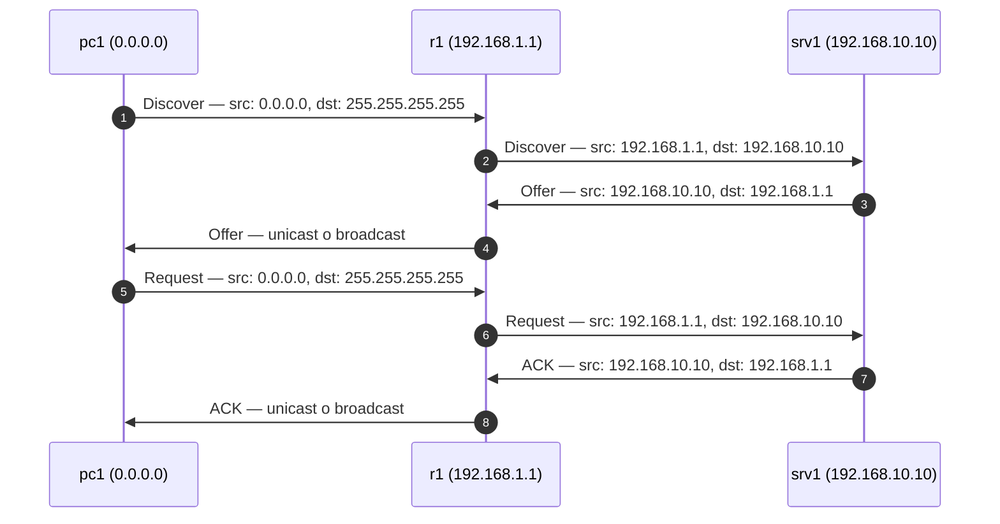
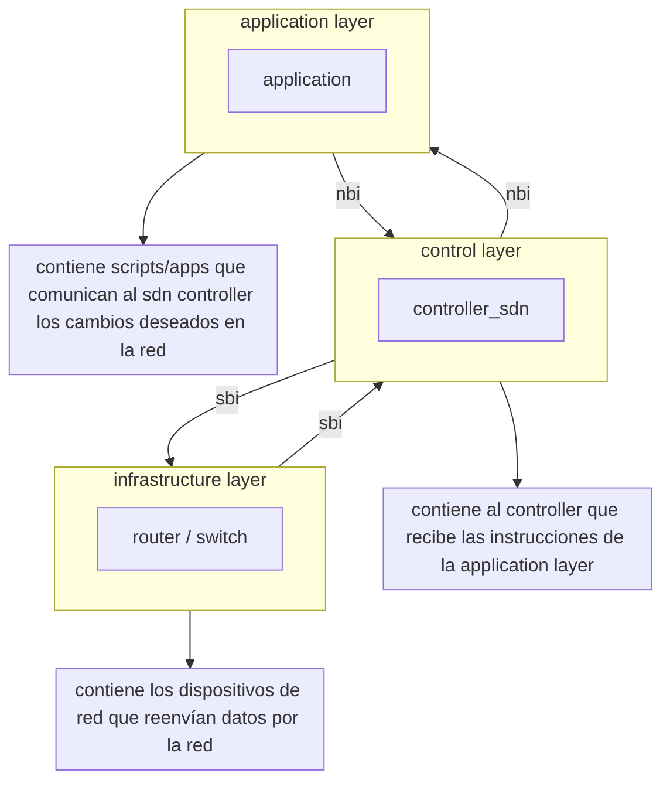
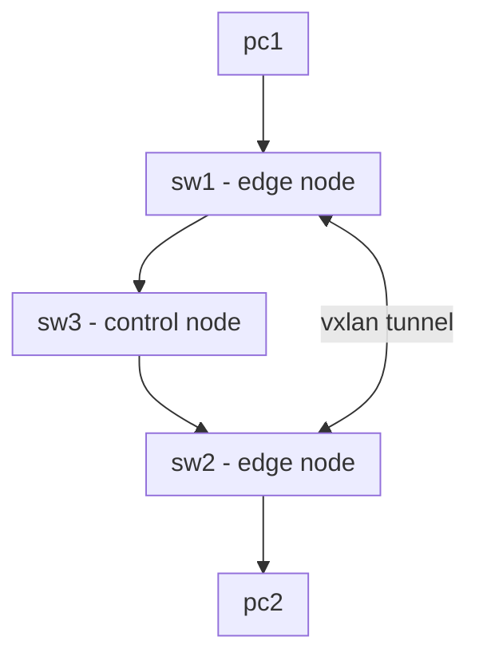

# fundamentals
### 802.3
estándar maestro de la [ieee](#ieee) que define las variantes físicas de [ethernet](#ethernet) y [fibra](#fibra). 

| **speed**    | **common name**  | **ieee standard** | **informal name** | **maximum length** |
| ------------ | ---------------- | ----------------- | ----------------- | ------------------ |
| **10 mbps**  | ethernet         | 802.3i            | 10base-t          | 100 m              |
| **100 mbps** | fast ethernet    | 802.3u            | 100base-tx        | 100 m              |
| **1 gbps**   | gigabit ethernet | 802.3ab           | 1000base-t        | 100 m              |
| **10 gbps**  | 10 gig ethernet  | 802.3an           | 10gbase-t         | 100 m              |
### anycast
comunicación donde múltiples dispositivos comparten la misma dirección ip, y la red entrega el tráfico al nodo más cercano según el enrutamiento (cdn, dns públicos).
### apc
_angled physical contact_ (**verde**): pulido de [fibra](#fibra) en ángulo. mínima reflexión. ver [upc](#upc)
### asa
linea de [firewall](#firewall) clásica de cisco.
### asic
_application-specific integrated circuit_: chips especializados en realizar determinadas tareas. son más rápidos que una cpu.

>tanto un switch como un router poseen chips asic (data plane) para el reenvío rápido de tramas/paquetes sin depender de la cpu (control and management planes). ver [planes](#planes)
### auto-mdix
capacidad de la [nic](#nic) para detectar y cruzar automáticamente los pines de envío/recepción, eliminando la necesidad de cables cruzados.
### bia
_burn in address_: otro modo de denominar la [mac](#mac) de un dispositivo.
### bidi
_bi-directional_ transceptor de [fibra monomodo](#fibra-monomodo) y [fibra duplex](#fibra-duplex). máximo 80 km.
### cable modem
permite hablar [docsis](#docsis) con la red del operador a través del [coaxial](#coaxial), y convertir esa conexión en ethernet para el router o los dispositivos del usuario. usado en [catv](#catv)
### can
_campus area network_: interconecta múltiples [lan](#lan) dentro de un recinto geográfico específico y privado, como una universidad, hospital o base militar.
### capa 1 
_capa física_: transmite y recibe bits con señales eléctricas (ethernet), ópticas (fibra) o de radio (wifi). su [pdu](#pdu) es el bit.
### capa 2
_capa de enlace_: transmite y recibe dentro de una red local mediante saltos ([hop](#hop)). utiliza direcciones [mac](#mac) para identificar las interfaces. implementa protocolos como [802.3](#8023) y [802.11](#80211). su [pdu](#pdu) es la [trama ethernet](#trama-ethernet) o la [trama wifi](#trama-wifi)
### capa 3
_capa de red_: provee conectividad entre dos hosts en diferentes [lan](#lan). utiliza direcciones ip para identificar hosts y busca el camino adecuado. implementa protocolos como ip ([ipv4](#ipv4) o [ipv6](#ipv6)) y [icmp](#icmp). su [pdu](#pdu) es el [paquete ipv4](#paquete-ipv4)
### capa 4
_capa de transporte_: provee comunicación end-to-end transparente entre dos aplicaciones o procesos. utiliza [puerto](#puerto) para identificar cada proceso o servicio en el host. implementa protocolos como [tcp](#tcp) o [udp](#udp). su [pdu](#pdu) es el [segmento tcp](#segmento-tcp) o el [## datagrama udp](#-datagrama-udp)

> provee transporte transparente de datos entre procesos y aplicaciones.

la capa 4 es la primera que es end-to-end (extremo a extremo). al protocolo de transporte no le importa si hay 1 router o 50 en medio ni qué direccionamiento usan, o se si se comunican por fibra o ethernet; solo le importa que el proceso en el host a se hable con el proceso en el host b. por eso se dice que ofrece un transporte transparente: crea la ilusión de una conexión directa lógica, abstrayendo por completo toda la infraestructura de red intermedia.
### capa 5
_capa de aplicación_: fusiona las capas 5, 6 y 7 del modelo osi: formato de datos, cifrado y control de sesiones. maneja http, [dns](#dns), [smtp](#smtp) y [ftp](#ftp). unidad: datos.
### catalyst
línea de [switch](#switch) de cisco.

| generación           | modelo     | notas                         |
| -------------------- | ---------- | ----------------------------- |
| **capa 2**           | 2960       | vlans, stp                    |
| **capa 3**           | 3560, 3650 | multicapa. permite svi y ospf |
| **enterprise / dna** | 9200       | automatización y sdn          |
### categoría utp
clasifica el [utp](#utp) basado en la frecuencia (**mhz**) y su velocidad máxima en 100 metros.

| **categoría**   | **velocidad** | **conector** | **nota clave**                  |
| --------------- | ------------- | ------------ | ------------------------------- |
| **cat 5e (ge)** | **1 gbps**    | rj-45        | estándar común                  |
| **cat 6**       | **5 gbps**    | rj-45        | **10 gbps hasta ~55 m**         |
| **cat 6a**      | **10 gbps**   | rj-45        | 10g garantizado                 |
| **cat 7**       | **10 gbps**   | gg45 / tera  | no estándar. uso doméstico raro |
| **cat 8**       | **40 gbps**   | rj-45        | datacenter (hasta 30 metros)    |
### catv
_cable tv_: tecnología de tv por cable reutilizada para proveer internet mediante el estándar [docsis](#docsis). utiliza [cable modem](#cable-modem)

>al comienzo era todo coaxial, pero poco a poco fueron reemplazando por fibra, dejando el cable [coaxial](#coaxial) para el último tramo hasta la vivienda ([hfc](#hfc))
### coaxial
cable con un conductor central rodeado por una malla de apantallamiento. utilizado en redes [catv](#catv) y [hfc](#hfc) para transportar señales de televisión y datos.
### conversión hexadecimal a binaria
traduce cada dígito del [sistema hexadecimal](#sistema-hexadecimal) por separado a su grupo de **4 bits** (un nibble).

**ejemplo**
para convertir el número 0x86dd

- tomamos el 8 y lo pasamos a binario: 1000
- tomamos el 6 y lo pasamos a binario: 0110
- tomamos la d (13) y la pasamos a binario: 1101
- tomamos la d (13) y la pasamos a binario: 1101

> resultado: 0x86dd = 10000110 11011101

para representar un número en binario se utiliza `0b` y en hexadecimal se utiliza `0x`

ejemplo para el número 10 en decimal:
	binario: `0b10` que es 2
	hexadecimal: `0x10`que es 16
	binario: `0d10` que es 10
### conectores de fibra
son las piezas mecánicas en los extremos de un cable de [fibra](#fibra) que alinean con precisión el núcleo de cristal para permitir el paso de luz.

| **conector** | **formato** | **uso principal**                | **mecanismo**  | **pulido típico** |
| ------------ | ----------- | -------------------------------- | -------------- | ----------------- |
| **lc**       | mini (sff)  | transceptores sfp / sfp+ / sfp28 | pestaña (clic) | upc (azul)        |
| **sc**       | cuadrado    | rosetas, onts y repartidores     | push-pull      | apc (verde) / upc |
| **mpo**      | multifibra  | transceptores qsfp (8-24 hilos)  | push-pull      | upc / apc         |
### crossover cable
estándares diferentes (t568a a t568b) en cada extremo, cruzando físicamente los pines tx y rx. se usa para conectar dispositivos [dte](#dte) <-> [dte](#dte) o [dce](#dce) <-> [dce](#dce). actualmente se usa [auto-mdix](#auto-mdix)
### crosstalk
interferencia interna que ocurre cuando la señal de un par de hilos se "filtra" e interfiere en el par adyacente dentro del mismo cable [utp](#utp)
### csma/cd
es un **protocolo de tráfico** que actúa como un semáforo para evitar colisiones en entornos **half duplex** (como un [hub](#hub)). el dispositivo primero escucha si el cable está libre (**carrier sense**), si lo está, envía sus datos; si detecta que otro ha hablado a la vez y hay un choque (**collision detection**), se detiene, espera un tiempo aleatorio y vuelve a intentar el envío. 
### dce
_data communication equipment_: equipos que proporcionan el acceso a la red (**modem**, **switch**). ver [dte](#dte)
### docsis
estándar que permite transmitir datos de internet sobre redes de televisión por cable ([catv](#catv)), independientemente de que la red del operador sea totalmente [coaxial](#coaxial) o [hfc](#hfc)
### dsl
_digital subscriber line_: tecnología que provee conectividad a internet a través de la línea telefónica utilizando un [modem dsl](#modem-dsl)

> adsl es una variante de dsl con velocidades asimétricas, mientras vdsl ofrece más velocidad en distancias cortas (100 mbps)
### dte
_data terminal equipment_: equipos que originan o terminan los datos (**pc**, **printer**, **router**). ver [dce](#dce)
### emi
ruido eléctrico externo proveniente de fuentes como motores o cables de alta tensión que distorsiona la señal en el cable [utp](#utp)
### fibra
medio de **capa 1** que transmite pulsos de luz. se divide en [fibra monomodo](#fibra-monomodo) y [fibra multimodo](#fibra-multimodo).

| **informal name** | **ieee standard** | **speed** | **cable type**           | **maximum length**      |
| ----------------- | ----------------- | --------- | ------------------------ | ----------------------- |
| **1000base-lx**   | 802.3z            | 1 gbps    | multimode or single-mode | 550 m (mm)<br>5 km (sm) |
| **10gbase-sr**    | 802.3ae           | 10 gbps   | multimode                | 400 m                   |
| **10gbase-lr**    | 802.3ae           | 10 gbps   | single-mode              | 10 km                   |
| **10gbase-er**    | 802.3ae           | 10 gbps   | single-mode              | 30 km                   |
**estructura**
1. **core:** núcleo de vidrio por donde viaja la luz.
2. **cladding:** mantiene la luz dentro del core
3. **buffer:** protege la fibra de vidrio.
4. **outer jacket:** cubierta exterior.
### fibra duplex
cable de [fibra](#fibra) con **dos hilos** (zipcord). uno dedicado exclusivamente a tx y el otro a rx; estándar en racks y servidores. ver [fibra simplex](#fibra-simplex)
### fibra monomodo
diseñada para **largas distancias** (wan). núcleo de **9 µm** con un solo modo de luz. usa láser. más cara que [fibra multimodo](#fibra-multimodo)
### fibra multimodo
diseñada para **distancias cortas** (lan/cpd). núcleo de **50 µm** con múltiples modos de luz. más barata que [fibra monomodo](#fibra-monomodo)
### fibra simplex
cable de una sola [fibra](#fibra). se usa en enlaces **[bidi](#bidi)** y acometidas **[fttx](#fttx)** (tx/rx por distintas longitudes de onda).
### firepower
línea de [ngfw](#ngfw) de cisco. inspección profunda de paquetes.
### firewall
dispositivo que monitoriza y protege el tráfico de red basado en [acl](#acl). no confundir con [host-based firewall](#host-based-firewall). evoluciona al [ngfw](#ngfw). ejemplo: la línea [asa](#asa) de cisco.
### host-based firewall
software que filtra el tráfico saliente y entrante de un ordenador.
### ngfw
[firewall](#firewall) de **capa 7** que bloquea malware, filtra urls y controla aplicaciones específicas (ej. bloquear chats en una app). integra [nips](#nips) y [nids](#nids), analiza tráfico cifrado ssl/tls. ejemplo: la línea [firepower](#firepower) de cisco
### gg45
conector híbrido para **cat 7**. compatible con rj-45.
### hfc
_hybrid fiber-coaxial_: redes híbridas que llevan fibra hasta el vecindario y [coaxial](#coaxial) hasta el usuario final. usado en [catv](#catv)
### hub
dispositivo de [capa 1](#capa-1) que no lee direcciones mac, simplemente recibe una señal eléctrica por un puerto y la escupe por todos los demás, por lo que si dos equipos transmiten a la vez, hay colisión. el [csma/cd](#csmacd) es el mecanismo de emergencia que usan esos equipos para no colapsar la red cuando detectan que sus señales se han pisado.
### ieee
_institute of electrical and electronics engineers_: es la organización que desarrolla los estándares globales para tecnología y redes, como el [802.3](#8023) (ethernet) y el [802.11](#80211) (wi-fi).
### ietf
_internet engineering task force_: comunidad abierta que define protocolos de internet como tcp, https, dns, etc. y lo publican en el rfc (_request for comments_).
### ios file system
sistema de archivos de cisco ios. se compone de un tipo y dentro, prefijos.

**tipos de ifs**
- **disk**: dispositivos de almacenamiento local (almacena la imagen ios, vlan.dat)
- **opaque**: usado para funciones internas
- **nvram**: donde se almacena la startup-config
- **network**: sistema de archivos externos (ftp, tftp)

| tipo      | prefijo      | local/remoto   | nota                                          |
| --------- | ------------ | -------------- | --------------------------------------------- |
| `disk`    | `flash:`     | local          | flash principal; suele contener la imagen ios |
| `disk`    | `usbflash0:` | local          | memoria usb                                   |
| `nvram`   | `nvram:`     | local          | contiene el archivo `startup-config`          |
| `network` | `ftp:`       | remoto         | servidor ftp                                  |
| `opaque`  | `system:`    | local (lógico) | funciones internas del ios                    |
```text
disk
└── flash: 
    ├── vlan.dat
    └── ios.bin

nvram
└── nvram: (ifs tipo nvram)
    └── startup-config

ram 
└── running-config (estructura en memoria)

network 
└── ftp: (ifs tipo network)
    ├── backup.cfg
    ├── ios-new.bin
    └── vlan-backup.dat
```
### ip phone
teléfono que funciona sobre [voip](#voip) y se conecta a un switch. funciona con [poe](#poe). tienen un switch interno de tres puertos: interno, uplink (hacia el switch) y downlink (hacia el pc). de modo que una pc se conecta al ip phone y este al switch, aprovechando un mismo switchport.

> como es un solo link, se separa el tráfico de voz en una vlan (voice vlan) y el tráfico de la pc en otra vlan (data vlan). sin embargo, no es un puerto trunk es un puerto access con una data vlan y una voice vlan.
### isr
línea de [router](#router) de cisco (2901, 2911)
### lan 
_local area network_: red local de alta velocidad y baja latencia (ethernet/wlan); es un [broadcast domain](#broadcast-domain). ver [network topology](#network-topology)
### lc
_lucent connector_: conector compacto de fibra con clip.
### mac
_media access control_: dirección física única de 48 bits (6 bytes) grabada en la [nic](#nic). formato hexadecimal: **oui** (3 bytes de fabricante) + **número de serie** (3 bytes). base del switching en l2.
### modelo osi 
estándar teórico de 7 capas que define cómo los sistemas se comunican en red. en la práctica, se usa el modelo tcp.
### modem dsl
transmite datos sobre línea telefónica de cobre usando [dsl](#dsl). requiere filtros para separar voz de datos y usa conector [rj-11](#rj-11).

>es la evolución del modem dial-up que modulaba datos en frecuencias audibles (56 kbps) pero no permitía el uso simultáneo de voz y datos
### multicast
comunicación del [protocolo ip](#protocolo-ip) donde un emisor envía tráfico a un grupo específico de receptores (suscriptores).
### nic
_network interface card_: tarjeta o chip de red que contiene la **mac address**; en servidores se usan varias para segmentar tráfico o sumar velocidad ([etherchannel](#etherchannel))
### patch panel
dispositivo pasivo que centraliza el cableado en un rack. organiza las conexiones permanentes y protege los puertos del [switch de capa 2](#switch-de-capa-2).
### plc
utiliza el cableado eléctrico como medio de transmisión. ideal para llevar red a puntos alejados sin tirar cable ethernet, aunque depende de la calidad eléctrica.
### plenum
cubierta del [utp](#utp) obligatoria en conductos de ventilación abiertos. al arder, emite humo mínimo y no tóxico. el **non-plenum (pvc)** solo se usa donde no hay retorno de aire.
### poe
_power over ethernet_: permite que un pse (power sourcing equipment) alimente un pd (powered device) con un cable ethernet. 

>usualmente el pse es un switch, y el pd puede ser un [ip phone](#ip-phone), una cámara ip, un [ap](#ap)

**power policing** 
es una función del poe que gestiona qué pasa cuando un dispositivo poe consume más potencia de la que negoció o de la que tiene permitida

| tipo                         | estándar          | potencia | pares utilizados |
| ---------------------------- | ----------------- | -------- | ---------------- |
| ilp (cisco inline power)     | propietario cisco | 7 w      | 2                |
| poe (type 1)                 | 802.3af           | 15 w     | 2                |
| poe+ (type 2)                | 802.3at           | 30 w     | 2                |
| upoe (type 3) - *universal*  | 802.3bt           | 60 w     | 4                |
| upoe+ (type 4) - *universal* | 802.3bt           | 100 w    | 4                |
### port mirroring
función de switch que copia el tráfico de puertos a un destino para análisis. basado en software, puede consumir cpu y perder paquetes bajo carga alta.
### punch down block
conexión fija de cableado ethernet en paneles o rosetas. el **110 block** es el estándar para datos, mientras que el **66 block** se usa para telefonía.
### rfid
identificación por radio unidireccional. etiquetas **pasivas** (sin batería) o **activas**.
### rg-6
cable coaxial estándar para banda ancha e instalaciones **docsis**. grueso, con buen aislamiento y conector de rosca (f).
### rj-11
conector de 6 posiciones para **telefonía** y adsl. solo usa 2 o 4 pines para voz y datos.
### rj-45
conector estándar de ocho hilos para [ethernet](#ethernet). soporta datos, [poe](#poe) y conexiones seriales de consola.

| estándar        | pares usados               | dte (router, firewalls, pc, ap)     | dce (switches, hubs)                |
| --------------- | -------------------------- | ----------------------------------- | ----------------------------------- |
| **10/100 mbps** | 2 (4 hilos de cobre)       | tx: 1 y 2 \| rx: 3 y 6              | tx: 3 y 6 \| rx: 1 y 2              |
| **> 1 gbps**    | 4 (8 hilos en full-duplex) | todos transmiten y reciben a la vez | todos transmiten y reciben a la vez |
### sc
_subscriber connector_: conector de fibra tipo **push-pull** (sin clip)
### serial
método de comunicación en el que los datos se transmiten secuencialmente, un bit tras otro, a través de un enlace entre dos dispositivos. pueden utilizarse protocolos de capa 2 como **hdlc** o **ppp**, que encapsulan los datos y controlan la comunicación.
### simplex
comunicación **unidireccional** (un solo sentido). ejemplo: radio, tv o un teclado.
### sistema binario
proceso de representar números decimales mediante bits basándose en potencias de 2. 

**conversión del decimal 128.077 desglosada por potencias de 2:**

- 2<sup>16</sup> (65536) → 1
- 2<sup>15</sup> (32768) → 1
- 2<sup>14</sup> (16384) → 1
- 2<sup>13</sup> (8192) → 1
- 2<sup>12</sup> (4096) → 1
- 2<sup>11</sup> (2048) → 0
- 2<sup>10</sup> (1024) → 1
- 2<sup>9</sup> (512) → 0
- 2<sup>8</sup> (256) → 0
- 2<sup>7</sup> (128) → 0
- 2<sup>6</sup> (64) → 1
- 2<sup>5</sup> (32) → 0
- 2<sup>4</sup> (16) → 0
- 2<sup>3</sup> (8) → 1
- 2<sup>2</sup> (4) → 1
- 2<sup>1</sup> (2) → 0
- 2<sup>0</sup> (1) → 1

> **resultado:** `1 1111 0100 0100 1101` 

para representar un número en binario se utiliza `0b`y en hexadecimal se utiliza `0x`

ejemplo para el número 10 en decimal:
- binario: `0b10` que es 2
- decimal: `0x10` que es 16
### sistema hexadecimal
proceso de representar números decimales mediante caracteres alfanuméricos (0-9, a-f) basándose en potencias de 16. en binario solo dices "sí o no" a la potencia. en hexadecimal dices "**cuántas veces del 0 al f**" está esa potencia en el número.

|decimal|0|1|2|3|4|5|6|7|8|9|10|11|12|13|14|15|
|---|---|---|---|---|---|---|---|---|---|---|---|---|---|---|---|---|
|hexadecimal|0|1|2|3|4|5|6|7|8|9|a|b|c|d|e|f|

**ejemplo**
para 255 (ff):

- 16^1  -> 15 x 16 = 240
- 16^0  ->  15 x 1 = 15

> suma: 240 + 15 = 255 -> ff

**ejemplo**
para 256 (100):

- 16^2 (256) -> 1 x 256 = 256
- 16^1 (16) -> 0 x 16 = 0
- 16^0 (1) -> 0 x 1 = 0

> suma: 256 + 0 + 0 = 256 -> 100

**ejemplo**
para el número 128 077 (`0b1F44D`):

- 16^4 = 65536 -> 1 (1) x 65536 = 65536
- 16^3 = 4096 -> 15 (f) x 4096 = 61440
- 16^2 = 256 -> 4 (4) x 256 = 1024   
- 16^1 = 16 -> 4 (4) x 16 = 64
- 16^0 = 1 -> 13 (D) x 1 = 13

> suma: 65536 + 61440 + 1024 + 64 + 13 = 128077 (`0b1F44D`)
### soho
_small office / home office_. entorno basado en un router "todo en uno" que integra módem, router, switch y punto de acceso en un solo equipo.
### straight-trough cable
mismo estándar de pines (t568b a t568b) en ambos extremos. se usa para conectar dispositivos [dte](#dte) <-> [dce](#dce). actualmente se usa [auto-mdix](#auto-mdix)
### switch
dispositivo de red que provee conectividad dentro de una [lan](#lan). tiene más [puerto](#puerto) que un [router](#router) y gestiona la [mac address table](#mac-address-table). ejemplo: la línea [catalyst](#catalyst) de cisco
### switch de capa 2
usa chips asic para conmutar [tramas](#trama-ethernet) por mac. los **managed** permiten [vlan](#vlan), [stp](#stp) y [snmp](#snmp). sus puertos son de tipo [switchport](#switchport)
### switch de capa 3
combina velocidad de hardware con ruteo ip. interconecta [vlan](#vlan) internamente sin depender de un [router](#router) externo. ver [svi](#svi)
### t568a
estándar de pines para rj-45

> bv - v - bn - a - ba - n - bm - m. 
### t568b
estándar de pines para rj-45. es el más utilizado

>bn - n - bv - a - ba - v - bm - m. 
### tap
dispositivo de hardware físico que extrae una copia exacta del tráfico en línea. es más fiable que el [port mirroring](#port-mirroring) al no depender de los recursos del switch.
### tera
conector no compatible con [rj-45](#rj-45), diseñado para **cat 7** (ver [categoría utp](#categoría-utp). blindaje total por par para eliminar el crosstalk.
### tethering
compartir internet 1 a 1 vía usb o bluetooth (más seguro).
### transceptor de fibra
dispositivo que convierte señales eléctricas de un switch en señales ópticas para su transmisión por fibra.

| **factor de forma** | **carriles (lanes)** | **velocidad típica** | **conector típico** |
| ------------------- | -------------------- | -------------------- | ------------------- |
| **sfp**             | 1                    | **1 gbps**           | lc duplex           |
| **sfp+**            | 1                    | **10 gbps**          | lc duplex           |
| **sfp28**           | 1                    | **25 gbps**          | lc duplex           |
### unicast
comunicación directa del [protocolo ip](#protocolo-ip) entre dos nodos únicos. es el modelo predominante en redes modernas y soporta tanto tcp como udp.
### upc
_ultra physical contact_ (**azul**): pulido de [fibra](#fibra) plano. más económico que [apc](#apc)
### utp
_unshielded twisted pair_: medio físico de conexión [ethernet](#ethernet). sigue la nomenclatura **x/ytp**: **x** (blindaje global) / **y** (blindaje por par).

| **sigla** | **global** | **por par** | **uso / notas**                                      |
| --------- | ---------- | ----------- | ---------------------------------------------------- |
| **u/utp** | ninguno    | ninguno     | estándar lan básico (cat 5e/6).                      |
| **f/utp** | **foil**   | ninguno     | protege contra [emi](#emi); común en instalaciones 10g. |
| **u/ftp** | ninguno    | **foil**    | elimina el [crosstalk](#crosstalk); típico en cat 6a.         |
| **s/ftp** | **malla**  | **foil**    | máximo blindaje para datacenters.                    |


en 10/100 base-t se usan 2 pares (4 hilos) en modo full-duplex: 
- dte: pines 1 y 2 (tx), pines 3 y 5 (rx)
- dce: pines 1 y 2 (rx), pines 3 y 5 (tx)
### voip
*voice over ip*: tecnología que permite transmitir voz a través de una red ip. las conversaciones se digitalizan y se envían en forma de paquetes ip. ver [ip phone](#ip-phone)
### volte
llamadas de voz digitales transmitidas sobre la red de datos **4g lte**, mejorando la calidad y velocidad de conexión.
### zeroconfig 
mecanismos para que los dispositivos se autoconfiguren y descubran servicios sin servidores ni intervención manual. incluye tecnologías como **[apipa](#apipa)**, bonjour, llmnr o netbios.
# switching
### 802.1q
estándar de [etiquetado de vlan](#etiquetado-de-vlan). inserta 4 (32 bits) bytes en la [trama ethernet](#trama-ethernet) para que varias [vlan](#vlan) compartan un mismo enlace físico ([trunk port](#trunk-port)). 

| campo                            | tamaño  | notas                                                                                                                                       |
| -------------------------------- | ------- | ------------------------------------------------------------------------------------------------------------------------------------------- |
| tpid (_tag protocol identifier_) | 16 bits | siempre tienen el valor 0x8100. indica que la trama ha sido 801.q-tagged                                                                    |
| tci (_tag control information_)  | 16 bits | contiene el **pcp** (ver [qos](#qos) y [pcp](#pcp)) el **dei** y el **vid**                                                                       |
|                                  | 3 bits  | el **pcp (*priority code point*)** de 3 bits usado para cos (class of service) para priorizar tráfico en redes congestionadas               |
|                                  | 1 bit   | el **dei (_drop elegible indicator_)** para indicar frames que pueden ser descartadas                                                       |
|                                  | 12 bits | el **vid (_vlan id_)** identifica la vlan a la que pertenece el frame. permite etiquetar hasta 4094 vlans (la 0 y la 4095 están reservadas) |

> las vlan de 1 a 1005 son de rango normal. de 1005 a 4094 son de rango extendido. algunos switches antiguos no soportan vlans de rango extendido.

> aunque siempre es 0x8100‭‬, el campo tpid tiene la función de "engañar" a la nic. como se inserta justo donde iría el campo length/type original, la nic lee esos 16 bits, ve que el valor es mayor a 1536 (‭‬‭‬en decimal) y entiende que es un ethertype que avisa: "ojo, no leas los datos todavía, que aquí viene una etiqueta de vlan".
 
> en un trunk, la trama mínima sube de 64 a 68 bytes porque los 4 bytes del tag 802.1q son un "añadido" obligatorio para cualquier vlan que no sea la nativa.  habitualmente, esas tramas miden 1522 bytes (1518 del estándar + 4 del tag).
### access port 
interfaz de switch configurada para pertenecer a una única [vlan](#vlan) (a veces llamada _untagged port_, ya que no lleva etiquetas), diseñada para conectar dispositivos finales (como pcs o impresoras) y entregar tráfico _untagged_ de esa red específica.
### adjacent-layer interaction
ocurre en un mismo host: cada capa ofrece sus servicios a la superior y utiliza los de la inferior. ejemplo: la capa 3 delega en la capa 2 el envío físico del paquete.
### backbonefast
función de [stp](#stp) que detecta cuando un switch recibe una [bpdu](#bpdu) peor de la que esperaba, significa que el camino al root se rompió. backbonefast lo detecta, verifica que hay otro camino al root y acelera la nueva reconvergencia hacia su root de siempre saltándose el max age. en [rapid pvst+](#rapid-pvst) viene incorporado de serie.
### blocking port
en [stp](#stp), puerto redundante **que** no reenvía datos de usuario para evitar bucles, pero sigue recibiendo [bpdu](#bpdu), aunque no los reenvía. tampoco rellena su [mac address table](#mac-address-table)
### bpdu
_bridge protocol data unit_: trama que los switches intercambian para elegir al root bridge y detectar bucles en la topología [stp](#stp). existen dos tipos: **bpdu hello** para elección del [root bridge](#root-bridge) y el mantenimiento, se envía cada dos segundos; y el **tcn** o _topology change notification_ para avisar que un enlace se cayó o se levantó y que todos deben actualizar sus tablas de direcciones mac.

>si un enlace falla, el stp clásico tarda unos **50 segundos** (20 de max age + 15 de listening + 15 de learning) en volver a poner un puerto en verde.

en una bpdu, cambian los campos según sea rapid pvst+ o pvst+ tradicional

|**campo**|**pvst+ (802.1d)**|**rapid pvst+ (802.1w)**|
|---|---|---|
|**protocol version identifier (pvi)**|**0**|**2**|
|**bpdu type**|**0x00** (configuration) o **0x80** (tcn)|**0x02** (rapid bpdu)|
|**flags**|solo usa **2 bits** (tc y tca)|usa los **8 bits** (proposal, agreement, role, etc.)|

**tcn**: tcn no afecta al max age de las bpdus. dice básicamente: «la topología ha cambiado; acelerad el envejecimiento de las entradas mac». la reconvergencia stp ocurre mediante las bpdus normales (si un enlace cae, no se espera al max age: el max age solo es válido si no se reciben bpdus, pero el enlace sigue up/up). dice: «no mantengas las entradas de la tabla mac tanto tiempo; envejecelas rápido»
### bpdu filter
evita que una interface envíe [bpdu](#bpdu) en casos innecesarios donde está conectado a un end host, o por razones de seguridad. 

>solo se activa en puertos portfast. no en todos los puertos access

si se habilita en una interface en particular desactivas stp por completo. no envía, no recibe. **bpdu guard en modo global no sirve de nada aquí** porque la bpdu ni siquiera llega a la lógica del switch. peligro total de bucle. lo mejor: filter global y guard local.

si se habilita en modo global no envía bpdus (limpieza), pero si recibe una, **desactiva portfast** y se vuelve un puerto normal.

si activas **bpdu filter global**, bpdu guard se activará y funcionará en el puerto donde esté configurado. si activas bpdu filter en una interface local, bpdu guard no se activará.
### bpdu guard
es un [stp toolkit](#stp-toolkit) que protege la red contra switches no autorizados conectados a puertos destinados a end-hosts. si un switch, recibe una [bpdu](#bpdu) por un puerto [portfast](#portfast) con bpdu guard, entra en modo err-disabled. solo se activa en puertos portfast. no en todos los puertos access

si en una interfaz de acceso quitas manualmente portfast (`spanning-tree portfast disable`), el bpdu guard global **dejará de funcionar** en ese puerto automáticamente, porque ya no cumple la condición de ser un puerto portfast. en cambio, si configuras `spanning-tree bpduguard enable` directamente **dentro de la interfaz**, le da igual lo que pase con portfast; el guardia se queda ahí plantado pase lo que pase.

>es el único de todo el [stp toolkit](#stp-toolkit) que entra en err-disable y hay que arreglar "a mano"
### bridge id
en [stp](#stp) es el campo de una trama [bpdu](#bpdu). el **menor** bridge id será el [root bridge](#root-bridge). incluye la [mac](#mac) del switch (para desempatar). el bridge priority (16 bits), por defecto en 32768,  se divide en bridge priority (primeros 4 bits) y el extended system id (vlan id) de 12 bits que implementa [pvst](#pvst). 

>el bit 13 marca el inicio del bridge priority, por lo tanto, los saltos de prioridad son de 4096 en 4096

cuando defines un switch como `primary`, definirá su prioridad en 24576 (si hay otro switch con prioridad menor que 24576, definirá la prioridad del nuevo switch restando 4096 a esa prioridad)

>cuando defines un switch como `secondary`, definirá su prioridad en 28672. un valor fijo.

|    bp     |           |          |          |  vlan  |        |       |       |       |      |      |      |     |     |     |     |
| :-------: | :-------: | :------: | :------: | :----: | :----: | :---: | :---: | :---: | :--: | :--: | :--: | :-: | :-: | :-: | :-: |
|    15     |    14     |    13    |    12    |   11   |   10   |   9   |   8   |   7   |  6   |  5   |  4   |  3  |  2  |  1  |  0  |
| **32768** | **16384** | **8192** | **4096** | *2048* | *1024* | *512* | *256* | *128* | *64* | *32* | *16* | *8* | *4* | *2* | *1* |
|     1     |     0     |    0     |    0     |   0    |   0    |   0   |   0   |   0   |  0   |  0   |  0   |  0  |  0  |  0  |  1  |
### broadcast
método de comunicación que envía una trama o paquete a todos los dispositivos de un mismo dominio de broadcast.
- en ethernet (capa 2), se utiliza la dirección mac ff:ff:ff:ff:ff:ff.
- en ipv4 (capa 3), se utilizan direcciones de broadcast como la broadcast dirigida de una subred.
- en ipv6 no existe el broadcast; se utiliza [multicast](#multicast).
### broadcast domain
grupo de dispositivos capaces de recibir una trama [broadcast](#broadcast) (con mac destino ffff.ffff.ffff) enviada por cualquier otro miembro.
### broadcast storm
loops de red donde switches conectados entre sí reenvían tramas de [flooding](#flooding) sin parar hasta saturar la red. ver [stp](#stp)
### cdp
_cisco discovery protocol_: es un [layer 2 discovery protocol](#layer-2-discovery-protocol) de cisco que viene **activado por defecto en sus equipos**. 
- se comunican por multicast a la dirección 0100.0ccc.cccc 
- se envían mensajes cada 60 segundos. los mensajes permanecerán en la cdp neighbor table durante 180 segundos
- cuando un equipo recibe un mensaje cdp, lo descarta. no lo reenvía (esto significa que solamente dispositivos directamente conectados se vuelven vecinos)

**ojo con las capabilities**
* **cdp:** `s` = **switch** | `r` = router.
* **lldp:** `b` = **bridge** (switch de capa 2) | `r` = router | `s` = **station only** (host/servidor).
### collision domain
es el segmento de red donde los paquetes pueden chocar entre sí si dos dispositivos transmiten al mismo tiempo. un [hub](#hub) es un collision domain gigante. en un [switch](#switch), cada interfaz es un dominio de colisión.
### comunicación inter-vlan
proceso de enrutamiento en [capa 3](#capa-3) que permite hablar a dispositivos de distintas [vlan](#vlan). se realiza mediante [svi](#svi) o [router on a stick](#router-on-a-stick).
### crc
_cyclic redundancy check_: algoritmo matemático que genera un valor de verificación basado en los datos de un archivo o trama. se compara el valor original con el calculado por el receptor; si no coinciden, los datos están corruptos.
### designated port
en [stp](#stp), es el puerto que reenvía tráfico desde el [root bridge](#root-bridge) hacia un segmento de red (mira "hacia abajo"). 

>todo [collision domain](#collision-domain) tiene un designated port.
### dtp
_dynamic trunking protocol_ protocolo de cisco que permite a las interfaces detectar dinámicamente su estado ([trunk port](#trunk-port) o [access port](#access-port)). solo funciona entre switches. en switches viejo viene **desirable** por defecto, en nuevos, viene **auto**. si configuras modo trunk, hay que desactivar con `nonegotiate`, si configuras modo acces, dtp se desactiva solo.

>en modo **desirable**, se conectará si el otro puerto es trunk, desirable o auto. en **auto**, se conectará solo si el otro es desirable o trunk. 

un switch antiguo también intentará negociar la encapsulación ([isl](#isl) o [802.1q](#8021q)) ya que viene en modo `switchport trunk encapsulation negotiate`por defecto. si ambos soportan isl, tirarán por ahí. las dtp frames viajarán por la vlan1 con isl, o la vlan nativa con 802.1q 
### duplex
comunicación bidireccional. se divide en [half-duplex](#half-duplex) (uno a la vez) y [full-duplex](#full-duplex) (ambos a la vez).
### encapsulamiento
proceso de "empaquetado" de la información. cada capa recibe la [pdu](#pdu) del nivel superior como datos puros y le añade su propia cabecera (**header**) con etiquetas de control. 

>durante el hop, la ip destino/origen nunca cambia. cambia la mac address de los dispositivos en cada hop
### estados stp
son los estados que atravieza un puerto en [stp](#stp) tradicional. el max age, de 20 segundos, es el tiempo que espera un puerto para recibir la [bpdu](#bpdu) del root. el forward delay es el tiempo de espera de cada estado trancisional (listening, learning).

|   **estado**   |     tipo     | regular traffic | **¿aprende macs?** | **¿envía/recibe bpdus?** |                                           **descripción**                                           |
| :------------: | :----------: | :-------------: | :----------------: | :----------------------: | :-------------------------------------------------------------------------------------------------: |
| **listening**  | trancisional |       no        |         no         |        **sí/sí**         | estado transitorio. el switch decide si el puerto será _root_, _designated_ o volverá a _blocking_. |
|  **learning**  | trancisional |       no        |       **sí**       |        **sí/sí**         |     el switch empieza a llenar su tabla cam (mac-address-table) pero aún no deja pasar tráfico.     |
| **forwarding** |   estable    |     **sí**      |       **sí**       |        **sí/sí**         |                    el puerto es totalmente operativo y reenvía tramas de datos.                     |
|  **blocking**  |   estable    |       no        |         no         |        **no/sí**         |                  el puerto no reenvía nada para evitar bucles. solo escucha bpdus.                  |
|  **disabled**  |   estable    |       no        |         no         |        **no/no**         |                      el puerto está administrativamente apagado (`shutdown`).                       |


**timers**
- **hello bpdus**: 2 segundos
- **max age**: 20 segundos
- **forward delay**: 15 segundos (15 de listening + 15 de learning = 30 seg)

### etherchannel
también conocido como **port-channel** o **lag** (link aggregation group), agrupa múltiples interfaces que actúan como una sola ante [stp](#stp), balanceando la carga mediante un algoritmo [hash](#hash) basado en la ip dest/source o la mac dest/source (algunos switches incluso balancean la carga en capa 4).

lo ideal es configurar el load balancing del algoritmo con `src-dst-ip` a nivel de capa 3, y empleando tanto la dirección ip de origen y destino. esto asignará un cable permanente (mediante hashing) a la dupla ip origen / ip destino y enviará todo el tráfico por ahí, evitando la llegada asíncrona de paquetes.


existen tres tipos de configuraciones:
- **pagp** (port aggregation protocol): creado por cisco, crea y gestiona el etherchannel automáticamente
- **lacp** (link aggregation control protocol): estándar 802.3ad que crea y gestiona automáticamente. permite agrupar hasta 8 interfaces (realmente son 16, pero las 8 restantes se dejan como backup)
- **static etherchannel**: las interfaces se configuran manualmente sin protocolo ni mantenimiento.


**modos de configuración por protocolo**

| **extremo a \ extremo b** | **active** | **passive** | **desirable** | **auto** | **on** |
| ------------------------- | ---------- | ----------- | ------------- | -------- | ------ |
| **`active`** (lacp)       | **sí**     | **sí**      | -             | -        | -      |
| **`passive`** (lacp)      | **sí**     | **no**      | -             | -        | -      |
| **`desirable`** (pagp)    | -          | -           | **sí**        | **sí**   | no     |
| **`auto`** (pagp)         | -          | -           | **sí**        | **no**   | no     |
| **`on`** (estático)       | -          | -           | -             | -        | **sí** |

>las interfaces de un etherchannel deben coincidir en **duplex, speed, switchport mode y allowed vlans**, de lo contrario serán excluidas del etherchannel y la marcará con `s`de suspended.
### ethernet 
estándar ieee [802.3](#8023) para redes lan (l1/l2). gestiona [trama ethernet](#trama-ethernet), direcciones mac, csma/cd y medios físicos como [utp](#utp) con conectores [rj-45](#rj-45). 
### etiquetado de vlan
marca con **vlan id** e información de prioridad. se usa en el tráfico que viaja entre equipos de red; el usuario final nunca ve estas etiquetas.
### fcs
_frame check sequence_: último bloque (4 bytes) de una [trama ethernet](#trama-ethernet) para detectar errores en la trama usando [crc](#crc)
### flooding
cuando el switch (que no conoce la [mac](#mac) destino de la trama recibida) reenvía la trama por todas sus interfaces, menos por la que recibió el paquete. ver [unknown unicast frame](#unknown-unicast-frame)
### full-duplex
transmisión y recepción **simultánea** por canales separados. estándar en switches modernos; elimina colisiones.
### half-duplex
bidireccional pero **no simultáneo**. típico de [hub](#hub) y walkie-talkies; requiere [csma/cd](#csmacd).
### isl
protocolo propietario de cisco para **etiquetado de vlans** en enlaces troncales (_trunks_). está **en desuso** frente al [802.1q](#8021q).
### jumbo frames
tramas ethernet que transportan una carga útil (mtu) superior a los **1500 bytes** estándar, llegando habitualmente hasta los **9000 bytes**. [trama giant](#trama-giant)
### known unicast frame
una trama para la que el switch conoce la [mac](#mac) destino porque está grabada en su [mac address table](#mac-address-table). en lugar de hacer [flooding](#flooding) realiza un forward.
### layer 2 discovery protocol
son protocolos de [capa 2](#capa-2) (como [cdp](#cdp) y [lldp](#lldp)) que comparten y reciben información (device type, ip address, host name) de sus vecinos directamente conectados.

>representan un riesgo de seguridad y generalmente no se usan
### lldp
_link layer discovery protocol_: es un [layer 2 discovery protocol](#layer-2-discovery-protocol) alternativa estándar de [cdp](#cdp) bajo nombre 802.1ab. viene desactivado por defecto en equipos cisco

- cdp y lldp pueden operar al mismo tiempo en un mismo dispositivo
- se comunican por multicast a la dirección `0180.c200.000e`
- se envían mensajes cada 30 segundos. los mensajes permanecerán en la cdp neighbor table durante 120 segundos. 
- cuando un equipo recibe un mensaje lldp, lo descarta. no lo reenvía.  (esto significa que solamente dispositivos directamente conectados se vuelven vecinos)
- en lldp hay que activar la rx y la tx por separado (a diferencia de cisco que con `cdp run` ya te libras, aunque a veces tx y rx se activan en cada interfaz automáticamente cuando hacer `lldp run`). es un problema de seguridad (a veces quieres recibir pero no enviar info para no develar la topología interna de tu red). en cisco, es todo cerrado y seguro, pero lldp es un estándar abierto

> lldp utiliza un reinit delay de dos segundos antes de enviar paquetes. esto asegura que el enlace es estable primero (y evita saturar la cpu con intercambio de mensajes innecesarios)

**ojo con las capabilities**
* **cdp:** `s` = **switch** | `r` = router.
* **lldp:** `b` = **bridge** (switch de capa 2) | `r` = router | `s` = **station only** (host/servidor).
### loop guard
es un [stp toolkit](#stp-toolkit) que se activa en la interfaz (o en modo global), y aunque deje de recibir [bpdu](#bpdu), no entrará en modo [designated port](#designated-port) (en lugar de abrir el puerto, lo pone en estado **loop-inconsistent**), y se bloquea. se activa en puertos root y non-designated (blocking).

>se arregla automáticamente cuando se soluciona la causa (loop-inconsistent)

**loop guard** y **root guard** son mutuamente excluyentes. no pueden estar habilitados en el mismo puerto al mismo tiempo.
- **root guard** está pensado para evitar que los **puertos designados** se conviertan en **puertos raíz (root ports)**.
- **loop guard** está pensado para evitar que los puertos **no designados** o los **puertos raíz** se conviertan en **puertos designados**.

si **loop guard** está configurado en un puerto (**spanning-tree guard loop**) y luego configuras **root guard** (**spanning-tree guard root**), **loop guard** se deshabilitará en ese puerto y viceversa.

si **loop guard** está habilitado por defecto (**spanning-tree loopguard default**) y luego configuras **root guard** en un puerto, **loop guard** se deshabilitará en dicho puerto. **la configuración más específica (interfaz frente a global) es la que tiene efecto.**

> Cada herramienta de protección STP se aplica según el comportamiento esperado del puerto. Un Root Port o un puerto Alternate/Non-designated **esperan recibir BPDUs superiores** de forma continua; por eso Loop Guard tiene sentido en esos roles. Si dejan de recibirlas, Loop Guard evita que el puerto asuma erróneamente que ahora es Designated y pase a forwarding. En cambio, un Designated Port **no depende de recibir BPDUs superiores** para conservar su rol, por lo que Loop Guard no tiene sentido en él.

| Rol actual         | Root Guard                           | Loop Guard                   |
| ------------------ | ------------------------------------ | ---------------------------- |
| Root Port          | Impediría su funcionamiento legítimo | Tiene sentido                |
| Alternate/Blocking | Impediría su funcionamiento legítimo | Tiene sentido                |
| Designated Port    | Tiene sentido                        | Normalmente no tiene sentido |
### mac address flapping
problema de red mal configurada que obliga al switch a reescribir la [tabla cam](#tabla-cam) miles de veces por segundo, consumiendo cpu y eliminando entradas legítimas, lo que degrada el rendimiento de todo el equipo mientras intenta "aprender" dónde está realmente esa mac. ver [stp](#stp)
### mac address table
tabla del switch aprendida por [flooding](#flooding) ([unknown unicast frame](#unknown-unicast-frame)). el switch solo aprende la [mac](#mac) address de la fuente (quien envía). mapea interfaz con mac address (no dirección ip). no confundir con la [tabla arp](#tabla-arp)
### mstp
_multiple spanning tree protocol_: es el estándar 802.1s que permite gestionar una instancia de rstp por cada vlan o grupo de vlans (vlan 1-50 en instancia 1, vlan 51-100 en instancia 2, etc), lo que facilita el load balancing en grandes redes sin tener que gestionar las vlans de una en una.
### mtu
_maximum transmission unit_: tamaño máximo de un paquete en una interfaz (estándar ethernet: **1500 bytes**). si se supera, se produce fragmentación en l3.
### native vlan
es una [vlan](#vlan) que solo existe en los [trunk port](#trunk-port) para gestionar tráfico sin etiquetas ([802.1q](#8021q)). por defecto, siempre es la vlan 1 (una por cada puerto trunk). cuando un switch recibe un frame sin etiqueta, asume que es para la vlan nativa. por eso deben coincidir en todos los switches.
### payload
carga útil o datos reales que transporta una [pdu](#pdu), excluyendo las cabeceras (headers) y colas (trailers) añadidas por cada capa. es la pdu de la capa superior inmediata.
### pdu
_protocol data unit_: es la unidad de datos en cada capa del modelo osi o tcp/ip. contiene el header de la capa y el [payload](#payload).

| **capa osi**           | **nombre de la pdu**                  | **dispositivo / concepto clave**       |
| ---------------------- | ------------------------------------- | -------------------------------------- |
| **7. aplicación**      | datos                                 | interfaz de usuario, http, ftp.        |
| **6. presentación**    | datos                                 | formateo, cifrado, jpeg, ascii.        |
| **5. sesión**          | datos                                 | gestión de diálogos y túneles.         |
| **4. transporte**      | segmento (tcp) / datagrama (udp)      | puertos de origen/destino.             |
| **3. red**             | paquete                               | direcciones ip (origen/destino).       |
| **2. enlace de datos** | [trama ethernet](#trama-ethernet) o [trama wifi](#trama-wifi) | direcciones mac / tráfico en la lan.   |
| **1. física**          | bits                                  | voltaje, pulsos de luz (fibra), ondas. |
### portfast
es un [stp toolkit](#stp-toolkit) que elimina los tiempos de espera en modo listening y learning de [stp](#stp). útil cuando conectas un end-host (pc, impresora) que no requiere stp (o un router)
- si lo activas en modo global, se aplica a **todos los puertos que operacionalmente sean non-trunk**, no solo a los configurados administrativamente como access (portfast global **se activa automáticamente** cuando el puerto negocía y termina en `operational mode static access`, incluso si administrativamente está en `dynamic auto`.)
- si lo activas en modo local, funcionará como tal hasta que reciba una [bpdu](#bpdu), entonces pasará a ser un puerto stp.
- puede activarse en puertos trunk (router roas, servidor, etc.)
- una interfaz en modo portfast sigue enviando bpdus (no desactiva stp, solo elimina los tiempos de espera). por eso es habitual combinarlo con [bpdu guard](#bpdu-guard)
### preamble
primer bloque (7 bytes) de una [trama ethernet](#trama-ethernet). contiene 7 bloques de 8 bits (56 bits) con la cadena "10101010" para sincronizar los relojes de ambos dispositivos antes de comenzar la transmisión de datos. 
### pvst+
_per vlan spanning tree_: instancias de [stp](#stp) según vlan, de modo que por cada [vlan](#vlan), las interfaces de un switch pueden estar como [blocking port](#blocking-port) o [designated port](#designated-port). permite balanceo de carga. ver [rapid pvst+](#rapid-pvst)

>**pvst** solo soporta isl. **pvst+** admite 802.1q

direcciones mac para multicast (enviarse [bpdu](#bpdu))

- **estándar (stp / rstp):** `0180.c200.0000`
- **cisco (pvst+ / rapid pvst+):** `0100.0ccc.cccd`
### rapid pvst+
variante cisco de [rapid stp](#rapid-stp) con gestión independiente de [stp](#stp) por cada [vlan](#vlan) (load balancing). implementa [uplinkfast](#uplinkfast) y [backbonefast](#backbonefast).tiene tres grandes diferencias.

>rapid pvst+ es compatible con pvst+
### rapid stp
estándar 802.1w donde se eliminan los [estados stp](#estados-stp) del [stp](#stp) tradicional (la red se adapta más rápido a los cambios de topología) y se añaden nuevos valores de [coste rapid stp](#coste-rapid-stp). la versión [rapid pvst+](#rapid-pvst), es la versión de cisco que incorpora un stp diferente para cada vlan, lo que favorece el load balancing. 

**flujo rapid stp**
1. en rstp los puertos arrancan en modo discarding (en lugar de blocking de stp tradicional)
2. se elije como [root bridge](#root-bridge) el de menor [bridge id](#bridge-id). todos sus puertos pasan de discarding port a [designated port](#designated-port).
3. cada switch non-root tendrá un único [root port](#root-port). se elige comparando las bpdus recibidas:
	- menor [coste stp](#coste-stp) para llegar al root bridge
	- menor **bridge id del vecino/emisor**
	- menor [port id](#port-id) del vecino/emisor
	- menor **port id local**
4. en cada segmento se elige un único [designated port](#designated-port). los switches conectados al segmento compiten según:
	- menor [coste stp](#coste-stp) hasta el root bridge
	- menor **bridge id**
	- menor **port id**
5. los puertos restantes permanecen en **discarding**, normalmente con rol **alternate** o **backup**.


**estados rstp**  
los estados **disabled, blocking y listening** de stp tradicional se integran en **discarding**.
- los puertos que alcanzan forwarding hacen **discarding → learning → forwarding**
- los puertos bloqueados permanecen en **discarding**

| estado         | procesa bpdus | regular traffic | mac address learning | stable/transitional |
| -------------- | ------------- | --------------- | -------------------- | ------------------- |
| **discarding** | sí            | no              | no                   | stable              |
| **learning**   | sí            | no              | sí                   | transitional        |
| **forwarding** | sí            | sí              | sí                   | stable              |

> el **envío de bpdus depende del rol del puerto**, no únicamente de su estado.

un rol non-designated (discarding) se separa en
- **alternate port**: es un puerto discarding (antiguo blocking) que se mantiene como "plan b" para llegar al root bridge a través de **otro switch** diferente. sustituye al root port si este falla.
- **backup role**: es cuando tienes más de una conexión en el mismo collision domain, no entre dos switches (que serían dos collision domain). ocurre cuando conectas dos puertos del mismo switch a un **hub**. la interfaz con el menor portid será la designated, las otras serán backup.

**bpdus**
- en stp tradicional, el root bridge origina las configuration bpdus y el resto de switches propaga información derivada de ellas por sus designated ports.
- en rapid stp, **todos los switches originan sus propias bpdus** y las envían periódicamente por sus designated ports cada **2 segundos**.
- rstp detecta normalmente la pérdida de conectividad tras **3 hello bpdus consecutivas (~6 segundos)**.
- **max age sigue existiendo**, pero actúa principalmente como límite de validez de la información stp; la detección rápida de fallos de rstp no depende normalmente de esperar 20 segundos.

**tipos de conexión rstp**
- **edge**: conexión hacia un end host. equivalente conceptualmente a [portfast](#portfast).
- **point-to-point**: conexión directa full-duplex entre switches. permite el mecanismo rápido proposal/agreement.
- **shared**: medio compartido, normalmente mediante un hub y operando en half-duplex.
### coste rapid stp

| **velocidad del enlace** | **stp cost (802.1d)** | **rstp cost (802.1w)** |
| ------------------------ | --------------------- | ---------------------- |
| **10 mbps**              | 100                   | 2,000,000              |
| **100 mbps**             | 19                    | 200,000                |
| **1 gbps**               | 4                     | 20,000                 |
| **10 gbps**              | 2                     | 2,000                  |
| **100 gbps**             | -                     | 200                    |
| **1 tbps**               | -                     | 20                     |
### root bridge
en [stp](#stp), es el switch maestro con el [bridge id](#bridge-id) más bajo; es el centro de la topología y todos sus puertos están en forwarding state ([designated port](#designated-port)). al inicio, todos los switches creen ser root bridge, envían [bpdu](#bpdu) y actualizan su jerarquía y [estados stp](#estados-stp). entonces, solo el jefe envía bpdus y el resto los reenvía por sus [designated port](#designated-port)
### root guard
es un [stp toolkit](#stp-toolkit) que se activa manualmente (**no permite configuración global**) en los [designated port](#designated-port) del switch, o sea, en la interfaz "que baja". aunque reciba una [bpdu](#bpdu) superior (con bridge id más bajo) no aceptará al nuevo switch como jefe y no reenviará datos de usuario.
 
>se arregla automáticamente cuando se soluciona la causa (root-inconsistent)

**loop guard** y **root guard** son mutuamente excluyentes. no pueden estar habilitados en el mismo puerto al mismo tiempo.
- **root guard** está pensado para evitar que los **puertos designados** se conviertan en **puertos raíz (root ports)**.
- **loop guard** está pensado para evitar que los puertos **no designados** o los **puertos raíz** se conviertan en **puertos designados**.

si **loop guard** está configurado en un puerto (**spanning-tree guard loop**) y luego configuras **root guard** (**spanning-tree guard root**), **loop guard** se deshabilitará en ese puerto y viceversa.

si **loop guard** está habilitado por defecto (**spanning-tree loopguard default**) y luego configuras **root guard** en un puerto, **loop guard** se deshabilitará en dicho puerto. **la configuración más específica (interfaz frente a global) es la que tiene efecto.**

 > Cada herramienta de protección STP se aplica según el comportamiento esperado del puerto. Un Designated Port puede recibir BPDUs, pero **no debería recibir una BPDU superior** a la que anuncia; por eso Root Guard tiene sentido en ese rol. En cambio, un Root Port o un puerto Alternate/Non-designated **dependen de recibir BPDUs superiores** para conservar su rol, por lo que Root Guard no tiene sentido en ellos. Para esos puertos tiene sentido Loop Guard, que evita que pasen indebidamente a Designated/Forwarding si dejan de recibir dichas BPDUs.

| Rol actual         | Root Guard                           | Loop Guard                   |
| ------------------ | ------------------------------------ | ---------------------------- |
| Root Port          | Impediría su funcionamiento legítimo | Tiene sentido                |
| Alternate/Blocking | Impediría su funcionamiento legítimo | Tiene sentido                |
| Designated Port    | Tiene sentido                        | Normalmente no tiene sentido |
### root port
la única interface en un switch no-raíz con el camino de menor costo hacia el [root bridge](#root-bridge). 

> los switches non-root tienen un único root port. un switch root bridge no tiene root ports.
### router on a stick
método de ruteo entre [vlan](#vlan) usando un router externo conectado por un enlace [trunk port](#trunk-port). el router usa **subinterfaces** como puertas de enlace. ver [svi](#svi)
### same-layer interaction
ocurre entre hosts distintos: una capa se comunica con su homóloga remota para coordinar funciones. ejemplo: las capas 4 de ambos hosts negocian la conexión mediante [puerto](#puerto).
### sfd
_start frame delimiter_: es el segundo bloque (1 byte) de una [trama ethernet](#trama-ethernet) consistente en un byte (8 bits) con la cadena "10101011". el último bit (el 1), le dice al destino que terminó el [preamble](#preamble) y comienzan los datos.
### coste stp
| speed    | cost |
| -------- | ---- |
| 10 mbps  | 100  |
| 100 mbps | 19   |
| 1 gbps   | 4    |
| 10 gbps  | 2    |
>el coste se mide partiendo desde el switch hacia el [root bridge](#root-bridge) en cada interfaz de entrada
### stp
_spanning tree protocol_: estándar 802.1d que evita [broadcast storm](#broadcast-storm) y [mac address flapping](#mac-address-flapping) definiendo un camino único para cada punto de la red a través de [estados stp](#estados-stp) y tramas [bpdu](#bpdu). cisco implementó [pvst+](#pvst) para definir un stp por cada vlan en la red. su evolución es el [rapid stp](#rapid-stp) y actualmente el [mstp](#mstp).

**flujo stp**
1. en stp tradicional los puertos arrancan en modo [blocking port](#blocking-port)
2. se elije como [root bridge](#root-bridge) el de menor [bridge id](#bridge-id). todos sus puertos pasan de blocking port a [designated port](#designated-port).
3. el resto de switches tendrán un único puerto [root port](#root-port) (el resto de interfaces continúa en modo blocking). el root port se elije a partir de:
	- el menor [coste stp](#coste-stp) para llegar al root bridge
	- el menor **bridge id** del vecino superior
	- el menor [port id](#port-id) del vecino (en caso de conexiones múltiples a un mismo switch)
4. el resto de conexiones non root port, tendrán una interfaz como designated port, la otra en modo non-designated ([blocking port](#blocking-port))
	- interface del switch con el **menor coste**
	- interface del switch con el menor **bridge id**
5. a partir de ahí, solo el root bridge origina bpdus, el resto las reenvía por sus designated ports

> direcciones mac para multicast (enviarse [bpdu](#bpdu))
> - **estándar (stp / rstp):** `0180.c200.0000`
> - **cisco (pvst+ / rapid pvst+):** `0100.0ccc.cccd`
### stp toolkit
son las herramientas básicas de configuración de [stp](#stp). incluye [portfast](#portfast), [bpdu guard](#bpdu-guard), [root guard](#root-guard) y [loop guard](#loop-guard).
### port id
en [stp](#stp), cuando existen conexiones múltiples entre dispositivos, tendrás dos escenarios:

**escenario 1**

```
{sw1} (designated port) <-----> (blocked port) {sw2}
```
en este escenario, puedes poner 10 o 100 conexiones, siempre serán de tipo dp en sw1 y bp en sw2

**escenario 2**

```
{sw1} (designated port) <-----> (root port) {sw2}
```

- aquí, todos los enlaces de sw1 serán dp, mientras que sw2 tendrá solo un root port, el resto estará en blocking.
- se elige al ganador atendiendo al portid + port priority del sw1
- por defecto el por priority es 128 (por lo que siempre gana fa0/1)
- si modificas el port priority, tiene que ser en múltiplos de 16
- se modifica el port priority por vlan
### svi
_switch virtual interface_: ip virtual asignada a cada [vlan](#vlan) en un switch de capa 3. actúa como [default gateway](#default-gateway) (no el router) y permite el ruteo por hardware (asic), siendo más eficiente.

> recuerda que un l2 también tiene una svi para poder generar tráfico ip (no para rutear, solo para gestión [ntp](#ntp), [ssh](#ssh), [syslog](#syslog)). por defecto, esta svi viene en la vlan 1, aunque puede cambiarse (asignarle ip y ponerla en up/up), aunque es obligatorio que esta vlan esté asignada en al menos un puerto físico (generalmente el trunk). además, se puede indicarle con `ip default-gateway` la salida
### switchport
interfaz física de capa 2 que conmuta tráfico basándose en direcciones mac y vlans, operando de forma nativa en todos los puertos de un [switch de capa 2](#switch-de-capa-2). 
 
>mientras que en un switch multicapa (l3) puedes usar el comando `no switchport` para asignarle una ip y que actúe como router, en un switch l2 el puerto es permanentemente un puente de red que solo admite configuraciones de **access** (para hosts finales) o **trunk** (para enlaces entre dispositivos de red).
### tabla cam
_content addressable memory_: es la memoria de alta velocidad de un switch. es básicamente otra forma de referirse a la [mac address table](#mac-address-table)
### trama ethernet
[pdu](#pdu) de [capa 2](#capa-2). contiene 26 bytes.

| **sección**         | tamaño  | notas                                                                                                                                                                                                                                                                                              |
| ------------------- | ------- | -------------------------------------------------------------------------------------------------------------------------------------------------------------------------------------------------------------------------------------------------------------------------------------------------- |
| **preamble**        | 7 bytes | permite sincronizar sus relojes para recibir mensajes (7 cadenas de 10101010)                                                                                                                                                                                                                      |
| **sfd**             | 1 byte  | *start frame delimiter*: indica el fin del preamble (1 cadena de 10101011)                                                                                                                                                                                                                         |
| **destination mac** | 6 bytes | contiene la mac del que recibe                                                                                                                                                                                                                                                                     |
| **source mac**      | 6 bytes | contiene la mac del que envía                                                                                                                                                                                                                                                                      |
| **802.1q**          | 4 bytes | contiene el tpid (_tag protocol identifier_) y el tci (_tag control information_). ver [802.1q](#8021q)                                                                                                                                                                                                 |
| **length/type**     | 2 bytes | si el payload es < = 1500 bytes indica el **tamaño** de ese pdu (en ethernet actual esto no se implementa). si > que 1536 bytes (jumbo frame) se olvida del tamaño y pasa a indicar el **tipo** (ethertype) del paquete: ipv4 (**0x0800**), ipv6 (**0x86dd**), arp (**0x0806**), do1q (**0x8100**) |
| **fcs**             | 4 bytes | *frame check sequence*: algoritmo [crc](#crc) para chequear la trama                                                                                                                                                                                                                                  |


el tamaño mínimo de una trama ethernet es de 64 bytes (header + payload + trailer). el preamble y el sfd no se tienen en cuenta, por lo tanto: **18 bytes (destination/source/type/fcs) + 46 bytes (payload) = 64 bytes**. si es menos, se rellena (padding) con ceros hasta completar los 46 bytes. ver [trama runt](#trama-runt)

una trama estándar tiene entre 64 y 1518 bytes (header + payload + fcs). el preamble y el sfd no se tienen en cuenta, por lo tanto: **18 bytes (destination/source/type/fcs) + 1500 bytes (payload) = 1518 bytes**. si es más, se divide en varias tramas, pero el estándar es 1500 bytes. ver [trama giant](#trama-giant)

> hoy en día casi todas las redes usan el formato **ethernet ii**, donde el campo funciona siempre como **type** (ethertype) para identificar el protocolo de capa 3 (ipv4, ipv6, etc.), independientemente de si el payload es pequeño o alcanza los 1500 bytes. 

cuando envías un archivo de 1.5 mb, la pc trocea esos 1,5 mb en unos 1000 paquetes ip de 1500 bytes cada uno y la tarjeta de red les pone el "envoltorio" de la trama ethernet. cada una de esas 1000 tramas llevará su propio encabezado (macs, ethertype) y su propio fcs para que el receptor pueda montarlas de nuevo sin errores.

cada vez que el paquete llega a un router, este "desnuda" la trama de capa 2 (descarta las macs anteriores) y le pone un "traje" nuevo con la mac origen de su propia interfaz de salida y la mac destino del siguiente salto (el próximo router o el destino final). el paquete ip del interior sigue igual (las ip origen/destino nunca cambian), pero las macs mueren y nacen en cada salto.
### trama giant
es una [trama ethernet](#trama-ethernet) que se descarta porque mide **más de 1518 bytes** ([jumbo frames](#jumbo-frames)).
### trama runt
es una [trama ethernet](#trama-ethernet) que se descarta porque mide **menos de 64 bytes**.
### trunk port
enlace entre equipos de infraestructura que transporta múltiples [vlan](#vlan) mediante [802.1q](#8021q) (a veces llamado _tagged port_). los switches "etiquetan" cada frame que envían por un trunk link, y el que recibe sabe a qué vlan entregarlo.
### type/length field
campo de una [trama ethernet](#trama-ethernet) (2 bytes) que describe el protocolo utilizado (si es $\ge$ 1536 bytes, ej. **0x0800** para ipv4 o **0x86dd** para ipv6) o la longitud de los datos (si es $\le$ 1500 bytes). ver [conversión hexadecimal a binaria](#conversión-hexadecimal-a-binaria)
### unknown unicast frame
una trama para la que el switch no tiene entrada conocida en su [mac address table](#mac-address-table). al no conocer el destino, realiza un [flooding](#flooding)
### uplinkfast
función de [stp](#stp) que solo funciona si el switch tiene al menos un puerto en modo blocking. si el [#root port] **deja de recibir [bpdus](#bpdu)**, el switch promociona inmediatamente ese puerto bloqueado a root port y lo acelera a forwarding, reconvergiendo en 1-3 segundos sin esperar max age. en [rapid pvst+](#rapid-pvst) viene incorporado de serie. 
### vlan
divide un switch físico en varios switches virtuales, cada uno con su propio [broadcast domain](#broadcast-domain). opera bajo el estándar [802.1q](#8021q). dispositivos en la misma vlan se ven en [capa 2](#capa-2); en distintas vlan requieren [routing](#routing) ([capa 3](#capa-3)). ver [native vlan](#native-vlan)
### vlan hopping
ataque en el que un host en una [vlan](#vlan) consigue enviar tráfico a otra vlan que no le corresponde, explotando dtp o doble etiquetado [802.1q](#8021q). una medida de [seguridad](#seguridad) es activar [dtp](#dtp) y configurar los puertos de usuario en modo access. 
### vtp
_vlan trunking protocol_ permite configurar varias [vlan](#vlan) en un switch (vtp server), y que otros switches (vtp clients) se sincronicen y copien esas vlans en su base de datos. en su versión 3, los vpt clients sí guardan la base de datos en su nvram.

los switches cisco operan como vtp server por default (pueden añadir, modificar o eliminar vlans en su nvram incrementando con cada cambio su revision number para que los clientes se sincronicen en los puertos trunks). 

> un vtp server es también un vtp client porque se sincronizará con el server que tenga el mayor revision number

en modo transparent un switch no sincroniza su base de datos con el resto, aunque reenvía los anuncios de vtp (si está en el mismo dominio). su revision number siempre se mantiene en 0, y no replica sus cambios internos con el resto.

> un switch en modo client con revision number mayor que el switch vtp server sí provocará cambios en la red. por eso lo más seguro es ponerlo en modo client antes de meterlo en la red. 

> vtp 3 cambió de meter las vlans en vlan.dat y ahora las guarda en la running-config. además, amplió el rango de vlans de 1006 a 2094, y encima permite apagar vtp con vtp mode off
# routing

### router
dispositivo de [capa 3](#capa-3) para proveer conectividad entre distintas [lan](#lan) y enviar data por internet. tiene menos puertos que un [switch](#switch). ejemplo: la línea [isr](#isr) de cisco

>dos interfaces de un mismo router no pueden estar en la misma subred. habría que usar [vrf](#vrf)

> **routing** es el proceso de decisión de un router (vía [static routing](#static-routing) o [dynamic routing](#dynamic-routing)) para determinar el camino que un paquete ip debe tomar en la red para llegar a su destino. utiliza la [routing table](#routing-table) y se basa en el [orden de decisión de rutas](#orden-de-decisión-de-rutas).  
### routing table
es la tabla de un [router](#router) donde guarda la rutas conocidas. similar a la [mac address table](#mac-address-table) en [capa 2](#capa-2). es básicamente el "mapa" que utiliza para decidir por qué interfaz debe reenviar cada paquete que recibe. las entradas son añadidas de manera estática o mediante [dynamic routing](#dynamic-routing).
### default route
también llamada **default gateway**, es la dirección ip de la interfaz del router que actúa como salida de una red local hacia cualquier destino externo desconocido.

>tiene el formato `0.0.0.0/0` o `::/0`
### host route
una ruta a una host específico (con máscara `/32` para [ipv4](#ipv4) o `/128` para [ipv6](#ipv6))

>una *local route* (`l`) en la [routing table](#routing-table) es una host route directamente conectada a la interfaz (la dirección ip del dispositivo en esa red)
### network route
una ruta a una red (con máscara `/24` para [ipv4](#ipv4) o `/64` para [ipv6](#ipv6))

>una *connected route* (`c`) en la [routing table](#routing-table) es una network route directamente conectada a la interfaz
### interface loopback
es una interfaz virtual dentro de un router que permanece siempre en estado up/up mientras el equipo esté encendido.

>se utiliza principalmente como identificador estable del dispositivo (router id) y para garantizar la conectividad en la gestión ([ssh](#ssh)) y los protocolos de enrutamiento. 
### orden de decisión de rutas
para elegir el camino hacia un destino, el [router](#router) aplica estos filtros en orden estricto:
1. **longest prefix match: (más específica)** siempre elegirá la ruta con la máscara más específica (el número cidr más alto). una ruta `/28` siempre ganará a una `/24` para un host específico.
2. **administrative distance (fuente más confiable):** si hay un empate en el prefijo (ej. dos rutas exactas `/24`), elige la fuente más confiable (menor valor). **connected (0) > static (1) > ospf (110)**.
3. **metric (ruta con menor coste):** si el prefijo y la ad son idénticos (mismo protocolo), elige el camino con menor coste (basado en saltos, ancho de banda, etc., según el protocolo).
### static routing
método de configuración manual de las rutas de un [router](#router) en la [routing table](#routing-table). 

| **tipo**              | concepto                                          | formato                                        | notas                                                                                                                                |
| --------------------- | ------------------------------------------------- | ---------------------------------------------- | ------------------------------------------------------------------------------------------------------------------------------------ |
| **directly attached** | solo se especifica la interfaz de salida          | `ip route [ruta] [exit-interface]`             | no válido para [ipv6](#ipv6) con interfaces ethernet                                                                                     |
| **recursive**         | solo se especifica el next hop                    | `ip route [ruta]  [next-hop]`                  | es recursivo porque el router tiene que mirar dos veces la routing table (consultar la ruta y luego consultar la interfaz de salida) |
| **fully specified**   | se especifica la interfaz de salida y el next hop | `ip route [ruta]  [exit-interface] [next-hop]` | obligatorio si queremos declarar ruta usando [link local address](#link-local-address) en ipv6                                                         |

>otro tipo serían las [floating static route](#floating-static-route), que añaden el ad al final del comando para configurar esa ruta con ad superior al protocolo dinámico que se esté utilizando.
### dynamic routing
proceso donde un [router](#router) usa [protocolos de enrutamiento](#protocolos-de-enrutamiento) (como [ospf](#ospf)) para intercambiar información de red con sus vecinos, permitiéndoles añadir o ajustar rutas en su [routing table](#routing-table). 
### router-id
identificador único de 32 bits (con formato de dirección ip) que utiliza un [router](#router) para identificarse dentro de los [protocolos de enrutamiento](#protocolos-de-enrutamiento), como [ospf](#ospf) o [bgp](#bgp). 

>se elige por configuración manual, por la ip más alta de la [interface loopback](#interface-loopback) o por la ip activa más alta de las interfaces físicas.
### administrative distance
valor que determina qué [protocolos de enrutamiento](#protocolos-de-enrutamiento) son más "confiables" dentro del [orden de decisión de rutas](#orden-de-decisión-de-rutas). una ad más baja gana siempre

>mientras la [metric](#metric) sirve para "desempatar" entre rutas idénticas bajo un mismo protocolo, el ad sirve para "desempatar" entre rutas idénticas con varios protocolos.

| **route protocol/type** | **ad** |
| ----------------------- | ------ |
| directly connected      | 0      |
| static                  | 1      |
| external bgp (ebgp)     | 20     |
| eigrp                   | 90     |
| igrp                    | 100    |
| ospf                    | 110    |
| is-is                   | 115    |
| rip                     | 120    |
| eigrp (external)        | 170    |
| internal bgp (ibgp)     | 200    |
| unusable route          | 255    |
### metric
valor utilizado en [dynamic routing](#dynamic-routing) para determinar la mejor ruta hacia un destino dentro de un mismo protocolo de enrutamiento. es parte del [orden de decisión de rutas](#orden-de-decisión-de-rutas)
- siempre gana la métrica más baja
- cada protocolo utiliza su propio sistema de métrica, por lo que esta solo vale para "desempatar" entre rutas de un mismo protocolo
- si dos rutas comparten el mismo protocolo, la misma ruta (misma subred, misma máscara) y la misma métrica, se añaden ambas a la [routing table](#routing-table) y se convierte en un [ecmp](#ecmp)
### ecmp
_equal cost multi-path_ cuando dos rutas hacia una misma red bajo el mismo protocolo de enrutamiento comparten la misma [metric](#metric). el router hace load-balance entre las dos rutas.
### hop
es un paso en el camino entre dos dispositivos (de un router o host a otro router o host).
### protocolos de enrutamiento
protocolos utilizados en [dynamic routing](#dynamic-routing) para elegir la mejor ruta hacia un destino. es parte del [orden de decisión de rutas](#orden-de-decisión-de-rutas).  se divide en dos familias de protocolos: [igp](#igp) y [egp](#egp), cada una con su propio [algoritmo de enrutamiento](#algoritmo-de-enrutamiento)

| tipo        | algoritmo                           | protocolo       | notas |
| ----------- | ----------------------------------- | --------------- | ----- |
| [igp](#igp) | [distance vector](#distance-vector) | [rip](#rip)     |       |
|             |                                     | [eigrp](#eigrp) |       |
|             | [link state](#link-state)           | [ospf](#ospf)   |       |
|             |                                     | [is-is](#is-is) |       |
| [egp](#egp) | [path vector](#path-vector)         | [bgp](#bgp)     |       |
### algoritmo de enrutamiento
procesos que utilizan los [protocolos de enrutamiento](#protocolos-de-enrutamiento) para compartir la información de las rutas y determinar la mejor ruta posible para cada destino.

>[egp](#egp) utiliza [path vector](#path-vector), mientras [igp](#igp) utiliza [distance vector](#distance-vector) o [link state](#link-state)

| protocolo | metric                                                            | nota                                                                                                                                                                                                                                    |
| --------- | ----------------------------------------------------------------- | --------------------------------------------------------------------------------------------------------------------------------------------------------------------------------------------------------------------------------------- |
| **rip**   | solo cuenta hops                                                  | cada router en el camino cuenta como un "hop". la metrica final es la sumatoria de "hops" hacia el destino, **sin tener en cuenta el ancho de banda.** tiene un límite de 15 saltos.                                                    |
| **eigrp** | basado en enlace más lento y latencia en cada salto (por defecto) | emplea una fórmula compleja que suma el ancho de banda del enlace más lento (es el que determina el "cuello de botella") y el retraso de todos los enlaces en cada "hop".                                                               |
| **ospf**  | basado en el ancho de banda                                       | solo tiene en cuenta el ancho de banda. asigna un coste a cada interface de salida y las suma (el problema es que a partir de 100 mbps, el coste es siempre 1). esta sumatoria es la métrica que utiliza para determinar la mejor ruta. |
| **is-is** | basado en costes                                                  | la métrica es la sumatoria total de cada enlace hacia la ruta. el coste no se calcula automáticamente. todos los enlaces tendrán de coste 10 que se deben ajustar manualmente.                                                          |
### igp
_interior gateway protocol_: protocolos de [dynamic routing](#dynamic-routing) que mueven el tráfico dentro de un [as](#as). ejemplo: [ospf](#ospf), [eigrp](#eigrp) 
### egp
_exterior gateway protocol_: protocolos de [dynamic routing](#dynamic-routing) que comparten rutas entre distintos [as](#as). ejemplo: [bgp](#bgp)
### distance vector
[algoritmo de enrutamiento](#algoritmo-de-enrutamiento) anterior a [link state](#link-state) utilizado por [rip](#rip) y [eigrp](#eigrp). cada router le pasa a su(s) vecino(s) la información de sus redes conocidas y la [metric](#metric) para llegar a ellas (*routing by rumor*), de moto que no tendrán un mapa de toda la red, solo sabrán lo que le dicen sus vecinos directos.
### link state
[algoritmo de enrutamiento](#algoritmo-de-enrutamiento)  donde cada router le pasa la información de sus interfaces a cada vecino de la red, hasta que todos tienen un mapa de topa la red. con este mapa, los routers elaboran sus propias rutas a través de dijkstra, lo que consume recursos. lo utilizan [ospf](#ospf) y [is-is](#is-is).
### path vector
[algoritmo de enrutamiento](#algoritmo-de-enrutamiento) global que elige rutas analizando la secuencia de [as](#as) que debe atravesar el paquete. permite aplicar políticas de tráfico complejas entre organizaciones. lo utiliza [bgp](#bgp)
### rip
_routing information protocol_: protocolo [igp](#igp) de tipo [distance vector](#distance-vector) que utiliza el conteo de saltos como [metric](#metric) sin mirar el ancho de banda de cada enlace.
- solo admite 15 hops y emite advertisement cada 30 segundos
- ripv1 y ripv2 se usan para ipv4, mientras que ripng (_rip next generation_) admite [ipv6](#ipv6)
- ripv1 no soporta [vlsm](#vlsm) ni [cidr](#cidr), es un protocolo classful, y se comunica por broadcast (255.255.255.255), mientras que ripv2 soporta vlsm y cidr (comparte la máscara) y trabaja con multicast (224.0.0.9)
- por defecto, rip implementa un [ecmp](#ecmp) de 4 rutas

ripv2 trata sus rutas como **clasful**:

- si empieza por 1-126: solo mira el **primer** número.  (clase a : `network x.0.0.0`)
- si empieza por 128-191: mira los **dos primeros**. (clase b `network x.x.0.0`)
- si empieza por 192-223: mira los **tres primeros**. (clase c `network x.x.x.0`)

> si tienes dos rutas (10.0.1.0 y la 10.0.2.0). con el comando `network 10.0.0.0` rip entenderá que se trata de una clase a, y solo tendrá en cuenta el primer octeto. buscará estas redes (que comiencen con 10) y las replicará a otros, aunque esta vez sí incluirá la máscara.
### eigrp
_enhanced interior gateway routing protocol_: protocolo [igp](#igp) de tipo [distance vector](#distance-vector) propietario de cisco (sucesor de igrp). utiliza [distance vector](#distance-vector) como [algoritmo de enrutamiento](#algoritmo-de-enrutamiento) y una [metric](#metric) compleja basada en ancho de banda y latencia en cada salto.  

- es más rápido que rip en reaccionar a cambios de red y **no está limitado a 15 hops**
- su dirección multicast es la 224.0.0.10
- es el único igp que implementa [unequal-cost load-balancing](#unequal-cost-load-balancing) (por defecto implementa 4 rutas para [ecmp](#ecmp)) 
- puede configurarse o bien como rip (con el comando `network [ip address]`donde tratará las interfaces como clasful) o bien, utilizando [wildcard](#wildcard) para un control más granular.

eigrp trata sus rutas de dos maneras:
1- en modo clasful:
- si empieza por 1-126: mira redes que coincidan con el **primer** octeto.  (clase a : `network x.0.0.0`)
- si empieza por 128-191: mira los **dos primeros octetos**. (clase b `network x.x.0.0`)
- si empieza por 192-223: mira los **tres primeros octetos**. (clase c `network x.x.x.0`)
2- usando [wildcard](#wildcard) para segmentar la red:

|método|comando (ejemplo)|uso en la vida real|
|---|---|---|
|1. inversión (255 - máscara)|network 192.168.1.0 0.0.0.127|el estándar. rápido y fiable para cubrir la subred entera.|
|2. ip específica (host)|network 192.168.1.254 0.0.0.0|el más recomendado. máxima seguridad; solo activas lo que tocas.|
|3. granular (binario)|network 172.16.0.0 0.0.15.255|para aprobar exámenes (ccna) o resumir muchas líneas en nodos complejos.|


**ejemplo** 

para una wildcard granular. tienes estas cuatro interfaces y quieres cubrir las cuatro a la vez. aquí puedes 
- **g0/0:** 172.16.**4**.1/24 (`...00000100`)  
- **g0/1:** 172.16.**5**.1/24 (`...00000101`)  
- **g0/2:** 172.16.**6**.1/24 (`...00000110`)  
- **g0/3:** 172.16.**7**.1/24 (`...00000111`)

fíjate en el tercer octeto de las cuatro redes:  

- 4: `00000100`  
 
- 5: `00000101`  
 
- 6: `00000110`  
 
- 7: `00000111`  

los primeros 6 bits son idénticos (`000001`), y solo varían los dos últimos bits. para ignorar esos dos últimos bits (que sumados valen 3‭‬‭‬‭‬), la wildcard debe ser `0.0.3.255`.  

> el comando correcto: network 172.16.4.0 0.0.3.255 porque sumas desde la derecha las potencias de cada bit que cambia (1 + 2 = 3)

**ejemplo** 

para una wildcard granular. escribe una sola línea de `network` con su wildcard para activar las 8 interfaces a la vez.  

**g0/0 a g0/7:** redes desde la **10.1.16.0** hasta la **10.1.23.0** (todas /24).  

para abarcar 8 redes, necesitas ignorar los 3 últimos bits del tercer octeto (‭‬‭‬‭‬porque 8 lo representas con 3 bits). por tanto, la sumatoria de esas potencias (4 + 2 + 1) es 7

> **resultado: network 10.1.16.0 0.0.7.255**

**ejemplo** 

tienes estas cuatro interfaces:  

- **g0/0:** 10.0.8.1/24  
- **g0/1:** 10.0.9.1/24  
- **g0/2:** 10.0.10.1/24  
- **g0/3:** 10.0.11.1/24  

configura eigrp con una sola línea de `network` y su wildcard para habilitar únicamente las interfaces g0/0 y g0/1 (las redes 8 y 9), dejando fuera la 10 y la 11. pista: mira el tercer octeto en binario.

como tienes dos redes solamente que cubrir, solamente tendrás en cuenta el primer bit de la derecha que te vale para cubrir ambas redes.

> **resultado: 10.0.8.0 0.0.1.255**
### unequal-cost load-balancing
técnica exclusiva de [eigrp](#eigrp) que permite incluir rutas alternativas (de mayor métrica) hacia una misma red.

**ejemplo**

tienes la ruta oficial:

```
d    192.168.4.0/24 90/28672 via 10.0.12.2, 00:01:28, gigabitethernet0/0
```

luego, con el comando show ip eigrp topology te aparece la ruta alternativa: 

```
p 192.168.4.0/24, 1 successors, fd is 28672 via 10.0.13.2 (30976/28416), fastethernet1/0
```
 
 aquí, el primer número entre paréntesis es el fd (feasible distance) que es la métrica de esa ruta. el segundo número es la ad (advertised distance) que es la métrica de tu vecino.
 - el ad del vecino debe ser menor que el fd de la mejor ruta (28416 < 28672) para ser un feasible succesor
 - toma la fd de la ruta alternativa y divídela entre la fd de la ruta oficial. redondea por exceso y tendrás la variance. (30976 / 28672 = 1.08). variance es 2.
 - aplica el comando variance 2 para incluir la ruta alternativa.

**glosario**
- **successor**: mejor ruta hacia el destino; se instala en la tabla de enrutamiento.
- **fd (feasible distance)**: métrica total desde **mi router** hasta el destino por una ruta.
- **rd (reported distance)** o **ad (advertised distance)**: métrica desde **el vecino** hasta el destino.
- **feasible successor**: ruta alternativa sin bucles que cumple: `rd alternativa < fd del successor`.
- **feasibility condition**: la comparación anterior.
- **administrative distance**: fiabilidad del protocolo; eigrp interno usa `90`. no tiene relación con advertised distance.
- **variance**: multiplicador que permite balanceo entre rutas con métricas desiguales.
### is-is
_intermediate system to intermediate system_: protocolo [igp](#igp) de tipo [link state](#link-state). su [metric](#metric) se basa en costes de cada enlace, por defecto en 10. aunque se puede modificar manualmente siendo el favorito de los isp. además, a diferencia de ospf, no depende de ip para su transporte (capa 2 nativa)
### ospf
_open shortest path first_: protocolo [igp](#igp) de tipo [link state](#link-state) basado en el algoritmo de dijkstra. su [metric](#metric) se calcula con el [coste ospf](#coste-ospf) y se divide en [area](#area), cada una con su propia [lsdb](#lsdb) donde se almacenan los [lsa](#lsa). ver [ospf neighbors](#ospf-neighbors)

hay tres versiones:
- ospfv1 (1989): legacy
- osfpv2(1998): para ipv4. estándar actual.
- osfpv3 (2008): pensado para ipv6

**hellos vs lsas**
- hellos: solo entre vecinos directos cada 10s. si fallan, a los 40s (dead timer) la adyacencia muere.
- lsas: se envían a toda la red para que todos tengan la misma lsdb. se refrescan cada 30 min (age 1800) para evitar que caduquen (maxage 3600).

**tipos de lsa**
- tipo 1 (router): lo generan todos los routers. describe sus enlaces directos.
- tipo 2 (network): solo lo genera el dr. representa la red multiacceso y lista a los routers conectados al switch.

**comunicación y cambios**
- estado inicial: se usan dbd (resumen) y lsr (petición) solo para sincronizar por primera vez.
- red estable: solo verás hellos cada 10s y refrescos de lsas cada 30 min.
- cambio en la red: no hay dbd ni lsr. se lanza un lsu con el nuevo lsa y se confirma con un lsack.
- orquestación en broadcast: el router que nota el cambio avisa al dr por la 224.0.0.6. el dr lo reenvía a todos por la 224.0.0.5.

> orquestación en p2p: sin dr, los dos routers se envían los lsus directamente por la 224.0.0.5.
### coste ospf
el coste en ospf se calcula dividiendo 100 mbps entre el ancho de banda de la interfaz (reference-bandwidth / interface bandwidth). para calcular el coste se tienen en cuenta las interfaces de salida

hay tres formas de cambiar el coste ospf
- de manera global para todas las interfaces con `auto-cost reference-bandwidth [valor]`
- de manera local, cambiando el coste de la interfaz en la configuración: `ip ospf cost [valor]`
- de manera local cambiando el *interface-bandwidth* (no afecta su velocidad real): `bandwith [valor en kbps]`

>el coste para alcanzar una interfaz loopback es 1. ejemplo: si el coste para llegar a r2 desde r1 es 10, el coste para la loopback de r2 será 101
### lsdb
_link state database_: es la tabla interna de un router [ospf](#ospf) donde almacena todas las lsas recibidas. con todas las lsa, los routers utilizan (dijkstra) para construir las rutas. todos los routers tienen la misma lsdb. 

>un lsa tiene un maxage de 60 minutos en la lsdb

**qué ver en la lsdb**
- **router link states (lsa 1):** el número de entradas indica cuántos routers hay en el área. en esta tabla, **link id y adv router** son siempre iguales (el router se describe a sí mismo).
- **net link states (lsa 2):** si aparece, hay un segmento **broadcast** (switch). el `adv router` es el **dr**. si la tabla está vacía, todos los enlaces son **punto a punto**.
- **external link states (lsa 5):** si ves la red `0.0.0.0`, el `adv router` es el **asbr** que da salida a internet/redes externas.
### lsa
_link state advertisement_: anuncio de estado de enlace en [ospf](#ospf) que viaja dentro de un [paquete ipv4](#paquete-ipv4). contiene las redes conectadas a las interfaces de un router para que toda el [area](#area) comparta el mismo mapa de red y actualicen su [lsdb](#lsdb). 

>un router hará flooding de la lsa en toda el area de osfp para que el resto de routers la reciba.

un lsa tiene un refresh time de 30 minutos antes de que el router que la originó la vuelva a floodear a todos los vecinos. pasados los 60 minutos (maxage), el router eliminará la lsa de su lsdb

hay 11 tipos de lsa, estos son 3:
- **type 1** (router lsa): lo generan todos los routers. contienen información sobre el propio router y las redes ospf conectadas a él.
- **type 2** (network lsa): lo generan solamente los dr (ver [ospf network types](#ospf-network-types)) y lista los routers en esa red multi-access (broadcast)
- **type 5** (as-external lsa): lo generan los [asbr](#asbr) para anunciar rutas fuera del as

### ospf neighbors
cuando activas [ospf](#ospf) en una interfaz, el router comienza a enviar **hello messages** cada cierto tiempo (determinados por el hello timer) para detectar posibles neighbors. este proceso pasa por varios estados. 

**reglas de adyacencia** 

1. el **area** debe ser la misma
2. las interfaces deben estar en la misma **subred**
3. el **process** debe estar habilitado en la interfaz y activo (no `passive-interface`)
4. **mtu** debe coincidir (si son dispares habrá adyacencia pero ospf funcionará mal)
5. la **network** type debe coincidir  
6. el **rid** de cada router debe ser único
7. **hello** and dead timer deben ser iguales en ambos extremos
8. **authentication** setting deben ser iguales

> a ser posible, mira nuestras redes haciendo adyacencias


| Estado       | Notas                                                                                                                                                                                                                                                                                                     |
| ------------ | --------------------------------------------------------------------------------------------------------------------------------------------------------------------------------------------------------------------------------------------------------------------------------------------------------- |
| **Down**     | No se ha recibido ningún Hello del vecino. El router envía Hellos con su RID en la cabecera OSPF; la lista de vecinos estará inicialmente vacía.                                                                                                                                                          |
| **Init**     | R2 recibe un Hello de R1 y registra su RID, pero el RID de R2 todavía no aparece en la lista de vecinos del Hello recibido. La comunicación aún es unidireccional.                                                                                                                                        |
| **2-Way**    | R2 envía un Hello incluyendo el RID de R1 en su lista de vecinos. Cuando R1 ve su propio RID en esa lista, confirma la comunicación bidireccional. En redes broadcast/NBMA se realiza la elección de DR/BDR y se decide qué vecinos formarán una adyacencia; dos DROther permanecen en 2-Way entre ellos. |
| **ExStart**  | Se intercambian DBD iniciales vacíos para elegir master —RID más alto—, slave y número de secuencia DBD inicial.                                                                                                                                                                                          |
| **Exchange** | Intercambian DBD de manera secuenciada. Estos contienen cabeceras que resumen las LSA de sus LSDB, no las LSA completas. Cada router determina cuáles le faltan o están desactualizadas.                                                                                                                  |
| **Loading**  | Cada router solicita mediante LSR las LSA que necesita. El vecino responde con LSU que contienen las LSA completas y el receptor confirma mediante LSAck.                                                                                                                                                 |
| **Full**     | La adyacencia está completamente formada y las LSDB correspondientes al área están sincronizadas.                                                                                                                                                                                                         |

por defecto, un router enviará hello packets cada 10 segundos (incluso después de formada la adyacencia). cuando se recibe un hello packet, el dead timer (40 segundos) se resetea. de lo contrario, se elimina la adyacencia.

>estos mensajes se envían por multicast a la dirección 224.0.0.5


| type | name                                   | purpose                                                                                  |
| :--- | :------------------------------------- | :--------------------------------------------------------------------------------------- |
| 1    | **hello**                              | neighbor discovery and maintenance.                                                      |
| 2    | **database description (dbd)**         | summary of the lsdb of the router. used to check if the lsdb of each router is the same. |
| 3    | **link-state request (lsr)**           | requests specific lsas from the neighbor.                                                |
| 4    | **link-state update (lsu)**            | sends specific lsas to the neighbor.                                                     |
| 5    | **link-state acknowledgement (lsack)** | used to acknowledge that the router received a message.                                  |

> si bien lsr, lsu y lsack son el "sobre" de la carta, los tipos de lsa (ver [lsa](#lsa)) son el contenido que viajan dentro de un paquete lsu

> el **lsdb** (_link-state database_) es la base de datos completa de topología donde se almacenan todos los **lsa** (_link-state advertisements_) recibidos, mientras que el **dbd** (_database description_) es un paquete utilizado durante el proceso de adyacencia para sincronizar dicha base.
### ospf network types
se refiere al tipo de enlace que se establece entre vecinos

existen tres tipos:

1. **broadcast**: el más común actualmente (**ethernet y fddi**). como todos ven a todos, se elige un designated router y un backup designated router para no saturar la red con mensajes hellos. 
2. **point-to-point**: como solo hay dos nodos (encapsulación de capa 2 tipo **ppp y hdlc**) ospf no pierde el tiempo eligiendo un dr, y activa la adyacencia inmediatamente.
3. **non-broadcast**: muy común en redes que no soportan broadcast/multicast (**frame relay o x.25**) y toca configurar la adyacencia a mano.

**broadcast network type**

- aquí los routers descubren sus vecinos dinámicamente, enviando hello messages vía 224.0.0.5
- en cada subred se elige un dr (designated router) y un bdr (backup designated router). en redes sin vecinos, un router conectado en esa interfaz a una red de pcs por ejemplo, será el dr automáticamente).
- el dr se elige por: la prioridad más alta (por defecto 1 en todos los routers) o la rid más alta. el segundo que gane será el bdr. el resto será drother.
- el cambio de prioridad no es inmediato (non-preemptive). habrá que reiniciar ospf en todos los routers (clear ip ospf process) o de lo contrario el bdr tomará el mando. o tumbar la interface del dr y el bdr
- los drother solo entran en modo full (ver [ospf neighbors](#ospf-neighbors)) con el dr y el bdr. entre ellos, estarán en 2-way todo el tiempo (no comparten sus lsas directamente ni solicitan con lsr).
- los drothers hablan con el dr por la 224.0.0.6 (solo en la fase full) y el dr les responde a todos por la 224.0.0.5

**point-2-point**

- se utiliza generalmente en conexiones seriales (encapsulación de capa 2 tipo ppp o hdlc)
- los routers descubren a sus vecinos dinámicamente enviando hello messages por la 224.0.0.5
- aquí no se elige dr ni dbr (no tiene sentido, son conexiones punto a punto). los dos routers harán full adjacency entre ellos.
- un extremo funciona como dce (data communication equipment) y el otro como dte (data terminal equipment). aquí el dce es el encargado de definir el clock rate de la conexión.
- la encapsulación por defecto en cisco es hldc (hldc es la encapsulación de capa 2, como ethernet). aunque se puede usar ppp, pero se debe configurar en ambos extremos
-  para saber quién es dte/dce se usa show controllers [interface] y para ajustar el reloj clock rate [bps]

>la non-broadcast network type utiliza los timers hello = 30 y dead = 120
 
puedes cambiar el network type con `ip ospf netowrk [type]` a broadcast, point-2-point, etc. ideal si, por ejemplo, solo conectas dos routers y quieres que formen la adyacencia sin los líos de dr/dbr (no tiene sentido)

| broadcast                                             | point-to-point                                            |
| :---------------------------------------------------- | :-------------------------------------------------------- |
| predeterminado en interfaces **ethernet**, **fddi**   | predeterminado en interfaces **hdlc**, **ppp** (seriales) |
| se eligen **dr/bdr**                                  | **no hay dr/bdr**                                         |
| vecinos descubiertos dinámicamente                    | vecinos descubiertos dinámicamente                        |
| temporizadores por defecto: **hello 10**, **dead 40** | temporizadores por defecto: **hello 10**, **dead 40**     |
### as
conjunto de redes bajo una misma gestión (isp o empresa) con un número único (asn). usa un [igp](#igp) para su tráfico interno y [bgp](#bgp) para conectarse al resto de internet.
### area
grupo de routers con [ospf](#ospf) que comparten la misma [lsdb](#lsdb). se compone del [backbone area](#backbone-area) con [internal routers](#internal-routers) y [abr](#abr), además del [asbr](#asbr) y [backbone router](#backbone-router). sus rutas se dividen en [intra-area route](#intra-area-route) y [interarea route](#interarea-route)

reglas:
- las áreas deben ser contiguas: un área no puede estar fragmentada en "islas" separadas; todos sus routers deben estar conectados entre sí dentro de esa misma área.  
- conexión obligatoria al backbone: todas las áreas deben tener al menos un router abr que las conecte directamente al área 0.  
- subredes consistentes: todas las interfaces que pertenezcan a la misma subred ip deben estar configuradas dentro de la misma área de ospf.
### abr
_area border router_: routers con interfaces en múltiples [area](#area). un router abr mantendrá una [lsdb](#lsdb) independiente por cada area.

>un router abr debe estar conectado a un máximo de dos áreas
### asbr
_autonomous system boundary router_: es un router [osfp](#osfp) que conecta su red con otra (gateway por ejemplo)
### backbone area
llamada también area 0. es un [area](#area) especial a la que el resto de areas deben conectarse.
### internal routers
routers con todas sus interfaces en la misma [area](#area)
### interarea route
una ruta con destino a otra [area](#area) diferente.
### intra-area route
una ruta con destino dentro de la misma [area](#area)
### backbone router
es un router con una interfaz directa a la [backbone area](#backbone-area)
### bgp
el único protocolo [egp](#egp) utilizado en la actualidad. utiliza [path vector](#path-vector) para conectar distintos [as](#as).
### fhrp
_first hop redundancy protocol_: son protocolos que protegen el [default gateway](#default-gateway) con dos o más routers de backup que se activan si el router principal falla. se comunican enviándose hellos messages por broadcast. Ejemplo: Ver [hsrp](#hsrp)

los routers tienen su propia ip pero comparten una única virtual ip address y una única virtual mac address que es la que tienen las pcs en la configuración del default gateway (no tienen la ip del router principal). esto es así para que no haya que estar cambiando las configuraciones en las pcs si falla un router (el router backup asumirá el mando con la misma mac virtual y la misma ip virtual).

cuando falla el router principal, el backup asume el mando (las pcs no se enteran porque tienen la misma ip virtual y la mac virtual), pero los switches tienen que actualizar su [mac address table](#mac-address-table), así que el router backup envía [gratuitous arp](#gratuitous-arp) para que los switches se enteren que él es el principal.

el router principal se elige así:
- la prioridad más alta (por defecto 100)
- la ip más alta

> fhrp es non-preemptive: aunque el router principal se active nuevamente no tomará el mando (a menos que se configure así en la cli)

generalmente, se configuran grupos en fhrp (un grupo por cada vlan/subnet) para hacer load-balancing, de modo que un router puede ser active en una vlan y backup de otra.

| fhrp     | terminology    | multicast ip                     | virtual mac                              | cisco proprietary? |
| :------- | :------------- | :------------------------------- | :--------------------------------------- | :----------------- |
| **hsrp** | active/standby | v1: 224.0.0.2<br>v2: 224.0.0.102 | v1: 0000.0c07.acxx<br>v2: 0000.0c9f.fxxx | yes                |
| **vrrp** | master/backup  | 224.0.0.18                       | 0000.5e00.01xx                           | no                 |
| **glbp** | avg / avf      | 224.0.0.102                      | 0007.b400.xxyy                           | yes                |


> en el caso de glbp, permite hacer load-balance entre routers en una misma subred (a diferencia de los otros donde cada subnet tiene asignada un router específico). aquí hay una active virtual gateway que es el router que coordina, y los active virtual forwarding. el avg tiene una tabla con las macs virtuales de cada router (máximo cuatro contando al avg), cuando una pc hace arp, avg le responde con la mac de un avf, cuando otra pc hace arp, avg le responde con otra mac de otro router (round robin), de modo que la carga se balancea.
### floating static route
es una ruta estática que permanece inactiva (no se incluye en la [routing table](#routing-table)) con una [administrative distance](#administrative-distance) más alta que las aprendidas por [dynamic routing](#dynamic-routing), de modo que si estas fallan, la estática funciona como backup.

>las floating static routes deben tener un ad más alto que los protocolos dinámicos
### hsrp
_hot standby redundancy protocol_: es un [fhrp](#fhrp) desarrollado por cisco. 
 
**version 1**
- multicast address: 224.0.0.2
- virtual mac address: 0000.0c7.acxx siendo xx el número de grupo (hasta 255)

**version 2 (implementa ipv6)**
- multicast address: 224.0.0.102
- virtual mac address: 0000.0c9f.fxxx siendo xxx el número de grupo (hasta 4095)

> las versiones deben ser las mismas en toda la red de routers hsrp
### vrf
_virtual routing and forwarding_: divide un [router](#router) físico en múltiples routers virtuales, cada uno con su propia [routing table](#routing-table). es un concepto de [capa 3](#capa-3) utilizado por los service providers junto a [mpls](#mpls) (cada tráfico queda aislado del resto, incluso las ips puede solaparse entre instancias vrf). en un  mismo router puedes tener una mezcla de interfaces con vrf, y otras sin vrf. 

>vrf sin mpls se denomina vrf-lite

# ip services

### protocolo ip
protocolo de [capa 3](#capa-3) encargado del enrutamiento. es un servicio de "mejor esfuerzo" (**best-effort**): no garantiza la entrega ni verifica el estado del destino.
### paquete ipv4
[pdu](#pdu) de la [capa 3](#capa-3). contiene la cabecera con metadatos para que los routers procesen el envío.

| campo                                           | tamaño       | función                                                                                                                                                                                                                      | notas                                                                                                                                                                                                                                                                                             |
| ----------------------------------------------- | ------------ | ---------------------------------------------------------------------------------------------------------------------------------------------------------------------------------------------------------------------------- | ------------------------------------------------------------------------------------------------------------------------------------------------------------------------------------------------------------------------------------------------------------------------------------------------- |
| **version**                                     | 4 bits       | identificar la versión de protocolo ip                                                                                                                                                                                       | solo toma dos valores: **ipv4** (0100 que es 4) y **ipv6** (0110 que es 6)                                                                                                                                                                                                                        |
| **ihl (_internet header length_)**              | 4 bits       | indica el tamaño total de la cabecera ip determinado por el campo options al final de la cabecera. varía en incrementos de 4 bytes                                                                                           | el **menor valor es 5** si la cabecera tiene 20 bytes (4x5=20) que es lo habitual (el campo options raras veces se usa); el **mayor valor es 15** si la cabecera tiene 60 bytes (4 * 15 = 60) en caso de que options sea 320, su valor máximo.                                                    |
| **dscp (_differentiated services code point_)** | 6 bits       | se usa para [qos](#qos).                                                                                                                                                                                                        | prioriza delay-sensitive data (voz, videoconferencias, etc.).                                                                                                                                                                                                                                     |
| **ecn (_explicit congestion notification_)**    | 2 bits       | evita descartar los paquetes si hay congestión, avisando al emisor para que reduzca la velocidad de transmisión.                                                                                                             | permite que los extremos reduzcan la tasa de envío antes de que se saturen las colas del router. ejemplo: 00 es no soporta ecn, y 11 es congestion encounter                                                                                                                                      |
| **total length**                                | 16 bits      | a diferencia del ihl (que solo indica el tamaño de la cabecera), indica el tamaño total del paquete (cabecera l3 + payload)                                                                                                  | un tamaño de 20 bytes (todos los campos ip suman 160 bits que dan 20 bytes) indica una cabecera ip sin payload. valor máximo: 65535 bytes (16 bits)                                                                                                                                               |
| **identification**                              | 16 bits      | número de identificación que vincula un fragmento a su paquete.                                                                                                                                                              | todos los fragmentos de un mismo paquete tienen el mismo valor para que puedan ser ensamblados en destino.                                                                                                                                                                                        |
| **flags**                                       | 3 bits       | usado para controlar los fragmentos                                                                                                                                                                                          | bit 0: reservado. bit 1: df (don't fragment). bit 2: mf (more fragment) 1 si vienen más fragmento, 0 para el último (o no fragmentos)                                                                                                                                                             |
| **fragment offset**                             | 13 bits      | indica la posición del fragmento dentro de un paquete. el valor máximo de 13 bits es **8.191**. si multiplicas $8.191 x 8$ bytes, te da **65.528 bytes**, que es casi el tamaño máximo total de un paquete ip (65.535). | permite reordenar los fragmentos aunque vengan a destiempo. no indica el "número de fragmento" (fragmento 1, fragmento 2...), sino la **posición** donde empieza ese trozo respecto al paquete original. ejemplo: si el campo dice **100**, el fragmento empieza en el byte 800 ($100 x 8$). |
| **ttl (_time to live_)**                        | 8 bits       | evita bucles en la red. decrementa en cada hop.                                                                                                                                                                              | valor por defecto. 64. valor máximo: 255                                                                                                                                                                                                                                                          |
| **protocol**                                    | 8 bits       | indica el protocolo encapsulado (l4) en el payload                                                                                                                                                                           | icmp: 1; tcp: 6; udp: 17; ospf: 89. existen 256 protocolos.                                                                                                                                                                                                                                       |
| **header checksum**                             | 16 bits      | calcula el checksum y lo compara con el que trae el paquete                                                                                                                                                                  | si no corresponde, descarta el paquete (no mira el payload)                                                                                                                                                                                                                                       |
| **source ip address**                           | 32 bits      |                                                                                                                                                                                                                              |                                                                                                                                                                                                                                                                                                   |
| **destination ip address**                      | 32 bits      |                                                                                                                                                                                                                              |                                                                                                                                                                                                                                                                                                   |
| **payload**                                     | **payload**  | **payload**                                                                                                                                                                                                                  | **payload**                                                                                                                                                                                                                                                                                       |
| **options**                                     | 0 - 320 bits |                                                                                                                                                                                                                              |                                                                                                                                                                                                                                                                                                   |


**dscp** 
el router tiene "colas". si entra un paquete con código 46 (una llamada de whatsapp) el router lo saca de la cola y lo envía inmediatamente. un paquete 8 (una descarga en segundo plano) o 0 (mail, navegación web) se queda esperando en la cola. ver [qos](#qos) y [dscp](#dscp)

**ecn** 
son 2 bits (00 no lo soporto; 01 y 00 es lo mismo, significa que el equipo lo soporta; 11 es congestion experienced y el router está a tope). cuando el router está saturado, en lugar de borrar el paquete, cambia los bits a 11. cuando el receptor recibe ese paquete "marcado", entiende que debe darle suave.

**total length** 
en la vida real, un paquete ip tendrá como mínimo 40 bytes, porque lo que suele ir dentro de ip es tcp, que añade sus propios 20 bytes de cabecera (incluso si no lleva datos, como en un mensaje de confirmación "ack"). lo máximo que tendrá no será 65535 (que poder puede, porque son 16 bits), pero el 99% de las redes del mundo (caseras, oficinas, internet pública), el valor del total length en un paquete ip nunca superará los 1500 (fue una decisión de diseño para que ip sobreviviera a cualquier hardware, presente o futuro (en los 70, ethernet no se había estandarizado)

**identificacion** 
se eligieron 16 bits para que el id no se repita demasiado rápido en redes de alta velocidad, evitando que el receptor mezcle por error fragmentos de dos paquetes distintos que viajen al mismo tiempo entre los mismos equipos (significa que puedes tener hasta 65.535 paquetes diferentes (cada uno con sus propios fragmentos) viajando entre tu pc y el servidor antes de que los números de id se repitan.)

**fragment offset** 
es el mismo truco que el ihl, pero multiplicando por 8. como el campo fragment offset tiene solo 13 bits, el valor máximo que podrías representar es 8191. si ese número fueran bytes, no podrías apuntar al final de un paquete de 65.535 bytes (te quedarías corto en el byte 8191).  

> si fragmentas un paquete ip máximo en una red estándar, el primer fragmento lleva 1480 bytes de payload (para sumar 20 de cabecera y llegar a 1500). el siguiente fragmento tendrá un offset de 185, porque ‭‬‭‬‭‬185 x 8 = 1480 en la práctica, estos valores casi siempre son los mismos: 0, 185, 370, 555... siempre en saltos de 185 unidades (que equivalen a esos 1480 bytes de payload). 
### ipv4
protocolo de **32 bits** (4 bytes) con un límite de 4.29 mil millones de [direcciones](#dirección-ip). para mitigar su agotamiento se utilizan técnicas como [nat](#nat), [clases ip](#clases-ip) y el direccionamiento [cidr](#cidr).

**cronología**

- ARPANET: no usaba IPV4
- Se crea IPV4 y se organiza en [clases](#clases-ip) para poner orden en la asignación de direcciones y simplificar el enrutamiento. 
- Llega el [subnetting](#subnetting): dividir internamente una red classful en redes más pequeñas de valor fijo (FSLM) que **seguían siendo públicas**
- Llega [VLSM](#vlsm) para flexibilizar la organización interna que proveía el subnetting
- Llega [CIDR](#cidr): Se eliminan las clases, con el subnetting cada organización divide internamente el bloque que recibió, con cidr, internet puede asignar y anunciar bloques de cualquier tamaño.
	- Ya no hay que asignar bloques rígidos de `/8`, `/16` o `/24`, una organización que necesitaba unas 500 direcciones podía recibir un `/23`, en lugar de una clase B completa.
- Finalmente, aparecen las [direcciones privadas](#direcciones-ipv4-privadas) y [NAT](#nat). pueden reutilizarse en distintas organizaciones porque no se enrutan directamente a internet.
### máscara de subred
es la herramienta que hace posible el [subnetting](#subnetting). antes, la máscara venía predefinida por el primer octeto; con el subnetting, tú decides dónde termina la red y dónde empieza el host.
### loopback
dirección **127.0.0.1** que apunta al propio equipo. se usa para testear que la pila **tcp/ip** y el software de red funcionan en el equipo; si responde al ping, el fallo de conexión es externo al sistema.
### dirección ip
número de 32 bits ([ipv4](#ipv4)) o 128 bits ([ipv6](#ipv6)) que identifica un host a nivel de [capa 3](#capa-3). 
### direcciones ipv4 privadas
la rfc 1918 define los rangos de direcciones ipv4 **privadas**, es decir, direcciones que **no son enrutables en internet** y están reservadas para redes internas. miles de dispositivos pueden usar las mismas ip privadas en redes distintas y salir a internet mediante [nat](#nat)

| clase | rango                         | máscara |
| ----- | ----------------------------- | ------- |
| a     | 10.0.0.0 - 10.255.255.255     | /8      |
| b     | 172.16.0.0 - 172.31.255.255   | /12     |
| c     | 192.168.0.0 - 192.168.255.255 | /16     |
### clases ip
división jerárquica para optimizar la [tabla de enrutamiento](#tabla-de-enrutamiento). las clases **a, b y c** definen el tamaño de la red según sus octetos iniciales. actualmente reemplazado por [cidr](#cidr) y [direcciones ipv4 privadas](#direcciones-ipv4-privadas)

| clase | bit(s) identificadores | bits variables para red                 | redes (2^n)        | bits host (2^n)     |
| ----- | ---------------------- | --------------------------------------- | ------------------ | ------------------- |
| **a** | `0`xxxxxxx             | **0**00000 a **0**11111 (0 - 127)       | 7 bits: 128        | 24 bits: 16.777.214 |
| **b** | `10`xxxxxx             | **10**0000 a **10**1111 (128 - 191)     | 14 bits: 16.384    | 16 bits: 65.534     |
| **c** | `110`xxxxx             | **110**00000 a **110**11111 (192 - 223) | 21 bits: 2.097.152 | 8 bits: 254         |

**desglose de direcciones:**

| rango                                 | clase | tipo            | descripción                           |
| ------------------------------------- | ----- | --------------- | ------------------------------------- |
| **1.0.0.0 - 9.255.255.255**           | a     | **pública**     | direcciones enrutables en internet.   |
| **10.0.0.0 - 10.255.255.255**         | a     | **privada**     | uso interno (grandes empresas).       |
| **11.0.0.0 - 126.255.255.255**        | a     | **pública**     | direcciones enrutables en internet.   |
| **127.0.0.0 - 127.255.255.255**       | a     | **especial**    | **loopback** (localhost / pruebas).   |
| **128.0.0.0 - 169.253.255.255**       | b     | **pública**     | direcciones enrutables en internet.   |
| **169.254.0.0 - 169.254.255.255**     | b     | **especial**    | **apipa**                             |
| **169.255.0.0 - 172.15.255.255**      | b     | **pública**     | direcciones enrutables en internet.   |
| **172.16.0.0 - 172.31.255.255**   | b | **privada** | uso interno (empresas medianas).  |
| **172.32.0.0 - 191.255.255.255**      | b     | **pública**     | direcciones enrutables en internet.   |
| **192.0.0.0 - 192.167.255.255**       | c     | **pública**     | direcciones enrutables en internet.   |
| **192.168.0.0 - 192.168.255.255** | c | **privada** | uso interno (hogares y oficinas). |
| **192.169.0.0 - 223.255.255.255**     | c     | **pública**     | resto de direcciones de clase c.      |
| **224.0.0.0 - 239.255.255.255**       | d     | **especial**    | **multicast** (transmisión a grupos). |
| **240.0.0.0 - 255.255.255.254**       | e     | **especial**    | **experimental** (investigación).     |
### subnetting
técnica que permite dividir redes de las antiguas [clases ip](#clases-ip) en subredes más pequeñas y eficientes. optimiza el uso de direcciones y mejora la seguridad de la red.
### vlsm
_variable length subnet mask_: es la técnica que, a diferencia del subnetting **flsm** tradicional (donde todas las subredes tienen la misma máscara), permite dividir un espacio de direcciones ip en subredes de **diferentes tamaños** adaptadas a las necesidades reales de cada segmento. 

> comenzar siempre por la red de mayor tamaño, luego la segunda de mayor tamaño, y así...

**ejemplo**

para una red de cuatro lans (110 hosts, 8 hosts, 45 hosts y 29 hosts) quedaría así:

1. la red de 110 hosts: /25 (128 hosts)
2. la red de 45 hosts: /26 (64 hosts)
3. la red de 29 hosts: /27 (32 hosts)
4. la red de 8: /28 (16 hosts)
5. cualquier conexión de router a router usaría un /30 (4 hosts)
### cidr
es la notación compacta del [subnetting](#subnetting) para escribir direcciones ip y sus máscaras. ver [vlsm](#vlsm)

| **cidr** | **máscara decimal** | **subredes (en /24)** | **hosts x subred** | **uso típico**                    |
| -------- | ------------------- | --------------------- | ------------------ | --------------------------------- |
| **/8**   | 255.0.0.0           | (clase a)             | 16,777,214         | redes globales o isps.            |
| **/16**  | 255.255.0.0         | (clase b)             | 65,534             | redes corporativas grandes.       |
| **/17**  | 255.255.128.0       | 1/2                   | 32,766             | grandes delegaciones.             |
| **/18**  | 255.255.192.0       | 1/4                   | 16,382             | campus universitarios.            |
| **/19**  | 255.255.224.0       | 1/8                   | 8,190              | isps regionales.                  |
| **/20**  | 255.255.240.0       | 1/16                  | 4,094              | sedes empresariales.              |
| **/21**  | 255.255.248.0       | 1/32                  | 2,046              | parques tecnológicos.             |
| **/22**  | 255.255.252.0       | 1/64                  | 1,022              | edificios de oficinas.            |
| **/23**  | 255.255.254.0       | 1/128                 | 510                | redes lan ampliadas.              |
| **/24**  | 255.255.255.0       | 1                     | 254                | redes locales estándar.           |
| **/25**  | 255.255.255.128     | 2                     | 126                | dividir una lan en dos.           |
| **/26**  | 255.255.255.192     | 4                     | 62                 | oficinas medianas.                |
| **/27**  | 255.255.255.224     | 8                     | 30                 | departamentos pequeños.           |
| **/28**  | 255.255.255.240     | 16                    | 14                 | redes pequeñas o gestión.         |
| **/29**  | 255.255.255.248     | 32                    | 6                  | grupos de servidores vip.         |
| **/30**  | 255.255.255.252     | 64                    | 2                  | enlaces punto a punto (legacy).   |
| **/31**  | 255.255.255.254     | 128                   | 2                  | enlaces punto a punto (modernos). |
| **/32**  | 255.255.255.255     | 256                   | 1                  | host único o interfaz loopback.   |

**ejemplo** 

para 172.16.24.127 /18

1. representación binaria del número: `rrrr . rrrr . rr | hhhhhh . hhhhhhhh`
2. dos bits de red (al ser de clase b, dos bits nos permiten 4 combinaciones = 4 subredes)
3. 14 bits para hosts (14 combinaciones = 16384 - 2 hosts por red)
4. los 6 bits de host en el tercer octeto nos dan el salto (2^6=64, las redes saltan de 64 en 64)
5. los bits de red dan la máscara (bit 2 = 192, por tanto 255.255.192.0)
6. calcular la dirección de red es buscar el múltiplo del salto anterior a 24: 172.16.0.0
7. calcular el broadcast es sumar el salto a la dirección de red - 1 (172.16.63.255)
### wildcard
es lo inverso a una [máscara de subred](#máscara-de-subred). se usa para indicar qué bits de una dirección ip debe ignorar el router al aplicar un filtro o activar un protocolo (como [ospf](#ospf)).  

> para calcular a partir de una máscara, simplemente resta 255 al valor en cada octeto.

bit 0: "check" (el bit debe coincidir exactamente).  
bit 1: "ignore" (no importa qué valor tenga el bit).

**ejemplo**

para una máscara /28 (que es 255.255.255.240)

- la wildcard es 0.0.0.15  
- su representación binaria es: 00000000 00000000 00001111

si configuras network 192.168.1.32 0.0.0.15 en la configuración del protocolo de enrutamiento: 

- los primeros 4 bits (0000): le obligan al router a que la ip de la interfaz coincida exactamente en esos bits. solo aceptará ips que empiecen por el bloque del .32.  
-  los últimos 4 bits (1111): son el "comodín". al ser todo 1s, el router ignora lo que haya ahí.  
	• binario mínimo: ... 0010 0000 (.32)  
	• binario máximo: ... 0010 1111 (.47)  

> resultado: el router activará el protocolo en cualquier interfaz que tenga una ip entre la .32 y la .47. los 1s de la wildcard simplemente "abren la puerta" a ese rango de 16 direcciones.

la widcard te permite abarcar un grupo de redes (siempre en potencias de dos) a partir de la red que definas en el comando network. por ejemplo para una red /28: network 172.16.1.16 0.0.0.63 abarcará las redes 0, 16, 32 y 48  (la red 64 queda fuera). otro ejemplo para una red /29: network 192.168.0.0 0.0.0.15 abarcará las redes 0 y 8 (la 16 se queda fuera)

existen 4 formas de declarar una wildcard con el comando network

**ejemplo**

para un router conectado a las redes 10.0.24.0/30 y 10.0.34.0/30.

- declarando todas las ips:

```network 0.0.0.0 255.255.255.255```

- declarando la ip exacta de la red:

```
network 10.0.24.2 0.0.0.0
network 10.0.34.2 0.0.0.0
```

- declarando una red más amplia:

```network 10.0.0.0 0.0.255.255```

- creando la wildmask muy específica:

```
network 10.0.24.0 0.0.0.3
network 10.0.34.0 0.0.0.3
```

| cidr | máscara de subred | wildcard mask | uso común             |
| ---- | ----------------- | ------------- | --------------------- |
| /32  | 255.255.255.255   | 0.0.0.0       | un host único         |
| /30  | 255.255.255.252   | 0.0.0.3       | enlaces punto a punto |
| /29  | 255.255.255.248   | 0.0.0.7       | redes pequeñas        |
| /28  | 255.255.255.240   | 0.0.0.15      | subredes de 14 hosts  |
| /27  | 255.255.255.224   | 0.0.0.31      | subredes de 30 hosts  |
| /26  | 255.255.255.192   | 0.0.0.63      | subredes de 62 hosts  |
| /25  | 255.255.255.128   | 0.0.0.127     | media clase c         |
| /24  | 255.255.255.0     | 0.0.0.255     | clase c completa      |
| /16  | 255.255.0.0       | 0.0.255.255   | clase b completa      |
| /8   | 255.0.0.0         | 0.255.255.255 | clase a completa      |

### apipa
asignación automática de ips en el rango **169.254.x.x**. ocurre cuando falla el servidor **dhcp**, permitiendo solo comunicación local entre equipos en el mismo estado, sin salida a internet.
### arp
_address resolution protocol_: protocolo para descubrir la dirección de capa 2 (dirección [mac](#mac)) a partir de una dirección ip ([capa 3](#capa-3)). consiste en dos mensajes: [arp request](#arp-request) y [arp reply](#arp-reply)

>arp no viaja como paquete ip. viaja como payload dentro de la trama ethernet (type/length 0x806) con sus propios campos (sender mac, sender ip, target mac, target ip)
### tabla arp
caché local que almacena temporalmente las parejas ip-mac para evitar consultas repetitivas en la red. 

> un switch también tiene tabla arp si tiene una svi o interfaz l3, pero generalmente trabaja con [mac address table](#mac-address-table)
### arp -a
comando que muestra (en pc) la tabla [arp](#arp) con la dirección ip, la dirección [mac](#mac) y el tipo (`static` para entradas manuales y `dynamic`para entradas aprendidas por arp). se limpia con `arp -d`
### arp reply
se envía como [unicast](#unicast) al host que solicitó el [arp request](#arp-request) con la dirección [mac](#mac) preguntada.
### arp request
se envía como [broadcast](#broadcast) a todos los host en la red. contiene la dirección ip de destino que se quiere resolver, y la dirección [mac](#mac) es ff:ff:ff:ff:ff:ff para todos los dispositivos de la [lan](#lan). la pc con la ip de destino, envía entonces un [arp reply](#arp-reply) con su ip y su dirección mac.
### gratuitous arp
es un mensaje [arp](#arp) que un dispositivo envía sin que nadie se lo pida ([arp reply](#arp-reply)) para anunciar su mac address a la red. sirve para actualizar instantáneamente las tablas de los switches y las cachés de los hosts. usado en [hsrp](#hsrp) y como ataque en [arp spoofing](#arp-spoofing)

> incluye la ip del dispositivo en source ip, la propia ip del dispositivo en destination ip, su mac address en source mac, y ffff.ffff.ffff en la mac destino
### modelo tcp/ip
estándar práctico de 4 o 5 capas que rige internet. enfocado en la implementación real de protocolos frente al [modelo osi](#modelo-osi). **las capas son modulares** (un paquete puede viajar por wifi o ethernet y no se entera). ver [adjacent-layer interaction](#adjacent-layer-interaction) y [same-layer interaction](#same-layer-interaction).
### puerto
los puertos de [capa 4](#capa-4) tienen dos funciones: identificar el protocolo de la capa de aplicación y permitir el [session multiplexing](#session-multiplexing)

los 65,535 puertos son: 
- **well-known (0-1023)** para servicios http o dns
- **registered (1024-49151)** para aplicaciones específicas 
- **ephemeral/dynamic/private** (49152-65535) son temporales. 

| servicio | puerto     | transporte | notas                                                    |
| -------- | ---------- | ---------- | -------------------------------------------------------- |
| ftp      | 20, 21     | tcp        | transferencia de archivos (20 datos, 21 control).        |
| ssh      | 22         | tcp        | acceso remoto cifrado.                                   |
| telnet   | 23         | tcp        | acceso remoto en texto plano (inseguro).                 |
| smtp     | 25         | tcp        | envío de correo electrónico entre servidores.            |
| tacacs+  | 49         | tcp        | administración de dispositivos cisco (aaa).              |
| http     | 80         | tcp        | tráfico web sin cifrar.                                  |
| pop3     | 110        | tcp        | descarga de correo electrónico.                          |
| https    | 443        | tcp        | tráfico web cifrado mediante tls.                        |
| dhcp     | 67, 68     | udp        | 67 para el servidor, 68 para el cliente.                 |
| tftp     | 69         | udp        | transferencia simple sin autenticación (ios, configs).   |
| ntp      | 123        | udp        | sincronización de reloj (crítico para logs).             |
| snmp     | 161, 162   | udp        | 161 (poll/get), 162 (traps de eventos).                  |
| syslog   | 514        | udp        | envío de mensajes de log al servidor central.            |
| radius   | 1812, 1813 | udp        | autenticación y contabilidad de usuarios (aaa).          |
| dns      | 53         | udp / tcp  | resolución de nombres (tcp para transferencias de zona). |
### tcp
protocolo de [capa 4](#capa-4) orientado a conexión que garantiza la entrega fiable, ordenada y sin errores. es más pesado que [udp](#udp) por su cabecera y el control de retransmisiones, siendo ideal para web y correo.

- orientado a conexión: antes de comenzar la transferencia de datos, el protocolo establece primero la conexión ver [three-way handshake](#three-way-handshake)
- comunicación confiable: el host destino debe dar acuse de recibo (ack) de cada segmento o el emisor lo reenviará otra vez.
- provee datos secuenciados: cada segmento tiene un número de secuencia en la cabecera tcp que pueden ser ordenados incluso si llegan a destiempo ver [sequencing](#sequencing)
- control de flujo: el receptor puede solicitar que aumente/disminuya el flujo de datos. ver [flow control](#flow-control)
### segmento tcp
[pdu](#pdu) de la **capa 4** con 20 bytes en total.

| campo                       | tamaño   | función                                  | notas                                                         |
| --------------------------- | -------- | ---------------------------------------- | ------------------------------------------------------------- |
| puerto origen               | 16 bits  | identifica la aplicación remitente.      | puerto efímero en clientes.                                   |
| puerto destino              | 16 bits  | identifica el servicio receptor.         | http (80), https (443), etc.                                  |
| sequence number             | 32 bits  | ordena los segmentos y reensambla datos. | indica el número del primer byte en el segmento.              |
| acknowledgment number       | 32 bits  | confirma la recepción de datos.          | indica el siguiente byte esperado (ack).                      |
| header length (data offset) | 4 bits   | indica dónde empiezan los datos.         | el tamaño mínimo son 20 bytes.                                |
| reserved                    | 4 bits   | espacio para uso futuro.                 | siempre en cero.                                              |
| flags (control bits)        | 9 bits   | gestionan el estado de la conexión.      | syn, ack, fin, rst, psh, urg.                                 |
| window size                 | 16 bits  | control de flujo (ventana).              | indica cuántos bytes acepta el receptor sin ack.              |
| checksum                    | 16 bits  | verificación de errores.                 | cubre cabecera y datos.                                       |
| urgent pointer              | 16 bits  | indica prioridad de datos.               | solo válido si el flag urg está activo.                       |
| options                     | variable | funciones extra (como el mss).           | si se usa, el relleno (padding) asegura múltiplos de 32 bits. |
### flow control 
se utiliza para gestionar la cantidad de datos que puede enviar un emisor en una conexión [tcp](#tcp). utiliza el campo **windows size** de un [segmento tcp](#segmento-tcp), compuesto por 16 bits (el receptor dice: "tengo espacio para recibir exactamente esta cantidad de bytes antes de que mi memoria se llene").

funciona bajo el concepto de **sliding windows**. en cada ack, el receptor actualiza su windows size para decirle al emisor cuánto puede recibir. si llega a 0, el receptor se detiene hasta esperar un ack mayor a cero.

> el emisor puede enviar varios segmentos seguidos sin esperar ack, siempre y cuando la suma de bytes no supere el último windows size recibido.

**ejemplo** 

si el windows size es de 65535, el emisor podrá enviar 45 segmentos seguidos de 1460 bytes (el windows size determina la carga útil o maximum segment size, que no tiene en cuenta los bytes de cabeceras, por lo tanto 1500 - 20 de cabecera ip - 20 de cabecera tcp = 1460 bytes)

**ejemplo** 

si el windows size es de 3000, y una mss de 1460, el emisor puede disparar dos segmentos de 2920 bytes sin esperar ack.
### sequencing
es el mecanismo de [tcp](#tcp) para garantizar que los datos se entreguen en orden y sin duplicados. 

en un [segmento tcp](#segmento-tcp), el sequence number tiene 32 bits, por lo que cada segmento enviado tiene asignado un número de secuencia único dentro de un rango de 0 a 4.294.967.295, que al llegar al límite se pone en 0 y sigue. cada conexión comienza con un isn (initial seq number) totalmente aleatorio dentro de ese rango.

el isn aumenta de acuerdo a la cantidad de datos enviados. si envías un segmento de 1000 bytes con isn (*initial seq number*) 500, el siguiente segmento tendrá un seq de 1500. en el caso de syn o fin (que no llevan datos), el consumo siempre es 1

a su vez, el receptor envía un ack con el siguiente byte que espera (forward acknowledgement) confirmando que recibió todo lo anterior. en el ejemplo anterior, el ack es de 1500

funciona así:
```
host a                                 host b
|                                         |
| --- seq: 1000, ack: 5000, datos: 200 -> |
|                                         |
| <--- seq: 5000, ack: 1200, datos: 800 - |
|                                         |
| --- seq: 1200, ack: 5800, datos: 300 -> |
|                                         |
| <--- seq: 5800, ack: 1500, datos: 100 - |
```
### session multiplexing
es la capacidad de la [capa 4](#capa-4) para gestionar múltiples conversaciones independientes entre un mismo host y varios destinos (o servicios) de forma simultánea, utilizando una única dirección ip.  

> funciona asignando un número de puerto origen único a cada sesión. gracias a esto, el host puede distinguir, por ejemplo, los datos que vienen de un video de youtube de los que vienen de una pestaña de wikipedia, aunque ambos lleguen por el mismo cable y compartan la misma ip. sin esto, el pc no sabría a qué aplicación entregarle cada segmento de datos que recibe.
### sockets
definido por ip y puerto (origen/destino) más el protocolo. stream sockets (tcp) y datagram sockets (udp).
### udp
protocolo de [capa 4](#capa-4) no orientado a conexión que prioriza la velocidad y mínima latencia. no garantiza la entrega ni el orden, lo que lo hace perfecto para streaming, voz sobre ip (voip) y juegos online. ver [tcp](#tcp) y [datagrama udp](#datagrama-udp)

- no es orientado a conexión. simplemente dispara los datos sin establecer primero una comunicación con el receptor.
- no provee comunicación fiable. si un datagrama se pierde, udp no retransmite.
- no provee [sequencing](#sequencing). si los datagramas llegan a destiempo, no hay mecanismo de reensamblarlos en origen.
- no provee [flow control](#flow-control)
### datagrama udp
[pdu](#pdu) de [capa 4](#capa-4) para [udp](#udp)

| campo          | tamaño  | función                             | notas                                  |
| -------------- | ------- | ----------------------------------- | -------------------------------------- |
| puerto origen  | 16 bits | identifica la aplicación remitente. | opcional (puede ser todo ceros).       |
| puerto destino | 16 bits | identifica el servicio receptor.    | necesario para el envío.               |
| longitud       | 16 bits | tamaño total del datagrama.         | incluye cabecera (8 bytes) + datos.    |
| checksum       | 16 bits | verificación de errores.            | opcional en ipv4, obligatorio en ipv6. |
### three-way handshake
proceso de apertura de sesión [tcp](#tcp) que conecta ambos hosts antes de enviar los datos. emplea las banderas syn y ack en la cabecera de un [segmento tcp](#segmento-tcp) y [sequencing](#sequencing). ver [four-way handshake](#four-way-handshake)

funciona así:
```
cliente                               servidor
|                                     |
| -------- syn (sequence = x) ------> |
|                                     |
| <------ syn, ack (seq=y, ack=x+1) - |
|                                     |
| -------- ack (seq=x+1, ack=y+1) --> |
|                                     |
```
### four-way handshake
similar al [three-way handshake](#three-way-handshake). se utiliza para cerrar una conexión [tcp](#tcp) y emplea tanto las banderas syn, ack y fin de un [segmento tcp](#segmento-tcp) como [sequencing](#sequencing)

funciona así:

```
host a                                host b
|                                     |
| -------- fin (seq=x, ack=y) ------> |
|                                     |
| <------- ack (seq=y, ack=x+1) ----- |
|                                     |
| <------- fin (seq=y, ack=x+1) ----- |
|                                     |
| -------- ack (seq=x+1, ack=y+1) --> |
|                                     |
```
### flag tcp
indicadores en la cabecera del **[segmento tcp](#segmento-tcp)** para controlar la sesión: **syn** (inicio), **ack** (confirmación), **fin** (cierre), **rst** (abortar), **psh** (empujar datos) y **urg** (prioridad).
### estados tcp
representan las fases en las que se encuentra una sesión de [tcp](#tcp) en un momento dado. 

| state            | description                                                      |
| ---------------- | ---------------------------------------------------------------- |
| **LISTEN**       | server is waiting for an incoming tcp connection.                |
| **SYN-SENT**     | syn sent; waiting for syn-ack.                                   |
| **SYN-RECEIVED** | syn received; syn-ack sent; waiting for ack.                     |
| **ESTABLISHED**  | connection established; data can flow.                           |
| **FIN-WAIT-1**   | fin sent; waiting for ack or fin from the remote host.           |
| **FIN-WAIT-2**   | fin acknowledged; waiting for the remote host's fin.             |
| **CLOSE-WAIT**   | remote fin received; waiting for the local application to close. |
| **CLOSING**      | both sides sent fin simultaneously; waiting for final ack.       |
| **LAST-ACK**     | local fin sent after receiving remote fin; waiting for its ack.  |
| **TIME-WAIT**    | final ack sent; waiting to ensure delayed segments expire.       |
| **CLOSED**       | no tcp connection exists.                                        |
### acl
_access control list_: es un conjunto de aces (_access control entries_) que funcionan como un filtro de paquetes, diciéndole al router que permitan o descarten el tráfico. pueden filtrar basadas en ip de origen/destino, o puerto de origen/destino. ver [standard acl](#standard-acl) y [extended acl](#extended-acl)

 - las acls se aplican inbound y outbound, pero desde el punto de vista de la interfaz. todo lo que entre por mi interfaz (in) vs todo lo que salga (out).
- el orden importa. se evalúa de arriba abajo. pero, una vez que se ha cumplido una condición en la lista, no se verifica el resto (funciona como un break)
- solo se puede aplicar una acl por dirección en cada interfaz. tendrá un máximo de 2 acls, una inbound y otra outbound. si aplicas otra acl, sobrescribe la anterior.
- las acls tienen un *implicit deny*: si un paquete no cumple ninguna condición se descarta.
 
| **característica**       | **acl estándar**                            | **acl extendida**                                                  |
| ------------------------ | ------------------------------------------- | ------------------------------------------------------------------ |
| **criterio de filtrado** | solo dirección ip de **origen**.            | ip origen/destino, protocolo (tcp, udp, icmp) y números de puerto. |
| **rango numérico**       | 1-99 y 1300-1999.                           | 100-199 y 2000-2699.                                               |
| **precisión**            | baja (filtra todo el tráfico del host/red). | alta (puede bloquear una aplicación específica, como http).        |
| **ubicación ideal**      | lo más cerca posible del **destino**.       | lo más cerca posible del **origen**.                               |

> las acls (standard y extendida) se dividen en numbered (se identifican con un número) y named (se identifican con un nombre). 
### standard acl
es una [acl](#acl) basada solamente en la dirección ip de origen. rango de 1-99 y 1300 - 2000. 

> ubicar lo más cerca posible del destino

**ejemplo para numbered**

*requerimientos*:
- hacia `10.0.2.0/24`, bloquear todo tráfico originado en `192.168.1.0/24` y permitir el resto.
- hacia `10.0.1.0/24`, bloquear `192.168.2.1`, permitir el resto de `192.168.2.0/24`, permitir `192.168.1.1`, bloquear el resto de `192.168.1.0/24` y permitir cualquier otro origen.

```
r2(config)# access-list 10 deny 192.168.1.0 0.0.0.255
r2(config)# access-list 10 permit any
r2(config)# interface g0/2
r2(config-if)# ip access-group 10 out

r2(config)# access-list 20 deny host 192.168.2.1
r2(config)# access-list 20 permit 192.168.2.0 0.0.0.255
r2(config)# access-list 20 permit host 192.168.1.1
r2(config)# access-list 20 deny 192.168.1.0 0.0.0.255
r2(config)# access-list 20 permit any
r2(config)# interface g0/1
r2(config-if)# ip access-group 20 out
```

**ejemplo para named**

*requerimientos*:
- pcs en la 192.168.1.0/24 no pueden acceder a la 10.0.2.0/24 (g0/2)
- pc3 (192.168.2.1) no puede acceder a la 10.0.1.0/24 (g0/1)
- otras pcs en la 192.168.2.0/24 pueden acceder a la 10.0.1.0/24
- pc1 (192.168.1.1) puede acceder a la 10.0.1.0/24
- otras pcs en la 192.168.1.0/24 no pueden acceder a la 10.0.1.0/24

```text
r2(config)### ip access-list standard to_10.0.2.0/24 
r2(config-std-nacl)### deny 192.168.1.0 0.0.0.255 
r2(config-std-nacl)### permit any 
r2(config-std-nacl)### interface g0/2 
r2(config-if)### ip access-group to_10.0.2.0/24 out 
r2(config-if)### 
r2(config-if)### ip access-list standard to_10.0.1.0/24 
r2(config-std-nacl)### deny 192.168.2.1 
r2(config-std-nacl)### permit 192.168.2.0 0.0.0.255 
r2(config-std-nacl)### permit 192.168.1.1 
r2(config-std-nacl)### deny 192.168.1.0 0.0.0.255 
r2(config-std-nacl)### permit any 
r2(config-std-nacl)### interface g0/1 
r2(config-if)### ip access-group to_10.0.1.0/24 out 
r2(config-if)#
```
### extended acl
es una [acl](#acl) que permite filtrar por protocolo, ip origen/destino y puerto origen/destino. rango de 100 - 199 y de 2000 - 2699.

> ubicar lo más cerca posible del origen

En ACL extendidas puedes especificar distintos **protocolos IP** (`tcp`, `udp`, `icmp`, `ospf`, etc.), pero **solo TCP y UDP usan puertos**, por lo que operadores como `eq`, `lt`, `gt`, `neq` y `range` se aplican a ellos.

**ejemplo**

requerimientos
- pcs en la 192.168.1.0/24 no pueden usar http (port 80) hacia el servidor 1 (10.0.1.100)
- pc3 (192.168.2.1) no puede usar ssh (port 22) hacia la red 10.0.2.0/24
- todo el resto del tráfico ip debe estar permitido.

```text
r1(config)### ip access-list extended from_vlan_1
r1(config-ext-nacl)### deny tcp 192.168.1.0 0.0.0.255 host 10.0.1.100 eq 80
r1(config-ext-nacl)### permit ip any any
r1(config-ext-nacl)### interface g0/1
r1(config-if)### ip access-group from_vlan_1 in
r1(config-if)### exit
r1(config)#
r1(config)### ip access-list extended from_vlan_2
r1(config-ext-nacl)### deny tcp host 192.168.2.1 10.0.2.0 0.0.0.255 eq 22
r1(config-ext-nacl)### permit ip any any
r1(config-if)### interface g0/2
r1(config-if)### ip access-group from_vlan_2 in
r1(config-if)#
```
### ntp
_network time protocol_: es un protocolo (**udp 123**) que sincroniza la hora del sistema entre toda la red para mantener la coherencia en el registro de logs. 

> cada dispositivo tiene dos relojes: hardware clock (hardware calendar) y software clock. el reloj de hardware mantiene la hora cuando el sistema se apaga o reinicia. el software clock es más rápido de consultar en ram, y ofrece mayor precisión

los ntp server se clasifican en stratum (distancia).
- un reference clock tendrá stratum 0
- los que sincronizan directamente del reference clock tienen stratum 1 (también llamados primary servers)
- de stratum 2 hacia abajo se denominan secondary servers (operan en modo server mode y client mode a la vez)

> el máximo nivel de stratum es 15

un dispositivo cisco opera en tres modos (incluso al mismo tiempo):
- server mode: funciona como server de stratums inferiores
- client mode: sincroniza su hora con stratum superiores. puede sincronizar con varios servidores
- symmetric active mode: o "peer mode". sincroniza con el de al lado para mayor precisión

> El `*` delante de la hora indica que **el reloj no está sincronizado con una fuente de tiempo confiable**, normalmente NTP. Ejemplo: `*13:05:12.123 UTC` → hora configurada/local, pero **no sincronizada**
### dhcp
protocolo de [capa 5](#capa-5) que automatiza (udp 67 y 68) la configuración ip.  requiere renovación al 50% (unicast) o al 87.5% (broadcast) antes de caer en [apipa](#apipa). ver [ciclo dora](#ciclo-dora) y [dhcp relay](#dhcp-relay)
### ciclo dora
proceso de cuatro pasos en [dhcp](#dhcp) para la asignación de ip: **discover** (cliente busca servidor), **offer** (servidor propone ip), **request** (cliente acepta oferta) y **ack** (servidor confirma). 

| **mensaje**  | **dirección**   | **tipo de transmisión** |
| ------------ | --------------- | ----------------------- |
| **d**iscover | client → server | broadcast               |
| **o**ffer    | server → client | broadcast or unicast    |
| **r**equest  | client → server | broadcast               |
| **a**ck      | server → client | broadcast or unicast    |

existen otros mensajes como: 
- **nack** (server -> client): para denegar el request
- **release** (client -> server): para indicar que no necesita más esa ip (unicast)
- **decline** (client -> server): para rechazar la ip ofrecida por el server

> En DHCP, el servidor envía el **DHCPOFFER** por broadcast o unicast según si el cliente puede recibir tráfico unicast antes de configurar su IP (en el mensaje DHCP, cabecera BOOTP con 16 bits: 0x8000 es broadcast activado, 0x0000 puede recibir por unicast). 
### dhcp relay
un servidor [dhcp](#dhcp) centralizado no recibirá mensajes broadcast de sus clientes en otras redes (los mensajes de broadcast se quedarían atrapados en el broadcast domain), a menos que el router se active como dhcp relay agent. 



> cuando el router reenvía los mensajes, pone la ip de su interfaz donde está conectada la red en el campo **giaddr** (gateway ip address). ahora el servidor dhcp sabe de qué subred viene la petición y de qué _pool_ de ips debe seleccionar la dirección que va a ofrecer.

> En un **switch de capa 2**: Si cliente y servidor DHCP están en la **misma VLAN/dominio de broadcast**, el `DHCPDISCOVER` llega directamente al servidor. Si están en **VLAN/subredes diferentes**, el switch L2 no puede reenviar ese broadcast entre ellas (necesita enrutamiento capa 3)
### dns
protocolo de [capa 5](#capa-5) que traduce nombres de dominio en direcciones ip mediante el puerto **tcp/udp 53**. utiliza diversos **[registros dns](#registros-dns)** para gestionar servicios y seguridad. se consulta con [nslookup](#nslookup)

- una consulta/respuesta dns utiliza udp. tcp se emplea para mensajes > 512 bytes
- los dispositivos guardan las consultas dns en una dns cache local para evitar preguntar cada dos segundos. 
- antes de dns, los registros se almacenaban en la ruta `c:\windows\system32\drivers\etc\hosts`

> no es la norma, pero un router cisco puede fungir como dns server. también puede ser configurado como un client (tendrá una entrada en el servidor dns)
### fqdn
nombre de dominio completo : **tld** (.com), dominio (google) y subdominio (www). la unión del protocolo y el fqdn forma una url.
### jerarquía dns
estructura de árbol invertido: el **recursive resolver** pregunta a los **root servers**, estos redirigen al **tld** correspondiente (.com, .net, .es) y, finalmente, se obtiene la respuesta del **authoritative name server** (el dueño del dominio).
### registros dns
los registros [dns](#dns) definen cómo se comporta el tráfico para un dominio. los más comunes son:

| **tipo**  | **valor**   | **propósito**                                                               |
| --------- | ----------- | --------------------------------------------------------------------------- |
| **a**     | ipv4        | vincula un nombre a una dirección ipv4 estándar.                            |
| **aaaa**  | ipv6        | vincula un nombre a una dirección ipv6 (128 bits).                          |
| **cname** | alias       | crea un nombre que apunta a otro nombre (ej. `tienda.com` → `web.com`).     |
| **mx**    | mail server | indica el servidor encargado de recibir el correo del dominio.              |
| **srv**   | servicio    | define la ubicación de servicios específicos (como servidores de voz o ad). |
| **ptr**   | nombre      | registro inverso (de ip a nombre). lo opuesto al registro a.                |
| **txt**   | texto       | se utiliza para la autenticación de correo electrónico                      |

### registro txt
usado para la autenticación de correo electrónico mediante tres protocolos: spf (ips autorizadas a enviar correos en nombre del dominio), dkim (clave pública que verifica el mensaje) y dmarc (qué hacer si fallan los anteriores: cuarentena, rechazar, nada).
### nslookup
es el comando para resolver una dirección [dns](#dns) (resolver-dnsname en powershell). en sistemas unix se utiliza el comando `dig`
### snmp
protocolo para monitorizar el estado de los dispositivos, cambiar configuración. utilizan el [puerto](#puerto) udp 161 para los [snmp agent](#snmp-agent), y el 162 para el [snmp manager](#snmp-manager). se comunican a través de [snmp messages](#snmp-messages)

**operaciones básicas en snmp**
- los managed devices pueden informar al manager de eventos
- el manager puede solicitar a los managed devices por información de su estado
- el manager puede solicitar a los managed devices que cambien su configuración 

**versiones snmp** 
- snmpv1: la versión original
- snmpv2c: permite obtener más información con una sola request (más eficiente). la "c" significa que retomaron el uso de "community strings" (passwords) de la v1 (ineficaces porque viajan en texto plano)
- snmpv3: mejor cifrado y autenticación. usar siempre esta.

**snmp vs syslog** 

mientras snmp es una suite de gestión completa: tiene lectura (get), escritura (set), confirmaciones (inform) y alertas reactivas (trap\ inform), [syslog](#syslog) funciona exactamente igual que un trap de snmp: el dispositivo sufre un evento, emite un paquete udp hacia el servidor central sin esperar ninguna confirmación de vuelta

> **Importante:**
> Cuando defines una community, cualquier con esa clave puede pedir datos (GET) y el dispositivo se los da (por eso se usa ACL con `snmp-server community [password] { ro | rw } [acl_number])`. El otro caso es cuando defines un snmp-server (`snmp-server host [ip_host] version [version] [community]`) para que el propio propio dispositivo dispare traps/informs solo, y los envíe.
### snmp agent
en [snmp](#snmp) son los dispositivos que se administran (routers, switches) con los [snmp manager](#snmp-manager). las [variables snmp](#variables-snmp) que administra el manager se almacenan en la management information base (mib)
### snmp manager
en [snmp](#snmp) son los dispositivos que administran los [snmp agent](#snmp-agent).

> un snmp manager forma parte de un network management station (nms). aunque a los efectos del ccna, se usan indistintamente.
### snmp messages

| message class | description                                                                                           | messages                         |
| ------------- | ----------------------------------------------------------------------------------------------------- | -------------------------------- |
| read          | messages que envía el nms para solicitar información de los  agents. (ej. “cuál tu % de uso de cpu?”) | get, getnext, getbulk            |
| write         | mensajes que envía el nms para modificar información de los agents. (ej. cambiar una dirección ip)    | set                              |
| notification  | mensajes enviados por los agents para alertar al nms de un evento concreto. (ej. una interfaz caída)  | trap (sin ack), inform (con ack) |
| response      | mensajes enviados como respuesta a un read/write/inform previo.                                       | response                         |
### snmp variables
son los datos que el [snmp agent](#snmp-agent) almacena y el [snmp manager](#snmp-manager) gestiona (hostname, uso de cpu, estado de una interfaz, dirección ip)

> cada variable tiene un identificador único llamado object id (oid) dentro de la mib. es una jerarquía de números (como carpetas anidadas) única para cada variable. las oid son las mismas en cada dispositivo.

**ejemplo** 

para la oid 1.3.6.1.6.3.1.1.5.4

| oid part | nombre         | significado                           |
| -------- | -------------- | ------------------------------------- |
| 1        | iso            | organización iso                      |
| 3        | org            | organizaciones                        |
| 6        | dod            | department of defense                 |
| 1        | internet       | rama de internet                      |
| 6        | snmpv2         | objetos relacionados con snmpv2       |
| 3        | snmpmodules    | módulos snmp                          |
| 1        | snmpmibobjects | objetos de la mib snmp                |
| 1        | snmptrap       | rama de traps snmp                    |
| 5        | snmptraps      | traps estándar                        |
| 3        | linkdown       | trap que indica que una interfaz cayó |

> conclusión: se trata de una oid de snmpv2 de tipo trap que indica que se cayó una interfaz

### syslog
protocolo para el registro de eventos (logs) sobre [udp](#udp) 514 (cambios en interfaces, cambios en vecinos ospf, reinicio de dispositivos). clasifica los mensajes por **prioridad** (facility/severity/mnemonic).

**formato de mensaje syslog**

|componente|¿qué es?|ejemplo en el mensaje|
|---|---|---|
|seq|número secuencial que ayuda a identificar si se ha perdido algún registro.|000012|
|timestamp|marca de tiempo que indica cuándo ocurrió exactamente el evento.|may 27 01:58:31.123|
|facility|"quién" dentro del sistema está reportando el suceso, permitiéndote filtrar logs por origen.|link|
|severity|nivel de severidad del evento, de 0 (emergencia) hasta 7 (depuración).|3|
|mnemonic|palabra clave corta, definida por el fabricante, que te permite identificar visualmente el tipo de evento sin leer toda la descripción|updown|
|description|texto explicativo detallado con la información específica del evento.|interface gigabitethernet0/1, changed state to up|

**ejemplo**

```
000012: may 27 01:58:31.123: %link-3-updown: interface gigabitethernet0/1, changed state to up
```

**severity levels**

|nivel|palabra clave|descripción|
|---|---|---|
|0|emergency|el sistema no se puede utilizar|
|1|alert|se debe actuar inmediatamente|
|2|critical|condiciones críticas|
|3|error|condiciones de error|
|4|warning|condiciones de advertencia|
|5|notice|condición normal pero significativa (notification)|
|6|informational|mensajes informativos|
|7|debugging|mensajes de nivel de depuración|

> en la cli de cisco el nivel 5 se llama notification

**syslog logging locations**

- [console line](#console-line)
- [vty lines](#vty-lines)
- buffer: se almacenan en ram (se consultan con el comando show logging)
- external server: se puede configurar un servidor externo que almacene los logs. el server escuchara los mensajes por el puerto udp 514

> **snmp vs syslog**: mientras [snmp](#snmp) **es una suite de gestión completa:** tiene lectura (`get`), escritura (`set`), confirmaciones (`inform`) y alertas reactivas (`trap`\ `inform`), **syslog funciona exactamente igual que un _trap_ de snmp**: el dispositivo sufre un evento, emite un paquete udp hacia el servidor central sin esperar ninguna confirmación de vuelta
### console line
canal físico y local de un equipo que permite su gestión directa mediante un cable conectado al puerto de consola físico (rj45 o usb).

>con `line console 0` entras a la configuración de ese único puerto físico. hay una sola línea de consola, así que el número siempre es 0
### vty lines
_virtual teletype_: canales virtuales de un equipo que permiten su gestión remota utilizando protocolos de terminal virtual como [ssh](#ssh) o [telnet](#telnet). con `line vty 0 15` configuras los 16 canales lógicos simultáneos, permitiendo que hasta 16 administradores distintos gestionen el equipo a la vez.

>por defecto, los mensajes de [syslog](#syslog) vienen desactivados por defecto en las vty lines
### telnet
_teletype network_: protocolo de [capa 5](#capa-5) ([puerto](#puerto) tcp 23) que permite el acceso remoto la cli de un dispositivo. carece de cifrado (transmite datos y contraseñas en texto plano). ha sido sustituido por [ssh](#ssh).
### ssh
protocolo de [capa 5](#capa-5) ([puerto](#puerto) tcp 22) que permite el acceso remoto la cli de un dispositivo. 

- las versiones de vios de cisco que contengan k9 soportan ssh. 
- cuando dice versión 1.99 significa “compatibilidad con sshv1 y sshv2"
- la versión 2 de ssh necesita una clave rsa mayor que 768 bits

**configurar ssh en la cli**

1. definir un hostname
2. definir un domain name
3. definir usuario/contraseña para acceder a la cli 
4. definir un secret para acceder al privileged exec mode
5. generar las claves rsa (antes de definir la versión 2)
6. restringir el uso de versión 2
7. configurar las [vty lines](#vty-lines): transport input ssh, aplicar acls, exec-timeout, etc.
### ftp
protocolo de [capa 5](#capa-5) para compartir archivos en la red. utiliza el [puerto](#puerto) tcp 21 para control y el puerto tcp 20 para datos. **tiene autenticación pero no cifrado**. a diferencia de [tftp](#tftp), permite crear directorios, listas archivos, navegar entre directorios, mediante los [ftp commands](#ftp-commands).

Ver [tipos de archivos en Cisco iOS](#ios-file-system)

**ftp control connection** 
siempre la inicia el cliente hacia el puerto 21 del servidor. a partir de ahí queda abierta durante toda la sesión ftp y sirve para intercambiar comandos y respuestas. las ftp data connections son independientes, se inician y terminan según se necesiten.

1. el cliente envía un tcp syn desde un puerto efímero suyo al puerto 21 del servidor.
```text
cliente:49152 -- (syn) --> servidor:21 
```
2. el servidor responde con syn/ack.
```text
cliente:49152 <-- (syn/ack )-- servidor:21 
```
2. el cliente responde con ack.
```text
cliente:49152 -- (ack) --> servidor:21
```
2. la control connection queda establecida.
3. el servidor suele enviar inmediatamente:
```text
220 service ready
```
2. a partir de ese momento, el cliente empieza a enviar comandos ftp por esa misma conexión y el servidor responde
```text
servidor -> 220 service ready
cliente -> user cesar
servidor -> 331 password required
cliente -> pass secreto
servidor -> 230 user logged in
cliente -> pasv 
servidor -> 227 entering passive mode (...)
cliente -> retr archivo.txt
servidor -> 150 opening data connection
(transferencia de datos)
servidor -> 226 transfer complete
cliente -> quit
servidor -> 221 goodbye
```


**ftp data connection**
se inicia para la transferencia de datos. puede ser active (la inicia el servidor) o passive (la inicia el cliente). si hay un firewall o [nat](#nat) implementado, el cliente inicia la transferencia de datos (es el primero en enviar el primer syn del [three-way handshake](#three-way-handshake))

-  **modo passive data connection** (inicia el cliente enviando un pasv al server. el server abre un puerto y el cliente inicia la conexión enviando el primer syn):

```
cliente -> pasv
servidor -> 227 entering passive mode (10,0,0,1,195,81)
```

aquí el servidor está diciendo:

"estoy escuchando en 10.0.0.1:50001. conéctate cuando quieras." (es 195 x 256 + 81 = 50001) entonces el cliente abre la data connection:

```
cliente:49153 ---> servidor:50001 (syn)
servidor ---> cliente (syn/ack)
cliente ---> servidor (ack)
```
y solo después suele venir:

```
cliente -> retr archivo.txt
servidor -> 150 opening data connection
```

- **modo active data connection** (la inicia el server cuando recibe un port del cliente. el cliente abre un puerto, y el server inicia la conexión enviando el primer syn)

```
cliente -> port 10,0,0,10,195,80
servidor -> 200 port command successful
```

aquí el cliente está diciendo: "cuando necesites transferir datos, conéctate a mi puerto 50000". entonces:

```
cliente -> retr archivo.txt
servidor -> 150 opening data connection
```

y entonces el servidor inicia:

```
servidor:20 ---> cliente:50000 (syn)
```
### ftp commands
son los comandos de texto que el cliente envía al servidor por la **conexión de control** (normalmente [tcp](#tcp) 21) para indicarle qué quiere hacer.

- **user** → envía el nombre de usuario.
- **pass** → envía la contraseña.
- **pwd** → muestra el directorio actual.
- **cwd** → cambia de directorio.
- **list** → lista archivos y carpetas.
- **retr** → descarga un archivo del servidor.
- **stor** → sube un archivo al servidor.
- **dele** → borra un archivo.
- **mkd** → crea un directorio.
- **rmd** → elimina un directorio.
- **quit** → cierra la sesión.

```text
cliente: user cesar
servidor: 331 password required

cliente: pass secreto
servidor: 230 login successful

cliente: list
servidor: 150 opening data connection
servidor: 226 transfer complete

cliente: quit
servidor: 221 goodbye
```

> los **ftp reply codes** son códigos numéricos que el servidor devuelve para indicar el resultado de un comando: **1xx** → respuesta preliminar, sigue esperando; **2xx** → éxito; **3xx** → necesito más información; **4xx** → error temporal; **5xx** → error permanente.
### ftps
variante de [ftp](#ftp) que añade cifrado mediante **[tls](#tls)**. ver [sftp](#sftp)
### sftp
protocolo de transferencia segura de archivos con **[ssh](#ssh)** para cifrar datos y credenciales.

> no es un upgrade de [ftp](#ftp) como [ftps](#ftps). es un protocolo nuevo
### tftp
protocolo de [capa 5](#capa-5) para compartir archivos en la red (solo copiar archivos, nada de navegar por directorios, listar archivos, crear directorios). utiliza el puerto udp 69. se compone de dos tipos de mensajes: read request (rrq) y write request (wrq). no tiene cifrado ni autenticación. ver [ftp](#ftp)

aunque utiliza udp, ofrece cierta reliablity con "lock-step" communication. si un mensaje no llega (ya sea data o ack), se retransmite.
- si estás esperando un ack y no llega → retransmites tu último data.
- si estás esperando un data y no llega → retransmites tu último ack.

**fases de tftp**
1. connection: el cliente envía un request al server (rrq o wrq) y este responde con su primer mensaje
2. data transfer: se intercambian mensajes: uno envía datos y el otro mensajes ack (el primer bloque de datos enviados forma parte de las fases connection y data transfer al mismo tiempo).
3. connection termination: tras el último bloque de datos se envía un último ack.

> ojo con el **transfer identifier (tid)**. la solicitud inicial (**rrq** o **wrq**) se envía al puerto **69/udp** del servidor. una vez aceptada, el servidor responde desde un **puerto efímero**, que pasa a ser su **tid** para esa transferencia. a partir de ese momento, todos los paquetes (data, ack y error) se intercambian entre los tid de cliente y servidor, sin volver a usar el puerto 69. esto permite que el puerto 69 quede libre para atender nuevas solicitudes.
### putty
cliente de terminal de código abierto gratuito que te permite conectarte de forma remota a otros equipos (como switches o routers cisco) usando protocolos seguros como [ssh](#ssh) o conexiones directas por **cable de consola (serial)**.

**valores de config**
- speed (baud): 9600
- data bits: 8
- stop bits: 1
- parity: none
- flow control: none
### nat
_network address translation_ tecnología que traduce direcciones ips.

> un uso habitual de nat es permitir que dispositivos con [direcciones ipv4 privadas](#direcciones-ipv4-privadas) se comuniquen con redes externas.

se clasifican en:
- source nat ([snat](#snat)) que modifica la dirección ip de origen 
- destination nat ([dnat](#dnat)) que modifica la dirección ip destino.

|     clasificación      | tipo        | relación     | descripción                                                                         |
| :--------------------: | ----------- | ------------ | ----------------------------------------------------------------------------------- |
|   source nat (snat)    |             |              |                                                                                     |
|     \|<br>    --->     | static nat  | 1:1 fijo     | mapeo manual y permanente entre dos direcciones ip.                                 |
|     \|<br>    --->     | dynamic nat | 1:1 dinámico | mapeo temporal usando una ip obtenida de un pool.                                   |
|     \|<br>    --->     | pat         | many:1       | mapeo de múltiples hosts a una (o varias) ip pública(s) mediante puertos de capa 4. |
| destination nat (dnat) | —           | variable     | traduce la dirección ip de destino de un paquete.                                   |
### snat
tipo de [nat](#nat) que modifica la **ip de origen** de un paquete. se divide en [static nat](#static-nat), [dynamic nat](#dynamic-nat) y [pat](#pat)
### dnat
tipo de [nat](#nat) que modifica la **ip de destino** de un paquete. se apoya en [port forwarding](#port-forwarding)
### static nat
tipo de [snat](#snat) que **mapea 1:1** una dirección **inside local** y una dirección **inside global** de modo **estático**. se hace de manera manual y la asignación es permanente.

**tipos de direcciones nat**
- **inside local**: dirección ip con la que se identifica el host dentro de la red interna (usualmente una ip privada).
- **inside global**: dirección ip con la que se identifica ese mismo host ante redes externas (tras el nat. usualmente una ip pública).
- **outside local:** ip con que se identifica ese host externo en la red interna
- **outside global**: ip real del host externo
### dynamic nat
tipo de [snat](#snat) que **mapea 1:1** una dirección **inside local** y una dirección **inside global** de modo **dinámico**. la asignación es temporal y las realiza el propio router automáticamente a partir de un pool de direcciones públicas.

**tipos de direcciones nat**
- inside local: dirección ip con la que se identifica el host dentro de la red interna (usualmente una ip privada).
- inside global: dirección ip con la que se identifica ese mismo host ante redes externas (tras el nat. usualmente una ip pública).
- outside local: ip con que se identifica ese host externo en la red interna
- outside global: ip real del host externo

> en dynamic nat se utilizan acls para seleccionar (no filtrar) la ips que serán nateadas. si una ip es denegada por la acl, no se descarta el paquete, simplemente no se natea.

> en dynamic nat se emplea un pool de direcciones públicas que son asignadas temporalmente a las ips privadas (24 horas). cuando se agota el pool se le conoce como "nat pool exhaustion", el paquete sí se descarta en este caso hasta que se libere una ip pública (time-out o limpieza manual)
### pat
_port address translation_ o nat overload, es un tipo de [snat](#snat) que mapea **many:1** tanto la ip como su [puerto](#puerto). el router mantendrá un registro de cada dirección inside-local y su puerto mapeada a una inside-global y su puerto.

> pat **intentará preservar el puerto original**. si ese puerto ya está ocupado en la tabla nat, **asigna otro disponible**. esto es [port preservation](#port-preservation)
### cgnat
nat masivo aplicado por el isp. varios clientes comparten una misma ip pública (rango 100.64.0.0/10), lo que suele impedir el [port forwarding](#port-forwarding) y el uso de [dnat](#dnat).
### port forwarding
aplicación de [dnat](#dnat) para abrir servicios internos (juegos, web, cámaras) al exterior. el router redirige un puerto público a una ip y puerto privados específicos.
### port preservation
intento del router por mantener el mismo puerto de origen interno en la salida pública al hacer [nat](#nat). si dos dispositivos usan el mismo puerto el router debe asignar uno distinto.
### icmp
*internet control message protocol*: protocolo de **capa 3** para mensajes de control y error. no usa puertos; es la base de `ping` y `tracert` para diagnosticar el estado de la red y la alcanzabilidad de los nodos.
### igmp
*internet group management protocol*: protocolo para gestionar la suscripción a grupos **multicast** en ipv4. permite que el router sepa qué clientes quieren recibir el tráfico, evitando inundar la red de forma innecesaria.
### imap
protocolo de recepción (tcp 143/993) que sincroniza los mensajes. los correos permanecen en el servidor, permitiendo la sincronización.
### ldap
protocolo que organiza la información en un árbol jerárquico. se usa para buscar y gestionar usuarios o grupos en active directory (tcp 389 o 636 para seguro).
### mda
_mail delivery agent_: agente que recibe el mensaje del **[mta](#mta)** y lo guarda físicamente en el disco del servidor. es el responsable final de colocar el correo en el buzón del usuario.
### mta
_mail transfer agent_: software servidor que encamina los correos por internet. consulta el dns para localizar el servidor de destino y utiliza el proceso de **[smtp relay](#smtp-relay)** para entregar el mensaje.
### mua
_mail user agent_: aplicación cliente (outlook, gmail) que permite al usuario redactar y enviar correos vía **[smtp](#smtp)**, así como recuperarlos mediante **[imap](#imap)** o **[pop3](#pop3)**.
### pop3
protocolo de recepción (tcp 110/995) basado en descargar y eliminar. los correos se mueven al dispositivo local y desaparecen del servidor. impide la sincronización.
### proxy server
intermediario de **capa 5** entre clientes e internet. ofrece privacidad, filtrado de contenido y _caching_ de datos; en modo **reverse proxy**, protege y optimiza servidores web internos.
### smb
protocolo estándar de windows para compartir archivos e impresoras (tcp 445). es la base del funcionamiento de cualquier **[file server](#file-server)** en entornos microsoft.
### smtp
*simple mail transfer protocol*: protocolo de **capa 5** para el envío de correo. usa **tcp 25** para transferencias entre servidores y **tcp 587** (con tls) para clientes.
### smtp relay
proceso de transferencia de mensajes entre servidores de dominios diferentes usando [smtp](#smtp). un **open relay** (mal configurado) permite que cualquiera envíe correos a través de él (spam).
# ipv6

### ipv6
protocolo de **128 bits** escrito con **32 carácteres hexadecimales**, divididos en **8 bloques de 4 carácteres** hexadecimales (cuatro bloques para la red, y cuatro para el host). para abreviar esta dirección, ver [nomenclatura ipv6](#nomenclatura-ipv6)

**¿cómo se reparte el pastel?**

el "pastel" se va troceando de izquierda a derecha.
1. **isp prefix (/32):** el bloque que identifica a tu operadora (pepephone/masorange) son los primeros 32 bits (dos primeros bloques de la dirección). todos los clientes de ese isp empezarán igual.
2. **customer id (16 bits)**: el tercer bloque lo usa el isp usa para identificarte a ti como cliente.  
3. **subnet id (16 bits)**: tu bloque para crear 65.536 subredes.  
4. **interface id (64 bits)**: el espacio para los hosts. generalmente se define con [eui-64](#eui-64)

> los puntos 1 y 2 forman el [global routing prefix](#global-routing-prefix) (/48) que recibes en tu contrato.

**pero....no siempre es así.** 

un isp puede otorgarte un global routing prefix /56 y tú solo tendrías 8 bits para crear 256 subredes. por eso es importante saber leer el prefijo de red.

**ejemplo 1**
para una dirección
```
300d:00f2:0b34:2100:0000:0000:1200:0001 /64
```

con un /64, al ser múltiplo de 4 es sencillo: primer bloque 16, segundo 32, tercero 48, cuarto 64. Da exacto, ponemos el resto de bits a cero y nos da la red.

quedaría así:
```
300d:00f2:0b34:2100:: /64
```

**ejemplo 2**
para una dirección
```
2001:db8:abcd:12f7:5678:9abc:def0:1234/60
```

con un /60, al ser múltiplo de 4 es sencillo: primer bloque 16, segundo 32, tercero 48 (`12f7`), aquí contamos los carácteres hexadecimales de uno en uno sumando cuatro cada vez: `1` corresponde al 52, `2` corresponde l bit 56, el `f` sería el 60. Ponemos a 0 todo a la derecha.

quedaría así:
```
2001:db8:abcd:12f0::/60
```

**ejemplo 3** 
para una dirección: 
```
2001:0db8:8b00:0001:fb89:017b:0020:0011
```

con /93 no tenemos múltiplo de 4. hay que llegar al bit más cercano al número, y tomar tantos bits como indique el prefijo: primer bloque 16, segundo 32, tercero 48, cuarto 64, quinto 80; llegamos al sexto bloque (017b) y  contamos 84 (0), 88 (1), 92 (7). el cuarto bit (b = 11 en decimal) se representa en binario como 1011, solo necesitamos el primer bit (92 + 1 = 93), y el resto de los bits se ponen a 0 (1000) que en hexadecimal es 8.

quedaría así: 
```
2001:db8:8b00:1:fb89:0178:: /93
```

**ejemplo 4**
para una dirección:
```
2001:db8:abcd:a6f3:5678:9abc:def0:1234/59
```

con un /59, nos situamos en el cuarto bloque (`a6f3`), que comienza en el bit 48 y termina en el 64. Aquí contamos de cuatro en cuatro bits: el `a` llega al 52, el `6` llega al 56, el `f` llega al 60. Tomamos el f y lo descomponemos en decimal que es 15 y luego en binario que es `1111`, y contamos 57, 58, 59... ponemos lo demás a 0 y nos queda el `1110` que en decimal es 14 y hexadecimal es `e`. Finalmente, todo a la izquierda a 0.

quedaría así: 
```
2001:db8:abcd:a6e0::/59
```

**tipos de direcciones** 

| nombre               | formato típico | notas                                                                                               |
| -------------------- | -------------- | --------------------------------------------------------------------------------------------------- |
| global unicast (gua) | 2000::/3       | única a nivel mundial y enrutable en internet. la "ip pública".                                     |
| unique local (ula)   | fd00::/8       | privada, enrutable solo internamente. no se publica en internet.                                    |
| link-local (lla)     | fe80::/10      | automática y obligatoria. no enrutable (solo para el segmento físico).                              |
| multicast            | ff00::/8       | envío a un grupo de nodos. sustituye al broadcast de ipv4.                                          |
| loopback             | ::1/128        | equivalente a 127.0.0.1. el tráfico no sale del host local.                                         |
| unspecified          | ::/128         | indica ausencia de dirección. se usa como ip de origen al pedir una ip o como default route (::/0). |
### nomenclatura ipv6
para acortar la dirección [ipv6](#ipv6) se utiliza esta nomenclatura:

1. se eliminan ceros iniciales (`0db8` -> `db8`)
2. un bloque de solo ceros se resume en un cero (`0000 -> 0`) 
3. se sustituye la secuencia más grande de bloques nulos (`0000:0000:0000 -> ::`)

ejemplo para la dirección 

```
2001:0db8:0000:0000:0042:0000:0000:0001:
```

1. eliminar ceros a la izquierda: quitas los ceros que encabezan cada bloque.
```
2001:db8:0000:0000:42:0000:0000:1
```
2. reducir bloques de ceros a un solo cero: los bloques que eran 0000 se convierten en un único 0.
```
2001:db8:0:0:42:0:0:1
```
3. comprimir con el doble punto (::)::: sustituyes la primera secuencia más larga de ceros. si hay empate, se reduce la primera aparición
```
2001:db8::42:0:0:1
```
### global routing prefix
es la porción de una dirección [ipv6](#ipv6) asignada por un isp a un cliente (los primeros 32 bits identifican al isp, los otros 16 te identifican a ti dentro del isp. son 48 bits en total). representa la dirección inmutable y única de esa organización en la tabla de enrutamiento global de internet.
### interface id
son los últimos **64 bits** de una dirección [ipv6](#ipv6). equivale a la parte de "host" de la dirección, pero con un tamaño fijo.
### global unicast address
dirección pública [ipv6](#ipv6) enrutable a través de internet. se compone del [global routing prefix](#global-routing-prefix) + la subnet id + el [interface id](#interface-id) (generado con [eui-64](#eui-64)) 

> el rango es `2000::/3` (de `2000` a `3fff`)
### unique local address
dirección privada [ipv6](#ipv6) no enrutables en internet pública (pero sí enrutable en red local). se compone del prefijo `fd` + el global id (40 bits aleatorios para evitar conflictos) + la subnet id + el [interface id](#interface-id) (generado con [eui-64](#eui-64))

> el rango es `fc00::/7` (`fc00` a `fdff`), aunque actualmente todas comienzan por `fd`.
### link local address
dirección [ipv6](#ipv6) que se genera automáticamente en cada interfaz (con el comando `ipv6 enable`). se usan para comunicación dentro la subnet (adyacencias de ospf3, next hop en rutas estáticas, [ndp](#ndp)). no es enrutable. se compone del prefijo fe80 + 54 bits a 0 + [interface id](#interface-id) (generado con [eui-64](#eui-64))

> el rango es `fe80::/10` (`fe80` a `febf`)
### eui-64
es el método que usa un host para autoconfigurar su [interface id](#interface-id) de 64 bits a partir de su dirección mac de 48 bits, permitiendo que el dispositivo genere su propia dirección [ipv6](#ipv6) sin necesidad de un servidor dhcpv6. ver [slaac](#slaac)
 
**cómo se conforma el eui-64**

- tomas la mac y en el centro colocas fffe para la mac `00:aa:11:22:33:44` quedaría así: `00:aa:11:fffe:22:33:44`
- tomas el segundo bit (comenzando por la derecha) del primer byte (`00` son ocho bits que hacen el primer byte: `0000 0000`). Inviertes el segundo bit y quedaria: `0000 0010` que es 2.
- quedaría así: `02aa:11ff:fe22:3344`. ahí tienes el interface id para la dirección ipv6 de ese equipo.

> Este bit se conoce como bit **U/L bit** (Universal/Local bit). Si esta a 0, significa **universally administered**, asignado por el fabricante. Si esta a 1, significa **locally administered**, definido localmente por un administrador, software, etc.

> Hay otro bit, el **bit I/G** (Individual / Group) que indica si la mac address pertenece a un solo dipositivo o a un grupo. `0` es unicast (individual), `1` es multicast (grupo). Este bit es el primero del segundo, es decir, el primer bit (desde la derecha) del segundo carácter hexadecimal. Justo a la derecha del bit U/L
### ndp
_neighbor discovery protocol_ es el equivalente de [arp](#arp) para [ipv6](#ipv6). utiliza icmpv6 y [solicited-node multicast address](#solicited-node-multicast-address) para averiguar la dirección mac de otros hosts en la red. es vital en [slaac](#slaac) y [dad](#dad). Utiliza los siguientes mensajes:

| mensaje                     | tipo icmpv6 | notas y explicación                                                                                                                                                                                                                    |
| ------------------------------- | --------------- | ------------------------------------------------------------------------------------------------------------------------------------------------------------------------------------------------------------------------------------------ |
| rs (router solicitation)    | 133         | el pc lo envía al arrancar para buscar routers en el segmento. se envía a la dirección de "todos los routers" (ff02::2).                                                                                                               |
| ra (router advertisement)   | 134         | los routers lo envían periódicamente o en respuesta a un rs. contiene prefijos de red, mtu, default gateway y si el pc debe usar [slaac](#slaac) o un servidor dhcpv6.  los routers lo envían a la dirección de "todos los hosts" (ff02::1) |
| ns (neighbor solicitation)  | 135         | se usa para descubrir la mac de un vecino o verificar si una ip está duplicada (dad). se envía a la solicited-node multicast address que se calcula a partir de la ip solicitada.                                                    |
| na (neighbor advertisement) | 136         | la respuesta al ns. contiene la dirección mac del nodo. también se envía de forma no solicitada si una interfaz cambia su mac para avisar a la red.                                                                                        |

> como no existe una tabla arp, los equipos en la red guardan una tabla de vecinos.
### solicited-node multicast address
es una dirección [ipv6](#ipv6) de tipo [multicast address (ipv6)](#multicast-address-ipv6) link-local (ff02), utilizada en [ndp](#ndp) para descubrir la mac address del vecino sin recurrir al ruidoso broadcast de arp en ipv4.

> se compone del prefijo `ff02::1:ff` + los últimos seis dígitos de la dirección solicitada

ejemplo para la dirección 
```
2001:db8:0:1:f2a:4fff:fea3:b1
```

- tomas el prefijo que no cambia: `ff02::1:ff`
- le añades los últimos seis dígitos de la dirección unicast: a3:00b1
- resultado: `ff02::1:ffa3:b1`

> todos los dispositivos en una red ipv6 se suscribirán a su propia snma para recibir peticiones por esa vía.
### dad
_duplicated address detection_: permite a un hosts detectar si alguien más está usando la misma [ipv6](#ipv6).

> el host emplea mensajes ns/na de [ndp](#ndp) con la dirección [solicited-node multicast address](#solicited-node-multicast-address) que quiere adoptar para sí. si nadie responde, se asigna esa ip.

### slaac
_stateless address autoconfiguration_: es el proceso donde un dispositivo se asigna a sí mismo una dirección [ipv6](#ipv6) sin necesidad de un servidor dhcpv6 que lleve un registro. 

> los hosts usan mensajes rs/ra de [ndp](#ndp) para aprender el prefijo de red (ejemplo: `2001:db8::/64`) de un router. el dispositivo toma ese prefijo y genera su propio **interface id** (usando [eui-64](#eui-64))

### ipv6 routing
proceso de enrutamiento para [ipv6](#ipv6). no viene activado por defecto (el router enviará y recibirá tráfico ipv6, pero no enrutará). hay que activarlo con `ipv6 unicast-routing`

> cada router mantiene dos [routing table](#routing-table) separadas para ipv4 y ipv6

| Ruta estática IPv6                    | Enlace Ethernet    | ¿Válida?              | Motivo                                          |
| ------------------------------------- | ------------------ | --------------------- | ----------------------------------------------- |
| Solo siguiente salto GUA              | Sí                 | Sí                    | La GUA puede resolverse recursivamente          |
| Interfaz + siguiente salto GUA        | Sí                 | Sí                    | Ruta completamente especificada                 |
| Solo siguiente salto link-local       | No                 | No                    | IOS necesita saber en qué enlace existe esa lla |
| Interfaz + siguiente salto link-local | Sí                 | Sí                    | Forma obligatoria con LLA                       |
| Solo interfaz de salida               | Generalmente no    | No para redes remotas | Provoca NDP por cada destino final              |
| Solo interfaz de salida               | Punto a punto real | Sí                    | Solo existe un extremo posible                  |
### paquete ipv6
[pdu](#pdu) de la [capa 3](#capa-3) para [ipv6](#ipv6). tiene un tamaño fijo de 40 bytes.

| **sección**             | tamaño   | notas                                                                                                                                                                                    |
| ----------------------- | -------- | ---------------------------------------------------------------------------------------------------------------------------------------------------------------------------------------- |
| **version**             | 4 bits   | indica la versión ip usada (será siempre `0110`)                                                                                                                                         |
| **traffic class**       | 8 bits   | usado para [qos](#qos). prioriza llamadas, videoconferencias, etc.                                                                                                                       |
| **flow label**          | 20 bits  | permite a los routers determinar paquetes de una misma sesión (descarga de un fichero, etc.) sin mirar capas superiores, y enviarlos por la misma ruta evitando que lleguen desordenados |
| **payload length**      | 16 bits  | indica el tamaño del payload (pdu de capa 4) en bytes. un valor de 1024 significa que el paquete mide 1024 bytes.                                                                        |
| **next header**         | 8 bits   | similar al campo protocol de [paquete ipv4](#paquete-ipv4), indica el tipo de encabezado del payload (tcp, udp)                                                                          |
| **hop limit**           | 8 bits   | similar al ttl. va decrementando por saltos hasta llegar a 0.                                                                                                                            |
| **source address**      | 128 bits | dirección ipv6 de origen                                                                                                                                                                 |
| **destination address** | 128 bits | dirección ipv6 de destino                                                                                                                                                                |
### multicast address (ipv6)
comunicación de uno-a-muchos en [ipv6](#ipv6) que utiliza el rango ff00::/8 (de ff00:: a ffff)

las direcciones multicast se dividen en scopes que definen qué tan lejos llega el paquete:
1. **interface-local (ff01)**: el paquete no sale del dispositivo. se usa para enviar paquetes a un servicio interno.
2. **link-local (ff02)**: el paquete se queda en la subnet local. los routers no lo reenvían.
3. **site-local (ff05)**: el paquete puede ser reenviado por el router. limitado a una ubicación (no atraviesa la wan)
4. **organization-local (ff08)**: puede abarcar una organización completa (atraviesa la wan)
5. **global (ff0e)**: no tiene límites. puede viajar por internet.

**direcciones link-local**

| purpose                                    | ipv6 address | ipv4 address |
| :----------------------------------------- | :----------- | :----------- |
| all nodes/hosts (broadcast) | ff02::1      | 224.0.0.1    |
| all routers                                | ff02::2      | 224.0.0.2    |
| all ospf routers                           | ff02::5      | 224.0.0.5    |
| all ospf drs/bdrs                          | ff02::6      | 224.0.0.6    |
| all rip routers                            | ff02::9      | 224.0.0.9    |
| all eigrp routers                          | ff02::a      | 224.0.0.10   |
### anycast address (ipv6)
comunicación [anycast](#anycast) de uno-a-uno-de-muchos en [ipv6](#ipv6). varios routers se configuran con la misma dirección, de modo que un paquete podrá ser enviado al más cercano de ellos (basado en la métrica)

> no tienen rango específico. una [global unicast address](#global-unicast-address) o una [unique local address](#unique-local-address) puede ser configurado como anycast
### loopback address (ipv6)
utilizada para testear la network stack en un dispositivo con [ipv6](#ipv6). los mensajes se procesan en el propio dispositivo. 

> se define como  `::1`
### unspecified ipv6 address
se utiliza cuando el dispositivo aún no tiene dirección [ipv6](#ipv6) asignada.

> se define como   `::` o `::/128`. no confundir con el default gateway que es `::/0`
# qos

### qos
_quality of service_: conjunto de herramientas que permiten dar diferente prioridad y tratamiento al tráfico de una red.

qos permite gestionar:
- **bandwidth**: asignar o reservar parte del ancho de banda disponible para determinadas clases de tráfico (ej. 20% voz, 30% aplicaciones críticas, 50% resto).
- **delay**: tiempo que tarda un paquete en viajar desde el origen hasta el destino (one-way delay). el retraso total de ida y vuelta se denomina two-way delay.
- **jitter**: variación del one-way delay entre paquetes consecutivos de una misma aplicación (cada paquete tiene un delay distinto). los [ip phone](#ip-phone) suelen utilizar un jitter buffer para compensar estas variaciones.
- **loss**: porcentaje de paquetes que no llegan a destino, por ejemplo cuando una cola se llena y el dispositivo comienza a descartar paquetes.

valores aceptables para una llamada telefónica

| característica | valor |
| ------------------ | --------- |
| one-way delay      | < 150 ms  |
| jitter             | < 30 ms   |
| loss               | < 1%      |
>quos emplea un sistema de [clasification/marking](#clasificationmarking) usando los campos [pcp](#pcp) y [dscp](#dscp) y fijando los [trust boundaries](#trust-boundaries) en la red. además, se apoya en técnicas como [tail drop](#tail-drop) y [queuing qos](#queuing-qos) para jerarquizar el envío de paquetes en la red. finalmente, la red debe ser coherente con la clasificación quos en cada dispositivo, lo que se llama [phb](#phb)
### clasification/marking
en [qos](#qos) permite clasificar el tráfico de red en clases o categorías para darle prioridad a un paquete sobre otro. puede ser con una [acl](#acl) o nbar (_network based application recognition_ que realiza una inspección profunda de paquetes hasta capa 7). pero los más utilizados son [pcp](#pcp) (en el campo [802.1q](#8021q) de una trama), y el [dscp](#dscp) (en un [paquete ipv4](#paquete-ipv4))
### trust boundaries
define hasta dónde los dispositivos confiarán en el [clasification/marking](#clasificationmarking) de [qos](#qos). generalmente hasta los [ip phone](#ip-phone). las pcs no entran en el trust boundaries.

> si los markings provienen de dispositivos confiables, el equipo de red no los cambiará. si no son confiables, les cambiará el marking (ejemplo: de cos5 a cos0) 
### queuing qos
en [qos](#qos) se emplean varias colas atendiendo a la [clasification/marking](#clasificationmarking) de los paquetes (el dispositivo clasifica los paquetes de acuerdo a su [dscp](#dscp), por ejemplo, y lo coloca en su respectiva cola). 

un scheduler planifica la salida de paquetes por la interfaz empleando dos técnicas
- **cbwfq** (*class-based weighted fair queuing*): utiliza la técnica **weighted** (toma más paquetes de las colas con mayor prioridad) y **round-robin** (se toman paquetes de cada cola por turnos rotativos), que garantiza a cada cola cierto porcentaje del ancho de banda.
- **llq** (*low latency queuing*): designa una o más colas como *strict priority queue* y las prioriza siempre hasta que estén vacías. esto puede afectar a las otras colas, por lo que se emplea [shaping / policing](#shaping--policing)
### shaping / policing
técnicas para controlar el flujo de tráfico en [qos](#qos). **shaping** buferea el tráfico de paquetes en una cola si el flujo actual excede el flujo configurado, y **policing** dropea el tráfico de paquetes si el flujo actual excede el flujo configurado (aunque se puede configurar ráfagas de datos por encima del flujo durante cierto tiempo)

> un ejemplo de esto es cuando el isp hace policing en su interfaz, y el usuario hace shaping en la suya para evitar la pérdida de datos.
### tail drop
se le llama al descarte de paquetes en [queuing qos](#queuing-qos) **cuando la cola de un dispositivo de red se llena**. esto genera [tcp global synchronization](#tcp-global-synchronization), por lo que se emplea [red](#red) y [wred](#wred)
### tcp global synchronization
se llama así cuando, durante una congestión de paquetes, todos los hosts reducen la sliding window al mismo tiempo, la cola se libera, los hosts aumentan la sliding window al mismo tiempo, volviendo a generar congestión ([tail drop](#tail-drop)).
### red
*random early detection*: es una técnica en [tail drop](#tail-drop) para evitar el [tcp global synchronization](#tcp-global-synchronization) que dropea paquetes **aleatoriamente** antes de que se llene la cola. ver [wred](#wred)
### wred
*weighted random early detection*, hace lo mismo que [red](#red), pero dropea paquetes antes de que se llene la cola atendiendo a su **prioridad**. 
### phb
_per-hop behavior_ es simplemente el **tratamiento [qos](#qos) que recibe un paquete en cada router o switch de capa 3 por el que pasa**, basándose normalmente en su valor [dscp](#dscp).

> es el comportamiento que aplica cada dispositivo al ver la etiqueta [dscp](#dscp)

> Recuerda: Lo política QoS que configures en un equipo, debe ser la misma para el resto de equipos de la red. 
### dscp 
*differenciated service code point*): conocido también como **tos byte**. es un campo del [paquete ipv4](#paquete-ipv4) que permite representar 64 markings agrupados en cuatro categorías (df, ef, cs, af). estas categorías se emplean en [qos](#qos).

> anteriormente se llamaba ipp (*ip precedence*) y ocupaba 3 bits (8 valores) con un marking similar a pcp (0 = best effort, 3 = voice signaling, 4 = video, 5 = voice) aunque el 6 y el 7 estaban reservados a control de red (ospf messages, etc.)

el estándar 4594 definió el uso de estos valores. recomendando los siguiente valores:

| tráfico           | valor |
| ----------------- | :---: |
| voz               |  ef   |
| video interactivo | af4x  |
| streaming         | af3x  |
| alta prioridad    | af2x  |
| best effort       |  df   |


**df (default forwarding)** 
- best effort traffic 
- tiene valor 0

| 32  | 16  |  8  |  4  |  2  |  1  |
| :-: | :-: | :-: | :-: | :-: | :-: |
|  0  |  0  |  0  |  0  |  0  |  0  |

**ef (expedited forwarding)** 
- baja latencia, loss y jitter (llamada de voz)
- tiene valor 46

| 32  | 16  |  8  |  4  |  2  |  1  |
| :-: | :-: | :-: | :-: | :-: | :-: |
|  1  |  0  |  1  |  1  |  1  |  0  |

**cs (class selector)** 
- 8 valores (retrocompatibilidad con ipp)
- los últimos tres bits se ponen a 0, y los tres de la izquierda se utilizan para representar los ocho valores de ipp. 

|    32     |    16     |     8     |     4     |     2     |     1     |
| :-------: | :-------: | :-------: | :-------: | :-------: | :-------: |
|    0/1    |    0/1    |    0/1    |   0   |   0   |   0   |
| class | class | class | siempre 0 | siempre 0 | siempre 0 |

los valores quedarían así (multiplicar el cs por 8 o dividir el dscp entre 8):

| cs0   |  cs1  |  cs2   |  cs3   |  cs4   |  cs5   |  cs6   | cs7    |
| ----- | :---: | :----: | :----: | :----: | :----: | :----: | ------ |
| dscp0 | dscp8 | dscp16 | dscp24 | dscp32 | dscp40 | dscp48 | dscp56 |

**af (assured forwarding)**
- 12 valores (4 clases de 3 valores cada una)
- mayor clase, más prioridad. 
- dentro de cada clase hay tres valores (drop precedence). mayor valor, mayor probabilidad de ser dropeado durante una congestión
- se representa como afxy, siendo x la clase (de 1 a 4) y y el drop precedence (de 1 a 3)

|  32   |  16   |   8   |  4  |  2  |     1     |
| :---: | :---: | :---: | :-: | :-: | :-------: |
|  0/1  |  0/1  |  0/1  | 0/1 | 0/1 |   0   |
| class | class | class | dp  | dp  | siempre 0 |

para calcular el af (utilizar la fórmula 8x + 2y)

ejemplo 1 (clase 4 + dp 3 = af43 = dscp 38)

| 32  | 16  |  8  |  4  |  2  |  1  |
| :-: | :-: | :-: | :-: | :-: | :-: |
|  1  |  0  |  0  |  1  |  1  |  0  |

ejemplo 2 (clase 3 + dp 2 = af32 = dscp 28)

| 32  | 16  |  8  |  4  |  2  |  1  |
| :-: | :-: | :-: | :-: | :-: | :-: |
|  0  |  1  |  1  |  1  |  0  |  0  |

### pcp
_priority code point_: campo de 3 bits dentro del tci (_tag control identifier_) de una trama [802.1q](#8021q) dentro de una [trama ethernet](#trama-ethernet) **conocido también como cos** (_class of service_) y que se utiliza para [qos](#qos)

- definido en el estándar ieee 802.1p
- como forma parte del campo dot1q solo puede ser utilizado en enlaces trunk y enlaces access con voice vlan. 
- al ser un campo de tres bits, tiene ocho posibles markings

| **pcp marking** | **traffic type**     | **note**                             |
| --------------- | -------------------- | ------------------------------------ |
| 0               | best effort          | tráfico regular sin prioridad        |
| 1               | background           |                                      |
| 2               | excellent effort     |                                      |
| 3               | critical apps        | establecer la llamada                |
| 4               | video                |                                      |
| 5               | voice                | tráfico de voz (llamada establecida) |
| 6               | internetwork control |                                      |
| 7               | network control      |                                      |
# security
### seguridad
la seguridad de una red implementa [mitigation techniques](#mitigation-techniques) para proteger el modelo [cia](#cia) frente a [threats](#threats) que puedan explotar cualquier [vulnerability](#vulnerability) del sistema mediante un [exploit](#exploit).

>  threat (ladrón) → exploit (roca) → vulnerability (ventana de vidrio) → impact on cia

ver además seguridad en capa 2: [port security](#port-security), [dhcp snooping](#dhcp-snooping), [dynamic arp inspection](#dynamic-arp-inspection) y [vlan hopping](#vlan-hopping)
### cia
es un modelo de [seguridad](#seguridad) basado en tres principios fundamentales.
- **confidentiality**: solo los usuarios autorizados pueden acceder a los datos
- **integrity**: los datos deben ser correctos y auténticos, y no pueden ser modificados por personas no autorizadas. 
- **availability**: la datos deben estar disponibles y accesibles en todo momento.
### mitigation techniques
es un control de [seguridad](#seguridad) diseñado para reducir o impedir el aprovechamiento de [vulnerability](#vulnerability) por parte de [threats](#threats).

> las [mfa](#mfa) y el [certificado digital](#certificado-digital) son ejemplos de mitigation techniques. también el framework [aaa](#aaa)

los security programs elements son:
- **user awareness**: diseñado para informar a los empleados de los riesgos de seguridad
- **user training**: programas de entrenamiento y educación para una mayor seguridad informática
- **physical access control**: acceso limitado a equipos de red y racks de servidores (mfa)
### threats
es un actor, evento o circunstancia (atacante, malware, desastre natural, empleado malicioso, etc.) con capacidad de comprometer la [seguridad](#seguridad) de un sistema y afectar la [cia](#cia).

| threat                     | qué es                                                                                                                                       | ejemplo                                                                                                                                                                                                                                                                             | cia |
| -------------------------- | -------------------------------------------------------------------------------------------------------------------------------------------- | ----------------------------------------------------------------------------------------------------------------------------------------------------------------------------------------------------------------------------------------------------------------------------------- | --- |
| dos                        | ataca la availability de un sistema                                                                                                          | tcp syn flood: el atacante lanza mensajes syn, el server responde con syn-ack, pero nunca recibe ack, llenando la tabla tcp del server.                                                                                                                                             | a   |
| ddos                       | ataque distribuido dos con múltiples atacantes.                                                                                              | el atacante infecta varios ordenadores (botnet) para ejecutar un ataque dos simultáneo.                                                                                                                                                                                             | a   |
| spoofing                   | usar una dirección de origen (ip / mac) falsa                                                                                                | dhcp exhaustion (starvation): el atacante lanza discover messages sin responder a los offer del server hasta llenar la pool                                                                                                                                                         | a   |
| reflection / amplification | el atacante envía tráfico a un reflector usando la dirección origen del target. si el resultado genera tráfico masivo se llama amplification | ataques dns o ntp: el atacante envía dns request usando la ip de un host. el server dns satura el host con información que no solicitó.                                                                                                                                             | a   |
| man-in-the-middle          | el atacante se sitúa en medio del origen y el destino para obtener o modificar información                                                   | arp spoofing o poisoning. tras un arp request, el atacante suplanta al server, interceptando paquetes que puede leer o modificar.                                                                                                                                                   | ci  |
| reconnaissance             | no es un ataque. recopila información pública para luego efectuar un ataque                                                                  | nslookup o búsqueda web para obtener email, dirección, teléfono                                                                                                                                                                                                                     | cia |
| malware                    | paraguas que engloba varios programas maliciosos                                                                                             | - virus: código malicioso que se inserta en programa o archivo y requiere ejecución del host.<br>- worms: no requieren host ni interacción de usuario. se propagan solos<br>- trojan horse: requieren interacción del usuario (descargar archivo, abrir adjunto)                    | cia |
| social engineering         | manipulación psicológica de los trabajadores                                                                                                 | - phishing: mail fraudulento para obtener datos sensibles (spear = workers; whaling = high profile)<br>- vishing: voice phishing<br>- smishing: sms phishing<br>- watering hole: atacan sitios confiables por el usuario<br>- tailgating: entrar a la empresa detrás de un empleado | cia |
| password attacks           | obtener la contraseña del usuario                                                                                                            | guessing, dictionary attack, brute force.                                                                                                                                                                                                                                           | cia |

### vulnerability 
es una debilidad potencial de [seguridad](#seguridad) que puede comprometer la [cia](#cia) de un sistema.
### exploit
es una herramienta o técnica maliciosa que puede utilizar un [threat](#threats) para aprovechar una [vulnerability](#vulnerability) y comprometer la [seguridad](#seguridad) de la empresa
### aaa
es un framework de [seguridad](#seguridad) y tipo de [mitigation techniques](#mitigation-techniques) que controla y monitorea a los usuarios de una compañía.
- **authentication**: verificar la identidad del usuario
- **authorization**: otorgar permisos necesarios para el acceso a datos y recursos 
- **accounting**: registrar las operaciones del usuario en el sistema (cambios en archivos, hora de login / logout)

> las empresas utilizan servidores aaa dedicados. ejemplo: ise de cisco (*identity service engine*) con los siguientes protocolos:
>- **radius**: protocolo abierto (udp 1812 / 1813)
>- **tacacs**+: propietario de cisco (tcp 49)
### mfa
_multi-factor authentication_: involucra utilizar al menos dos de estos tres componentes: 
- algo que sabes: pin, usuario/contraseña, patrón
- algo que tienes: notificación en teléfono, key-card, certificado digital
- algo que eres: retina scan, finger print, face id (todo lo biométrico)
### certificado digital
método de autenticación utilizado por personas y sitios web para demostrar su identidad.

> las entidades envían un csr (*certificate signing request*) a la ca (*certification authority*) para generar un certificado
### port security
función de [seguridad](#seguridad) de cisco que permite controlar el acceso por [mac](#mac) a un switchport. si no configuras ninguna mac address segura, el switch aprenderá automáticamente la primera mac address que aparezca en el puerto (**secure dynamic mac address**). por defecto, solo se permite **1 mac address segura** por interfaz).

**violation modes**

| modo         | apaga la interfaz?    | genera syslog? | incrementa violation-counter? |
| ------------ | --------------------- | -------------- | ----------------------------- |
| shutdown (default) | sí (err-disabled)     | sí             | sí (una vez)                  |
| restrict | no (descarta tráfico) | sí             | sí (todas las veces)          |
| protect  | no (descarta tráfico) | no             | no                            |

> si una interfaz entra en estado err-disabled por una violación de port security, puedes recuperarla con shutdown / no shutdown, o configurar la recuperación automática mediante errdisable recovery cause psecure-violation.

**aging**
- por defecto, las secure mac addresses no expiran (aging time = 0). si configuras un aging time, puedes elegir entre:
- absolute: la mac address se elimina cuando expira el temporizador, independientemente de que haya tráfico.
- inactivity: el temporizador se reinicia cada vez que se recibe tráfico desde esa mac address; si permanece inactiva durante el tiempo configurado, se elimina.
- las mac addresses configuradas manualmente (static secure mac addresses) no utilizan aging por defecto. para permitirlo, debes habilitar secure static address aging con `switchport port-security aging static`

| tipo                             | tabla operativa  | running-config                 | startup-config          |
| -------------------------------- | ---------------- | ------------------------------ | ----------------------- |
| dynamic expira                   | se elimina       | no aplica                      | no aplica               |
| sticky                           | nunca expira | nunca se elimina por aging | no cambia hasta guardar |
| static expira con aging static | se elimina       | se elimina                 | no cambia               |

> secure dynamic → envejecen; secure static (configuradas manualmente) → envejecen si activas aging static; secure sticky → no envejecen.

**sticky secure mac-address** 

`switchport port-security mac-address sticky` convierte las secure dynamic mac addresses ya aprendidas en sticky mac addresses y, además, hace que todas las mac addresses seguras aprendidas en el futuro se guarden automáticamente en la running-config. para conservarlas tras un reinicio, es necesario guardar la configuración (`copy running-config startup-config`).

> una sticky aprendida se comporta como static, salvo que sea inmune al aging
### dhcp snooping
función de [seguridad](#seguridad) en los switches que filtran tráfico [dhcp](#dhcp) en *untrusted ports* para evitar dhcp [dhcp starvation](#dhcp-starvation) y [dhcp poisoning](#dhcp-poisoning).

**untrusted ports** 

los untrusted ports son puertos hacia los clientes (downlink). los trusted ports son puertos hacia la red (uplink). en dhcp snooping todo los puertos son untrusted por defecto

> **Regla mental**: Mira lo que entra. Por aquí pueden entrar OFFER/ACK legítimos? Trusted. 

**operaciones dhcp snooping** 
- si el tráfico proviene de un trusted port, reenvía sin inspección
- si el tráfico viene de un untrusted port:
- si es un mensaje dhcp server (offer, ack, nack), descártalo
- si es un mensaje dhcp client de tipo discover/request: compara la **mac address de la trama** con la **mac address del campo CHADDR** en el mensaje dhcp
- si es un mensaje dhcp client del tipo release/decline: compara la ip del paquete y la interfaz con la [dhcp snooping binding table](#dhcp-snooping-binding-table) del switch

**dhcp snooping rate limit** 

limita el intervalo de paquetes por segundo permitidos en la interfaz (generalmente se limita a 15 o 20). si supera, la interfaz entra en errdisable. rate limit está desactivado en todas las interfaces por default

**dhcp option 82**

Información extra que el switch añade al mensaje DHCP para decirle al servidor **desde dónde viene realmente el cliente**. Es útil en redes grandes para saber **por qué switch/puerto/VLAN entró el cliente**.

¿Dónde está el problema? Que con **DHCP Snooping activado**, si el switch recibe un paquete DHCP **con Option 82 entrando por un puerto untrusted** desde otro switch, lo descarta porque asume: “esto ya fue tocado por otro relay/switch, no debería venir desde un cliente”.

Tienes dos soluciones, marcar los enlaces entre switches como trusted, o aplicar `no ip dhcp snooping information option` para que los switches no modifiquen el mensaje dhcp.
### dhcp starvation
el atacante utiliza *spoofed mac addresses* para inundar el dhcp pool del server con mensajes discover de macs falsas, lo que genera un *denial of service*. ver [dhcp snooping](#dhcp-snooping)
### dhcp poisoning
es una técnica *man-in-the-middle* donde el atacante monta un *dhcp server* falso en la red y se anuncia como *default-gateway*, recibiendo todo el tráfico saliente (lee o modifica). ver [dhcp snooping](#dhcp-snooping)
### dhcp snooping binding table
es una base de datos dinámica creada por un switch cisco cuando tiene activo el protocolo [dhcp snooping](#dhcp-snooping). registra las asignaciones de ip que ocurren en los puertos _untrusted_, con cuatro datos clave: la dirección mac, la ip asignada, interfaz y vlan. también se usa en [dynamic arp inspection](#dynamic-arp-inspection)
### dynamic arp inspection
es una función de [seguridad](#seguridad) en switches para filtrar mensajes [arp](#arp) en sus puertos *untrusted* (todos los puertos son **untrusted por default**, y solo los conectados a otros dispositivos de red serán configurados como *trusted*) con el objetivo de evitar [arp spoofing](#arp-spoofing)

**dai function operations**
- dai funciona mirando si coinciden los campos sender mac y sender ip del mensaje arp de un puerto untrusted contra la [dhcp snooping binding table](#dhcp-snooping-binding-table)
- si se trata de un host sin dhcp, se usa arp acl

**dai arp acl** 

dai compara los mensajes arp contra la dhcp snooping binding table, pero si un host no tiene dhcp (un server con ip estática, por ejemplo) hay que crear una arp acl y activarla en el switch

**dai rate limiting** 

en dai, los puertos untrusted tendrán rate limit activado por defecto a 15 pps con burst interval a 1 (x packets per y seconds). si se excede el rate limit, la interfaz entra en errdisable (shut/no shut o activar errdisable recovery cause arp-inspection)

**dai optional checks**

el dai básico solo mira la dirección mac del mensaje arp contra la dhcp snooping binding table (**OJO: además de comprobar que corresponde a la vlan/interfaz esperada**). para mayor seguridad (con el comando `ip arp inspection validate src-mac dst-mac ip`), también se pueden inspeccionar los campos de las direcciones mac de la propia trama ethernet.

- src-mac: compara **source mac** del frame ↔ **sender mac** del cuerpo arp (en requests y replies).
- dst-mac: compara **destination mac** del frame ↔ **target mac** del cuerpo arp (solo replies).
- ip: aparte de macs, filtra ips absurdas en el cuerpo (0.0.0.0, 255.255.255.255, multicast). en las request y responses se comprueba la ip sender del mensaje arp contra esta lista de ips absurdas, y la ip target solo en las responses
### arp spoofing
técnica de ataque (man-in-the-middle) que engaña al resto de equipos (interceptando un arp request o enviando [gratuitous arp](#gratuitous-arp)) haciéndoles creer que su pc es el default gateway. todo el tráfico de la red hacia el exterior pasará por él. también se llama **arp poisoning**
### nids
sistema de detección que analiza copias de tráfico y genera alertas. es pasivo: monitoriza anomalías mediante **[port mirroring](#port-mirroring)** o **[tap](#tap)** sin bloquear el flujo original.
### nips
sistema de prevención que trabaja en línea para bloquear activamente amenazas. a diferencia del **[nids](#nids)**, puede descartar paquetes maliciosos y detener ataques **[dos](#dos)**.
### radius 
protocolo **aaa** utilizado para validar accesos vía wi-fi o vpn. los dispositivos de red delegan la autenticación a radius (puertos udp 1812/1813), que suele consultar a active directory.
### sha-256
estándar actual de [hash](#hash); sustituye a los vulnerables md5 y sha-1 por su equilibrio entre seguridad y rapidez.
### siem
plataforma que centraliza y correlaciona registros de seguridad (logs) de toda la red. analiza eventos en tiempo real para detectar patrones de ataque complejos.
### tacacs+  
protocolo de administración de dispositivos desarrollado por cisco. a diferencia de [radius](#radius), utiliza tcp 49.
### tls
_transport layer security_: protocolo de [seguridad](#seguridad) que proporciona cifrado en las comunicaciones entre dispositivos. se utiliza en [ftps](#ftps) y algunas [vpn](#vpn) de acceso remoto.
### utm
dispositivo de seguridad que integra múltiples funciones (firewall, antivirus, [nips](#nips), filtro web) en una sola caja. es simple pero representa un único punto de fallo para toda la red.
### 802.1x
estándar de [seguridad](#seguridad) para redes wireless o wired, que define cómo se realiza el control de acceso a la red. define un **supplicant** (cliente), un **authenticator** (ap) y un **authentication server** (radius). utiliza protocolos de autenticación como [eap](#eap)

```
        [ laptop ] ------------ [ AP ] ------------ [ RADIUS SERVER ]
         supplicant          authenticator             auth server
        < --- open authenticacion --->
        < ----------------- eap authentication --------------------->

```
### dtls
_datagram transport layer security_: protocolo que proporciona cifrado, autenticación e integridad para comunicaciones basadas en udp, equivalente a [tls](#tls) pero adaptado a datagramas.
# wan

### wan
_wide area network_: es una red que conecta redes [lan](#lan) separadas geográficamente. se puede implementar a través de líneas dedicadas punto a punto ([leased line](#leased-line)), red privada del proveedor ([mpls](#mpls)) o internet (con el uso de [vpn](#vpn) o mediante [soho](#soho)). 

**wan redundancy**  

la redundancia en wan es clave. hay cuatro tipos:
1. singled-home: una conexión a un único proveedor 
2. dual-homed: dos conexiones al mismo proveedor (puede ser un solo router con dos enlaces, o dos routers con un enlace cada uno el mismo proveedor)
3. multihomed: una conexión a cada uno de los proveedores (puede ser dos enlaces del mismo router, o dos routers a cada ISP)
4. dual-multihomed: múltiples conexiones a varios proveedores


| Diseño                   | Proveedores | Conexiones               | Routers edge posibles |
| ------------------------ | ----------- | ------------------------ | --------------------- |
| Single-homed             | 1           | 1                        | Normalmente 1         |
| Dual-homed               | 1           | 2                        | 1 o 2                 |
| Single-router multihomed | 2 o más     | Una hacia cada proveedor | 1                     |
| Dual-router multihomed   | 2 o más     | Múltiples                | 2                     |

### network topology
define el diseño de una red:
- **estrella**: todos los dispositivos conectados a un dispositivo central
- **full mesh**: cuando cada dispositivo está conectado a todos los demás.
- **partial mesh**: cuando algunos dispositivo están conectados entre ellos, pero no todos.

**two tier campus lan design (collapsed core)**
- **access layer**
	- la capa que conecta los end hosts (muchas interfaces poe enabled).
	- aquí se implementa qos, port-security, dai, etc.
	- access switches conectan con hosts en modo estrella
- **distribution layer** (a veces llamada core-distribution layer o aggregation layer)
	- aggregates (concentra) con capa 2 las conexiones de los layer switches (stp)
	- los distribution switches conectan con core switches en modo partial mesh (los cs no se conectan entre sí)
	- conecta con otros distribution switches con capa 3 (ospf) en modo full mesh
	- es la frontera entre capa 2 y capa 3
	

**three tier campus lan design**
- **access layer**
- **distribution layer**
- **core layer**
	- aggregates (concentra) los distribution switches con core switches (uno por cada tres distribution switches)
	- el objetivo de esta capa es la velocidad (nada de qos, security features)
	- opera en capa 3 (nada de stp!!!)
	- alta redundancia

**spine leaf architecture**
- habitual en data centers donde el tráfico es mayormente servidor <-> servidor horizontal (east-west) en lugar del típico endhost <-> switch vertical (north-south)
- la malla spine-leaf está optimizada para ese patrón horizontal en vez de embudar todo hacia un core como en el modelo north-south clásico.
- cada servidor/host tendrá el mismo número de saltos (latencia predecible)
- los servidores/hosts se conectan a todos los switches leaf y estos a los switches spine de modo que:
	- cada leaf está conectado a todos los spine
	- cada spine está conectado a todos los leaf
	- un leaf nunca se conecta con otro leaf
	- un spine nunca se conecta con un spine
### leased line
en [wan](#wan), una leased line (generalmente conexiones seriales) es una conexión física privada, dedicada, punto a punto (ancho de banda total) entre dos sitios remotos a través de un service provider. cuando se conectan más sedes, aparece entonces [hub-and-spoke](#hub-and-spoke) o full mesh (escala muy mal: para **n sedes necesitas n(n−1)/2 enlaces**). puede utilizar varios medios físicos: [fibra](#fibra) (ethernet), [serial](#serial) (ppp o hdlc)

> con 10 sedes necesitarías una full mesh de 45 leased lines, por lo que [mpls](#mpls) suele ser más económico y fácil de gestionar

las leased lines están definidas en varios estándares:

| nivel               | norteamérica (t-carrier) | europa (e-carrier) |
| ------------------- | ------------------------ | ------------------ |
| nivel 0             | ds0 = 64 kbps            | 64 kbps            |
| primer nivel        | t1 = 1.544 mbps          | e1 = 2.048 mbps    |
| segundo nivel nivel | t2 = 6.312 mbps          | e2 = 8.448 mbps    |
| tercer nivel        | t3 = 44.736 mbps         | e3 = 34.368 mbps   |

### hub-and-spoke
en [wan](#wan) es una [network topology](#network-topology) tipo estrella que conecta un hub (datacenter) con los spokes (oficinas), a través de una [leased line](#leased-line). permite centralizar el control de datos.

> en lugar de utilizar un cable físico directamente conectado a cada sede, cada sede se conecta al service provider que conecta el hub con los spokes

Hub-and-spoke no implica necesariamente “un datacenter” o un servidor central. Significa simplemente que hay una **sede central (hub)** y varias **sedes remotas (spokes)**:

- Sede B → leased line → Sede A
- Sede C → leased line → Sede A
- Sede D → leased line → Sede A

La sede A es el **hub**. Si B quiere hablar con C, normalmente el tráfico pasa por A: **B → A → C**. necesitarías varios enlaces punto a punto.

Si quieres que las tres sedes tengan conexión directa entre sí, ahí hablarías de **full mesh**: 

A↔B, A↔C y B↔C.

> Con leased lines funciona, pero escala muy mal: para **n sedes necesitas n(n−1)/2 enlaces**.

### mpls
_multi-protocol label switching_: tecnología [wan](#wan) de infraestructura compartida (varias empresas comparten el mismo service provider): el tráfico de cada cliente se mantiene separado y se reenvía mediante labels. utiliza varios medios físicos ([serial](#serial), [fibra](#fibra), [conexión satelital](#conexión-satelital))

**cómo funciona?** 

el cliente tiene un **ce** (customer edge router) conectado a un **pe** (provider edge router), que a su vez enlaza con los **p routers** (provider core router)

```
(oficina a) ce <-> pe <- p - service provider - p -> pe <-> ce (oficina b) 
```

**ruteo en mpls**
cuando el pe recibe un paquete del ce, le añaden la label entre la cabecera ethernet y la cabecera ip y lo envía a los p routers:

`[Ethernet][MPLS label][IP src/dst][datos]`

Los routers internos del proveedor (**P routers**) no necesitan enrutar mirando la IP destino: miran la **etiqueta MPLS**, la sustituyen por otra y reenvían el paquete. 

> por eso se dice que mpls es un protocolo de capa 2.5 (**no utiliza direcciones ip**)

- en layer 3 mpls vpn, el ce de cada oficina se parea con su pe (ruta estática o dinámica con ospf, por ejemplo). de modo que aprende las rutas del resto de ce routers de la empresa.
- en layer 2 mpls vpn, la red del proveedor es transparente para los ce routers, que asumen que están directamente conectados (en la misma subred). aquí los ce se parean directamente entre ellos.

### vpn
_virtual private networks_: crea conexiones privadas [wan](#wan) a través de internet. se divide en [site-2-site vpn](#site-2-site-vpn) y [remote-access vpn](#remote-access-vpn)

### remote-access vpn
permite a usuarios remotos acceder a la red corporativa a través de internet mediante una [vpn](#vpn). generalmente se usa [tls](#tls) y requiere un cliente vpn como cisco anyconnect, openvpn o wireguard.

### site-2-site vpn
es una [vpn](#vpn) entre dos dispositivos que conectan dos sedes a través de internet. se implementa con [ipsec](#ipsec) que cifra el paquete ip original y lo rencapsula. ver [gre](#gre) y [dmvpn](#dmvpn)

### ipsec
conjunto de protocolos de seguridad utilizado habitualmente para crear [site-2-site vpn](#site-2-site-vpn) a través de internet. se crea un túnel entre esos dispositivos donde el paquete ip se encripta y se encapsula en un nuevo paquete con un ipsec header y un nuevo ip header.

```
[IP externa][ESP][Paquete IP original cifrado]
                 |--------- cifrado ---------|
```
### gre
_generic routing encapsulation_: crea un túnel lógico punto a punto encapsulando paquetes originales dentro de un nuevo paquete ip para que dos routers puedan comportarse como si estuvieran conectados por un enlace directo. 

```
[IP externa][ESP][IP GRE + GRE + Paquete original cifrado]
                 |--------------- cifrado ---------------|
```

> Primero **GRE encapsula** el paquete original; después **IPsec cifra todo ese paquete GRE**.

el paquete ip exterior permite transportar el tráfico a través de la [wan](#wan) y, al llegar al destino, se elimina la encapsulación para recuperar el paquete original. gre puede transportar tráfico multicast y protocolos de routing como ospf o eigrp. pero no implementa seguridad, por eso se usa junto a [ipsec](#ipsec) en [site-2-site vpn](#site-2-site-vpn)

> **gre over ipsec:** ipsec no entiende de multicast ni broadcast (ospf/eigrp lo necesitan para comunicarse y formar adyacencias). el paquete original se encapsula en un nuevo paquete con un gre header y un ip header, y este a su vez se cifra y se encapsula en un paquete ipsec con un ipsec header

> Imagina que tienes varias redes detrás de router A y B. Puedes configurarlas a mano en cada uno y crear un túnel IPSec entre los routers. Si el día de mañana colocas otra red, lo ideal es que los routers hablen OSPF para que aprendan las redes. IPSec no habla multicast (OSPF necesita multicast para hablar), ahí entra GRE. Es básicamente un cable virtual que viaja por debajo de IPSec.
### dmvpn
_dynamic multipoint vpn_: tecnología de cisco para [site-2-site vpn](#site-2-site-vpn) que permite crear túneles dinámicos entre routers utilizando [ipsec](#ipsec), evitando configurar manualmente una malla completa de túneles.

> **DMVPN = mGRE + NHRP + IPsec + routing**.

**cómo funciona**

se configura una topología [hub-and-spoke](#hub-and-spoke). el hub comparte con los spokes la información necesaria para que puedan crear túneles directos entre ellos (**spoke-to-spoke**).

> Empiezas con **hub-and-spoke**: todos los spokes conocen al hub. Si un spoke A necesita hablar con B, **NHRP le pregunta al hub cuál es la IP pública de B** y después A puede levantar dinámicamente un túnel directo **spoke-to-spoke**. Por eso DMVPN puede terminar comportándose como una **partial/full mesh dinámica**, sin configurar manualmente cada túnel GRE entre cada pareja de routers.
### dmz
segmento de red intermedio y aislado. aloja servidores que deben ser accesibles desde internet (web, correo, vpn) protegiendo el núcleo de la red interna.
### metro ethernet
servicio [wan](#wan) que extiende ethernet entre sedes a través de la infraestructura de un proveedor; permite que oficinas distantes operen lógicamente como si estuvieran en la misma **[lan](#lan)**.
# virtualización/cloud
### vm
en [virtualización](#virtualización), es una instancia o instancias de un sistema operativo que corren de forma aislada sobre un mismo hardware físico mediante un [hipervisor](#hipervisor).
### virtualización
permite correr múltiples sistemas operativos en un solo dispositivo físico. el [hypervisor](#hypervisor) se encarga de gestionar los recursos de hardware de cada [vm](#vm).

**acceso a la red**
- **bridged** = la vm es un equipo más de la lan.
- **nat** = la vm sale a través del host.
- **host-only** = red aislada entre host y vms.

> en hypervisor type 1 el control es más granular. las vms se conectan entre ellas y a la red vía un virtual switch interno que corre en el propio hypervisor. las interfaces de este vswitch pueden operar en modo access o trunk, y salen a la red por la nics del servidor físico
### hypervisor 
también llamado vmm (_virtual machine monitor_), en [virtualización](#virtualización) gestiona el acceso de las [vm](#vm) al hardware físico.
- **type 1** (*bare metal o native*): corre directamente sobre el hardware (vmware esxi, microsoft hyper-v, proxmox)
- **type 2** (*hosted hypervisor*): corren las [vm](#vm) (guest os) encima de un os anfitrión (host os). ejemplo: oracle virtualbox, vmware workstation, parallels
### cloud
provisión de recursos informáticos (servidores, almacenamiento, redes y aplicaciones) a través de internet bajo demanda.

**cinco características esenciales**
- on-demand self-service: aprovisionamiento automático.  
- broad network access: acceso desde cualquier red/dispositivo.  
- resource pooling: recursos compartidos entre clientes.  
- rapid elasticity: escalado rápido según demanda.  
- measured service: uso medido y pago por uso.

**cuatro modelos de despliegue:**
- private: cloud para el uso de una sola organización (puede ser gestionada por un  third-party, puede ser remote o on-prem).
- community: cloud compartida entre organizaciones similares.
- public: cloud ofrecida al público por un proveedor (no es on-prem).
- hybrid: combinación de nubes privadas y/o públicas.

**tres modelos de servicio:**

| servicio | proveedor                               | cliente                          | ejemplos                                                                     |
| -------- | --------------------------------------- | -------------------------------- | ---------------------------------------------------------------------------- |
| **iaas** | infraestructura física y virtualización | so, aplicaciones y datos         | vms, almacenamiento virtual, redes virtuales                                 |
| **paas** | infraestructura, so, dbs, dev tools     | aplicaciones y datos             | contenedores gestionados, entornos de desarrollo, bases de datos gestionadas |
| **saas** | toda la solución                        | uso de la aplicación y sus datos | correo web, crm, ofimática online, diseño gráfico online                     |
### contenedor 
paquete de software con una aplicación y sus dependencias que se ejecuta de forma aislada compartiendo el kernel del sistema anfitrión.
- **container engine**: software que crea, ejecuta y administra contenedores (*docker*)
- **container orchestrator**: software que automatiza el despliegue, gestión y escalado de múltiples contenedores (*kubernetes, docker swarm*). si un contenedor se rompe, kubernetes lo reinicia; si hay mucho tráfico, crea más copias.

# wireless
### 802.11 
estándar [ieee](#ieee) que define la [wifi](#wifi)

| **estándar** | **nombre comercial** | **bandas** | **velocidad teórica máx.** | **notas clave**                 |
| ------------ | -------------------- | ---------- | -------------------------- | ------------------------------- |
| **802.11**   |                      | 2.4        | 2 mbps                     |                                 |
| **802.11b**  |                      | 2.4        | 11 mbps                    |                                 |
| **802.11a**  |                      | 5          | 54 mbps                    |                                 |
| **802.11g**  |                      | 2.4        | 54 mbps                    |                                 |
| **802.11n**  | wifi 4 (ht wifi)     | 2.4 / 5    | 600 mbps                   | [mimo](#mimo)                   |
| **802.11ac** | wifi 5 (vht wifi)    | 5          | **7 gbps**                 | [mu-mimo](#mu-mimo) (bajada)    |
| **802.11ax** | wifi 6               | 2.4 / 5    | **9.6 gbps**               | [ofdma](#ofdma) y mu-mimo .     |
| **802.11ax** | wifi 6e              | 2.4/5/6    | **9.6 gbps**               | 6ghz a 160 mhz                  |
| **802.11be** | wifi 7               | 2.4/5/6    | **46 gbps**                | [mlo](#mlo). canales de 320 mhz |

### wifi
tecnología [802.11](#80211) que opera en capa 1 (radiofrecuencia) y 2 (tramas mac) y transmite datos ([trama wifi](#trama-wifi)) utilizando ondas electromagnéticas en diferentes [bandas wifi](#bandas-wifi). usa **[csma/ca](#csmaca)** para evitar colisiones en el aire (la wifi es un medio [half-duplex](#half-duplex)) y se protege mediante [wpa2](#wpa2) o [wpa3](#wpa3)

el area de cobertura de la señal wifi se verá afectada por:
- **absorption**: la señal atraviesa un material y pierde energía (paredes, madera).
- **reflection**: la señal rebota en una superficie (metal).
- **refraction**: la señal cambia de dirección (vidrio, agua).
- **diffraction**: la señal rodea parcialmente un obstáculo.
- **scattering**: la señal se dispersa en múltiples direcciones (polvo, niebla).
- **interference**: la señal se debilita por interferencia (wifi del vecino)

una red inalámbrica se define por:
- qué función realiza el ap? ver [ap](#ap)
- qué topología forma? [service set](#service-set)
- cómo se administra? ver [wifi ap deployment](#wifi-ap-deployment)
- ¿cuán segura es? ver [seguridad wifi](#seguridad-wifi)

### bandas wifi
en [wifi](#wifi) se utilizan las siguientes bandas

| banda   | canales recomendados           | ancho habitual    | características                                                               |
| ------- | ------------------------------ | ----------------- | ----------------------------------------------------------------------------- |
| 2.4 ghz | 1, 6 y 11                      | 20 mhz            | mayor alcance (penetración), más saturado y más lenta (canales más estrechos) |
| 5 ghz   | múltiples canales no solapados | 20, 40 u 80 mhz   | menor alcance (penetración), menos saturado y canales más anchos              |
| 6 ghz   | múltiples canales no solapados | 80, 160 y 320 mhz | peor alcance (penetración), espectro limpio y canales más anchos              |

- a mayor ancho de canal, mayor velocidad potencial, pero mayor consumo de espectro y más riesgo de interferencias.
- 2.4 ghz ofrece mayor cobertura.
- 5 ghz y 6 ghz ofrecen mayor rendimiento, pero tienen [dfs](#dfs)
- los [ap](#ap) se ubican en patrón honeycomb (los aps adyacentes tienen bandas diferentes) para que no se produzcan interferencias

### trama wifi
la trama [wifi](#wifi) tiene má s campos que una trama ethernet.

| campo               | tamaño   | nota                                                                                                                                                         |
| ------------------- | -------- | ------------------------------------------------------------------------------------------------------------------------------------------------------------ |
| frame control       | 2        | información sobre el tipo de mensaje                                                                                                                         |
| duration/id         | 2        | depende del tipo de mensaje: tiempo en ms que estará ocupado el canal para enviar la trama / id para la conexión                                             |
| address 1           | 6        | contiene el destination address **da**, source address **sa**, receiver address **ra** (recipient inmediato) y transmitter address **ta** (sender inmediato) |
| address 2           | 6        |                                                                                                                                                              |
| address 3           | 6        |                                                                                                                                                              |
| seq control         | 2        | para reensamblar fragmentos y eliminar tramas duplicadas                                                                                                     |
| address 4           | 6        |                                                                                                                                                              |
| qos control         | 2        | usado para qos                                                                                                                                               |
| ht control          | 4        | high throughput (ht) control                                                                                                                                 |
| frame body (packet) | variable | payload (paquete ip)                                                                                                                                         |
| fcs                 | 4        | para comprobación de errores                                                                                                                                 |
> la trama wifi puede contener hasta cuatro direcciones. cuáles se presentan y en qué orden depende del tipo de mensaje.

el campo frame control puede describir tres tipos de mensajes:
- **control**: para controlar el acceso al medio. 
	- rts (*request to send*)
	- cts (*clear to send*)
	- ack
- **management**: para gestionar el acceso al bss ver [ap association](#ap-association)
- **data**: para enviar datos
### ap association
cuando un cliente se asocia con un [ap](#ap) pasa por tres fases: 

```
1. NO AUTENTICADO / NO ASOCIADO
- station   --  probe request -->          ap
- station   <-- probe response --          ap
- station   -- auth request -->            ap
- station   <-- auth response --           ap
2. AUTENTICADO / NO ASOCIADO
- station   -- association request -->     ap
- station   <-- association response --    ap
3. AUTENTICADO / ASOCIADO
```

> una station puede escanear por bss de dos modos:
> - **active scanning**: la station envía *probe requests* y escucha cualquier *probe response* de un ap
> - **passive scanning**: el ap envía *beacon messages* cada x tiempo anunciando el [bss](#bss), la station escucha los beacons
### csma/ca
mecanismo de control en [wifi](#wifi) que facilita conexiones [half-duplex](#half-duplex). escucha el canal, espera un tiempo aleatorio y vuelve a escuchar, si está libre, envía. como no detecta choques en el aire, usa **ack** para confirmar la recepción; si no llega, retransmite.

> a diferencia de [csma/cd](#csmacd) que detecta y se recupera de colisiones, csma/ca evita colisiones
### service set
Es un grupo de dispositivos inalámbricos. 

> Todos los dispositivos en el mismo service set comparten el mismo [ssid](#ssid)

se divide en tres categorías: 
- independent ([ibss](#ibss))
- infrastructure ([bss](#bss) y [ess](#ess))
- mesh ([mbss](#mbss))
### ibss
*independent basic service set*: tipo de [service set](#service-set) donde un grupo de dos o más dispositivos se conectan sin [ap](#ap). también conocido como redes [ad-hoc](#ad-hoc). ejemplo: airdrop
### bss 
*basic service set*: tipo de [service set](#service-set) donde un grupo de dispositivos se conectan a través de un [ap](#ap), no directamente entre ellos. el ap posee un [bssid](#bssid) y una [bsa](#bsa).
### ssid
_service set identifier_: es el nombre legible que identifica el [service set](#service-set), comúnmente conocido como el nombre de la [wifi](#wifi)

> todos los dispositivos en el mismo service set, comparten el mismo ssid
### bssid
*bss identifier*: mac address de un [ap](#ap) que lo identifica dentro del [service set](#service-set)

> Varios aps pueden compartir el mismo [ssid](#ssid), pero el bssid es único para cada ap
### bsa
*basic service area*: es el área de alcance de la señal del [ap](#ap) en un [bss](#bss)
### ess 
*extended service set*: tipo de [service set](#service-set) compuesto por dos o más [bss](#bss) que se conectan al mismo [distribution system](#distribution-system). 

- cada ap tiene el mismo [ssid](#ssid), pero diferentes [bssid](#bssid)
- utilizan diferentes canales para evitar interferencias. 
- deben solaparse en sus [bsa](#bsa) entre un 10-15% para que los clientes hagan roaming.
### distribution system
es la red cableada upstream a la que se conecta la red [wifi](#wifi). cada [bss](#bss) o [ess](#ess) se mapea a una [vlan](#vlan) en la red cableada.

> un [ap](#ap) puede implementar diferentes wlan (*wireless vlan*), cada una con su propio [bssid](#bssid) y mapeada a una vlan del ds. el ap se conecta a la ds vía trunk.
### mbss 
*mesh basic service set*: tipo de [service set](#service-set) donde un [ap](#ap) de tipo rap (*root access point*) se conecta a la red cableada, y múltiples ap de tipo map (*mesh access points*) se conectan en malla al rap. utiliza dos radios/canales: uno para proveer un [bss](#bss) a los clientes, y el otro de tipo [backhaul](#backhaul) para enviar tráfico de ap en ap.  
### ap
dispositivo de [capa 2](#capa-2) que convierte ethernet en [wifi](#wifi). no rutea, solo extiende la red cableada al aire.

**qué hace el ap?**
- **ap normal**: conecta clientes wi-fi a la red cableada.
- **repeater**: extiende la [bsa](#bsa) de un [bss](#bss). Es como un wgb, en un ap repeater con dos radios (en distintas bandas o canales), la radio del wds/backhaul se conecta al ap principal como un cliente wifi más, luego la otra radio anuncia el SSID para los clientes. Un repeater con una sola radio es nefasto y lastra el rendimiento.
- **wgb (workgroup bridge)**: un wgb se asocia al AP raíz **como un cliente Wi-Fi más de la red**, pero detrás de él puedes conectar varios equipos por cable. uWGB (estándar) solo permite un cliente cableado. WGB de **Cisco permite varios clientes cableados** con un solo wgb.
- **outdoor bridge**: une redes remotas mediante enlace inalámbrico (p2p o multipoint en modo [hub-and-spoke](#hub-and-spoke))
### wifi ap deployment
en [wifi](#wifi) existen tres métodos de despliegue para una red inalámbrica.

**autonomous**
- los [ap](#ap) se configuran individualmente (no hay gestión centralizada con [wlc](#wlc)), y hay que ir ap por ap configurando qos, canales, potencia, ACLs.
- generalmente, se conectan al [distribution system](#distribution-system) con enlace trunk
- cada vlan transita por toda la red saturando la red
- no es recomendable para grandes redes

**lightweight ap**
- también llamado split-mac architecture. las funciones se dividen entre el [wlc](#wlc) (seguridad, qos, authentication, association, roaming) y el ap(transmitir/recibir datos, cifrado, beacons, probes)
- wlc y lightweight ap se comunican y autentican con certificados digitales (standard x.509)
- en este modelo, se emplea el protocolo de comunicación [capwap](#capwap). 
- como el tráfico va en túnel hacia el wlc, se conectan al [distribution system](#distribution-system) en modo access (no siempre, en modo local sí, pero en modo flexconnect no, por ejemplo)
- importante: el tráfico de cada ap va exclusivamente al wlc por túnel, y este se encarga de reenviar las tramas. el tráfico no va directamente por la red cableada (primero al wlc y luego este reenvía)
- Se crean dos túneles: **control** (UDP 5246) para configuración y administración, va encapsulado; **data** (UDP 5247), no va encapsulado (se puede con DTLS)
- un lightweight ap puede funcionar en varios modos:

| modo           | ¿ofrece bss? | función principal                                                                               |
| -------------- | ------------ | ----------------------------------------------------------------------------------------------- |
| local          | sí           | ap normal, clientes se asocian.                                                                 |
| flexconnect    | sí           | como local, pero puede conmutar tráfico localmente si pierde el wlc.                            |
| sniffer        | no           | captura tramas 802.11 y las envía a dispositivo para análisis (wireshark).                      |
| monitor        | no           | detecta rogue aps/clientes y puede enviar deauth.                                               |
| rogue detector | no           | escucha tráfico ARP en la red cableada y mapea contra lista de rogue devices que provee el wlc. |
| se-connect     | no           | análisis rf/espectro.                                                                           |
| bridge/mesh    | no           | como outdoor bridge, puentea sitios. puede ser mesh                                             |
| flex + bridge  | no           | bridge/mesh con capacidad para actuar solo si pierde el wlc                                     |

**cloud-based ap**
- a medio camino entre autonomous ap y lightweight ap (split-mac architecture)
- no reenvía datos de usuario a la nube. solo provee soluciones de gestión/control.
- ver [meraki](#meraki)
### wlc
_wireless lan controller_: en [wifi](#wifi), es un dispositivo que centraliza la gestión de múltiples [ap](#ap) y controla funciones como configuración, seguridad, roaming y políticas de la red inalámbrica. también gestiona datos de usuarios usando [capwap](#capwap). ver [configuración wlc](#configuración-wlc)

**wlc deployments**

| tipo                   | max ap | def                                      |
| ---------------------- | ------ | ---------------------------------------- |
| unified                | 6000   | hardware dedicado dentro de la red       |
| cloud based            | 3000   | el wlc corre en una [vm](#vm) en la nube |
| embedded               | 200    | el wlc está integrado en un switch       |
| cisco mobility express | 100    | el wlc está integrado en un ap           |
### capwap
_control and provisioning wireless access points_: protocolo de comunicación entre el [wlc](#wlc) y el lightweight ap, dentro del [wifi ap deployment](#wifi-ap-deployment) de tipo lightweight ap.

se crean dos túneles:
- **control** (udp 5246) para operaciones de control/gestión (encriptado con dtls)
- **data** (udp 5247) para tráfico de clientes (no encriptado)

> el túnel data, puede ser encriptado usando [dtls](#dtls)

### configuración wlc
en una topología básica encontrarás el [wlc](#wlc) conectado con enlace [trunk port](#trunk-port) (transporta la [vlan](#vlan) de gestión y al menos una vlan de datos) al L3, y cada [ap](#ap) en modo [access port](#access-port) conectado al L3 por la interfaz del asociada a la vlan de gestión (el ap no necesita trunk, los datos viajan por [capwap](#capwap) en la vlan de gestión al wlc que se encarga del tráfico).

> **option 43:** si wlc y lap están en la misma red, el lap descubrirá solo al wlc. si el wlc está en otra vlan, necesitas `option 43` en la declaración de la pool de dhcp para que el lap sepa dónde está el wlc
>
> `option 43 ip [ip del wlc en la management vlan]`


> en un wlc, un puerto es físico, una interfaz es lógica (piensa en puerto físico / SVI's en un switch). 

en un wlc encontrarás varios puertos:
- **service port**: si el wlc trae un service port, esta interfaz se conecta con un cable para controlar directamente el wlc aunque la red esté caída (trae su propia ip, te conectas a él y gestionas el wlc por ssh/https)
- **distribution system port**: puerto que se conecta al distribution system (la red cableada) para el tráfico de datos. generalmente se conecta mediante trunk al switch, y puede implementar lag
- **console port**: para acceder a la consola del wlc (rj45/usb)
- **redundancy port**: para conectar a otro wlc

y luego están las interfaces:
- **management interface**: 
	- interfaz lógica principal del wlc.
	- tiene una ip en la vlan de gestión.
	- es utilizada para administración y para capwap con los lap.
	- su gateway es el svi del switch/router.
	- Normalmente es la interfaz física que conecta con trunk al L3
	- Normalmente, tendrás una sola
- **virtual**: 
	- interfaz lógica interna.
	- no pertenece realmente a ninguna vlan.
	- se utiliza para funciones internas (movilidad, web auth, etc.).
	- No hacerle caso
- **dinámicas**: 
	- una por cada vlan que quieras que gestione el wlc.
	- cada interfaz dinámica se asocia a una vlan y se le asigna una ip dentro de esa vlan
- **redundancy management interface:**
	- cuando pones dos wlc en línea, uno está en active, el otro en standby. esta interfaz permite conectarse y configurar el standby
- **service port interface**: para gestionar el wlc fuera de la red (conectas un cable y accedes por ssh/https)

> Por si solo, declarar la interfaz dinámica no hace nada. Luego tienes que declarar las WLAN (ssid, auth, políticas) y asociar esa WLAN con la interfaz dinámica.

luego configuras el wlan
- aquí cada wlan que crees lo asocias a una interfaz 
- varias wlan pueden asociarse a la misma interfaz dinámica (puedes tener una wlan para cámaras, iot, invitados, asociadas todas a la misma interfaz dinámica)
- le asignas un ssid
- en cada wlan es donde se configuran parámetros como la autenticación, qos, etc. (por eso, varias wlan pueden compartir la misma interfaz dinámica, pero distintas políticas de autenticación, políticas qos, etc.)

> cisco wlc soporta lag, pero únicamente en modo estático (equivalente a mode on). no utiliza lacp ni pagp como aggregation method de [etherchannel](#etherchannel)

**ports vs interfaces** 

las interfaces son lógicas, los puertos son físicos. puedes encontrar puertos de tipo:
- **service port**: dedicado a la gestión del wlc (se conecta por access al switch porque solo permite una vlan)
- **distribution system port**: los puertos que se conectan al [distribution system](#distribution-system), bien en modo lag o trunk, son los puertos físicos por donde viajan los datos de las vlans
- **console port**: para administración directa del wlc (usb, rj45, etc.)
- **redundancy ports**: para unir con otro wlc

### seguridad wifi
en [wifi](#wifi) se aplica el framework [cia](#cia).
- **authentication**. se implementa con:
	- open authentication (el cliente envía una authentication request, el ap acepta sin más)
	- [wep](#wep) 
	- [eap](#eap) (leap, eap-fast, peap, eap-tls)
- **integrity**: funciona con un [mic](#mic)
- **encryption**: se implementa con [tkip](#tkip), [ccmp](#ccmp) y [gcmp](#gcmp)

> Para "englobarlos" a todos, se creó la WPA, una especie de "suite" o certificación que combina todos estos métodos.
### wep
_wired equivalent privacy_: protocolo de [seguridad wifi](#seguridad-wifi) de tipo "shared-key" 
- proporciona tanto **autenticación** como **cifrado** (rc4).
- al ser "shared-key" requiere que tanto sender como receiver tengan la misma key (*la "shared-key" es simplemente una contraseña que pones tú en ambos dispositivos. Nunca se transmite por el aire*)
- las keys pueden ser de 40 o 140 bits
- las keys se combinan con con un iv (initialization vector) de 24 bits, obteneindo un total de 64 o 128 bits.
- wep no es seguro, se puede crackear.

> el ap envía un "challenge phrase" y el cliente lo encripta con rc4 usando la key y lo devuelve junto con el iv utilizado. El ap lo compara con su propia challenge phrase encriptada.
### eap 
_extensible authentication protocol_: framework de autenticación en [seguridad wifi](#seguridad-wifi) (integrado en el protocolo [802.1x](#8021x)) del que surgen los siguientes protocolos:

**leap** (_lightweight eap_): 
- de cisco como mejora de wep
- cliente debe proveer usuario y contraseña
- requiere "muthual authentication" (no solo el server envía challenge phrase, el cliente también)
- después del intercambio challenge-response, las claves wep se reemplazan cada cierto tiempo durante el tráfico
- es vulnerable

**eap-fast** (_eap flexible authentication via secure tunneling_): 
- el server genera un **pac** (*protected access credential*) para crear un túnel [tls](#tls) 
- establecido el túnel, la autenticación/autorización ocurre dentro de este túnel

**peap** (*protected eap*): 
- similar a eap-fast, excepto que, en lugar de un pac, el server envía un certificado digital para crear el túnel tls
- el certificado autentica al servidor, luego dentro del túnel tls, el cliente debe autenticarse ante el servidor.

**eap-tls** (_eap transport layer security_): 
- similar a peap, pero ahora el cliente también tiene que tener un certificado digital para autenticarse ante el servidor
- como ya están autenticados, el túnel tls se usa después para intercambiar claves de crifrado.
### mic
_message integrity check_: en [seguridad wifi](#seguridad-wifi), es un método de integridad donde el sender calcula el mic y lo inserta en el mensaje. el recipient recibe el mensaje, calcula el mic (usando el mismo protocolo del sender) y lo compara con el del sender. Si coincide, lo acepta.
### wpa
*wifi protected access*: suite comple ta de [seguridad wifi](#seguridad-wifi) que soporta dos métodos de autenticación en todas sus versiones:
- **personal mode**: utiliza una **psk (pre-shared key)** compartida entre el cliente y el ap. la psk **nunca se envía por el aire**; se utiliza durante el **4-way handshake** para demostrar que ambas partes la conocen y derivar las claves de cifrado de la sesión.
- **enterprise mode**: utiliza [802.1x](#8021x) y soporta varios métodos de autenticación (peap, eap-tls, etc.)

**versiones**
- **wpa**: incluye [tkip](#tkip) (basado en wep) que provee cifrado/[mic](#mic)
- **wpa2**: incluye [ccmp](#ccmp) que provee cifrado/mic
- **wpa3**: incluye [gcmp](#gcmp) que provee cifrado/mic


> wpa3 también incluye **pmf** (*protected management frames*), **sae** (*simultaneous authentication of equals*) que protege el four-way handshake en personal mode, y **forward secrecy** que protege los datos en el aire de ser descifrados
### tkip
*temporal key integrity protocol*: protocolo de cifrado en [seguridad wifi](#seguridad-wifi) que se usa en [wpa](#wpa). 
- fue una solución temporal a [wep](#wep)
- se utiliza en wpa1
- utiliza "key mixing-algorithm" donde se crea una clave wep única por cada frame
- el iv pasa a 48 bits
- utiliza mic en cada frame con la mac address del sender, un timestamp y un seq number
### ccmp 
*counter/cbc-mac protocol*: protocolo de cifrado en [seguridad wifi](#seguridad-wifi) 
- se usa en wpa2
- Utiliza dos algoritmos para cifrado y MIC para integridad
- Para cifrar utiliza **aes** (*advanced encryption standard*)
- Para integridad utiliza **cbc-mac**
### gcmp 
*galois/counter mode protocol*: protocolo de cifrado en [seguridad wifi](#seguridad-wifi) 
- se utiliza en wpa3
- Utiliza dos algoritmos para cifrado y MIC para integridad
- Para cifrar utiliza **aes** (*advanced encryption standard*)
- Para integridad utiliza **gmac**
### band steering
tecnología que unifica las [bandas wifi](#bandas-wifi) bajo un solo nombre de red ([ssid](#ssid)). el router asigna automáticamente al cliente la banda más óptima según distancia y capacidad.
### ad-hoc
conexión directa entre dispositivos sin router ni [ap](#ap) central. útil para transferencias rápidas punto a punto. opuesto al **modo infraestructura**.
### backhaul
se refiere a un canal/radio independiente que usa cada [ap](#ap) en un [mbss](#mbss) para comunicarse con los otros sin consumir ancho de banda de la red de los clientes.
### dbi
mide la ganancia de la antena. a **menor dbi**, la señal es omnidireccional (todas direcciones); a **mayor dbi**, es direccional (larga distancia en un punto concreto).
### dfs
mecanismo en la banda 5 ghz de la [wifi](#wifi) que obliga al router a cambiar de canal si detecta radares meteorológicos o militares. opera en los canales **52 al 144**.
### hotspot
compartir vía [wifi](#wifi) para varios dispositivos (menos seguro que [tethering](#tethering))
### iot
redes en malla para domótica: **z-wave** (900 mhz, sin interferencias, gran penetración) y **zigbee** (2.4 ghz, masivo y escalable pero sensible a saturación).
### meraki
solución de red gestionada desde la nube de cisco que centraliza la administración de [ap](#ap), switches, firewalls y otros dispositivos mediante un dashboard web.

> se utiliza en el tipo de despliegue **cloud-based ap** dentro de los [wifi ap deployment](#wifi-ap-deployment)
### mimo
_multiple input, multiple output_: es una tecnología [wifi](#wifi) que permite que un mismo dispositivo envíe o reciba más datos durante su turno de comunicación utilizando varios flujos simultáneos.

> antes de mimo, existía un solo flujo de comunicación. con mimo 2x2 o 4x4, se aumenta el número de flujos, lo que se traduce a mayor información recibida/enviada en cada turno (carreteras).
### mlo
función de [wifi](#wifi) 7 que suma la velocidad de las [bandas wifi](#bandas-wifi) 2.4, 5 y 6 ghz simultáneamente. permite saltar entre bandas sin cortes para evitar interferencias.
### mu-mimo
evolución de [mimo](#mimo) que permite al router repartir sus antenas **entre varios dispositivos** a la vez. 

- **mimo (su-mimo):** varios flujos → **un dispositivo**.
- **mu-mimo:** varios flujos → **varios dispositivos**.

> en **wi-fi 5** solo funciona para descarga; en **wi-fi 6** es bidireccional.
### noise
es la suma de todas las interferencias de fondo (otros routers, microondas, bluetooth, motores). también se mide en **dbm**.
### ofdma
tecnología de [wifi](#wifi) 6 que permite a varios dispositivos compartir un mismo turno de transmisión dividiendo el canal en partes más pequeñas.

> divide el canal [wifi](#wifi) en partes más pequeñas para que varios dispositivos puedan transmitir o recibir datos al mismo tiempo sin tener que esperar un turno completo.
### radiofrecuencia
parte del espectro electromagnético para transmitir datos mediante ondas de radio (bluetooth, redes móviles, radio fm, [wifi](#wifi)). la antena transmisora recibe corriente eléctrica y genera campos electromagnéticos que se propagan en forma de ondas. la antena receptora puede captar estas ondas y convertirlas de nuevo en señales eléctricas. las ondas electromagnéticas se miden en amplitud (altura), frecuencia (ciclos por segundo, medido en hz), y longitud de la onda (anchura). 

> el período es la cantidad de tiempo que se tarda en completar un ciclo (longitud de onda)
### rssi
potencia de la señal recibida en **dbm**. valores más cercanos a cero son mejores. **-50 dbm** es ideal; **-70 dbm** es el límite para una conexión estable.
### snr
es la diferencia entre [rssi](#rssi) y el [noise](#noise); un valor de **30 db** es excelente.
### wds
*Wireless Distribution System* permite enlazar **AP ↔ AP por Wi-Fi**, usando el aire como parte del Distribution System en vez de Ethernet.

> **WDS crea un puente de capa 2 inalámbrico entre APs**, como sustituir un cable Ethernet por un enlace Wi-Fi.

> Aquí un equipo con dos radios es ideal: una puede dedicarse al enlace WDS/backhaul entre APs y la otra a los clientes. De lo contrario, **backhaul y clientes comparten canal y airtime**, así que el rendimiento cae bastante.

# automation

### network automation
es el uso de software y scripts para configurar y monitorizar dispositivos de red de forma automática. métodos/herramientas para automatizar tareas:
- [sdn](#sdn)
- [automation tool](#automation-tool)

>**sdn y automation no es lo mismo**
>puedes automatizar una red tradicional con python scripts (ej. usando expresiones regulares para parsear un log), mientras con sdn, es toda una arquitectura (que involucra controladores, apis, json, xml) que centraliza y facilita la gestión de la red.

### sdn
_software-defined network_: es una arquitectura de red que centraliza la **control plane** (ver [planes](#planes)) en el **controller** (*appliance* o software). el controller interactúa con los dispositivos de red mediante [api](#api), lo que facilita la [network automation](#network-automation)
- el controller interactúa con la red a través de la [sbi](#sbi), y la aplicación (usuario) interactúa con el controller a través de la [nbi](#nbi)
- ejemplos de soluciones sdn: [sd-access](#sd-access), aci (application center infrastructure - utilizado en datacenters) y [sd-wan](#sd-wan)

> En una red tradicional, la data y la control plane son **distributed**, cada dispositivo tiene su propia control y data plane.

> Esta arquitectura también sule llamarse **Software-Defined Architecture (SBA)** o **Controller-Based Networking**

> sdn no es lo mismo que automation. sdn es una arquitectura de red (separa la data plane de la control plae) que facilita la network automation




### planes
las funciones de un dispositivo de red pueden dividirse (categorizarse) en *planes*:
- **data plane**
	- involucra todas las tareas de envío/recepción de datos (tráfico) de usuarios (encapsular/desencapsular, añadir etiquetas dot1q, nat, acl, port security, etc.).
	- se procesa en chips [asic](#asic)
	- La tabla MAC se almacena en un memoria llamada **TCAM** (Ternary Content-Addressable Memory), a veces llamada [CAM Table](#tabla-cam)
- **control plane**
	- todas aquellas funciones que influencian la data plane, es decir, que controlan lo que hace la data plane (construir la routing table, poblar la tabla ARP, poblar la tabla MAC, stp,)
	- se procesa en la cpu
- **management plane**
	- no afecta directamente la data plane
	- consiste en todos aquellos protocolos que se utilizan para controlar y gestionar los dispositivos: ssh/telnet, syslog, snmp, ntp...
	- se procesa en la cpu.

### sbi
*southbound interface* es una interfaz de software que permite la comunicación entre el **sdn controller** (ver [sdn](#sdn)) y los dispositivos de red. utiliza protocolos [api](#api) como openflow, NETCONF, cisco opflex o cisco onepk.

>el usuario (o una aplicación) interactúa con el controller mediante la [nbi](#nbi) usando [api rest](#api-rest). el **controller** interactúa con los dispositivos mediante la **sbi** usando [api](#api) como netconf o restconf.

### nbi
*northbound interface*: es una interfaz de software que permite que aplicaciones o herramientas de automatización interactúen con el **sdn controller** (ver [sdn](#sdn)) mediante [api rest](#api-rest). el usuario interactúa con el controller a través del nbi usando [api rest](#api-rest), y el nbi interactúa con los dispositivos de red a través de la [sbi](#sbi) usando [api](#api) como netconf o restconf.

>el intercambio de datos se apoya en el uso de datos estructurados (datos serializados) como [json](#json), [xml](#xml), [yaml](#yaml)

### sd-access
_software-defined access_: solución [sdn](#sdn) de Cisco (no es una categoría genérica de arquitectura SDN), es un producto de Cisco para automatizar redes [lan](#lan). 

consiste en un controller ([cisco dna center](#cisco-dna-center), llamado actualmente **cisco catalyst center**) que se gestiona mediante scripts/apps/gui a través de [api rest](#api-rest) y este con el **fabric** de la red.

> **fabric** es la combinación de las capas [underlay](#underlay) y [overlay](#overlay)

Conviene separar la categoria el producto:

| Categoría genérica      | Ámbito       | Solución Cisco                                     | Ejemplos de otros vendors                              |
| ----------------------- | ------------ | -------------------------------------------------- | ------------------------------------------------------ |
| **SD-LAN / Campus SDN** | LAN / Campus | **Cisco SD-Access (SDA)**                          | Aruba Dynamic Segmentation, Juniper Mist               |
| **SD-WAN**              | WAN          | **Cisco Catalyst SD-WAN**                          | Fortinet Secure SD-WAN, VMware/VeloCloud, Versa SD-WAN |
| **Data Center SDN**     | Data Center  | **Cisco ACI (Application Centric Infrastructure)** | VMware NSX, Juniper Apstra, Arista CloudVision         |

### cisco dna center
*cisco digital network architecture center*: actualmente llamado **cisco catalyst center**, funciona como sdn controller en una red [sd-access](#sd-access) y como plataforma de gestión de red centralizada en redes tradicionales (acls, dhcp, inventario, software updates). 

expone una [api rest](#api-rest) para la comunicación con apps ([nbi](#nbi)) y soporta varios protocolos (netconf, restconf, telnet, ssh, snmp) para la comunicación con los dispositivos de red ([sbi](#sbi)).

Tambien implementa **IBN** (*Intent-based netowrking*) donde basicamente tú defines **qué quieres que haga la red** (intención/política) y el sistema **traduce esa intención a configuraciones, las despliega y verifica continuamente** que la red cumple lo pedido.

> Se instala como una app en un servidor fisico tipo [cisco ucs](#cisco-ucs)

### cisco ucs
*Unified Computing System* es la plataforma de servidores/data center de Cisco. Integra **servidores + networking + almacenamiento/conectividad + gestión centralizada** en una misma arquitectura. 

> **Catalyst → redes campus; UCS → infraestructura de cómputo del data center**.

### overlay
representa toda la red virtual en una arquitectura [sd-access](#sd-access) que se construye encima de la red física [underlay](#underlay) permite el uso de túneles **vxlan** e implementación de **cts** (cisco trustsec: qos, políticas de seguridad, segmentación, etc.)

en una implementación sdn tradicional, la control plane reside en el controller. en una sd-access, el controller reside en el control node (un switch multicapa normal dentro de la red) que implementa lisp: básicamente contiene una lista de mapeos de **eids** (endpoint identifiers = end hosts) con sus **rlocs** (routing locators = edge node)
- lisp provee la control plane
- vxlan provee la data plane

> A diferencia deuna red tradicional, que emplea una routing table para localizar el destino de un hosts, se emplea un sistema de mapeos tipo dns, donde el control node mantiene la tabla de relaciones que une cada host (eid) con su edge node (rloc)

**Cómo funciona**
- sw2 (rloc) le dice a su control node (sw3) que pc2 (eid) está conectada a él
- sw3 registra a pc2 en su lista de mapeos
- pc1 quiere comunicarse con pc2 y se comunica con su rloc (sw1)
- sw1 le pregunta a su control node (sw3) cómo puede llegar a pc2
- sw3 le responde que puede llegar a través de sw2
- finalmente, el mensaje va de sw1 a sw2 a través de un túnel vxlan



### underlay
representa toda la red física en una arquitectura [sd-access](#sd-access) de dispositivos (multilayer switches, routers, etc.) y sus conexiones (cableadas e inalámbricas), que permiten implementar los tuneles vxlan de la capa [overlay](#overlay)

**existen tres roles de los switches en la capa underlay**
- **edge node**: conecta con dispositivos finales
- **border node**: conecta con dispositivos fuera del dominio sd-access (ej. un router wan)
- **control node**: utiliza el protocolo **lisp** (*Locator ID Separator Protocol*) para implementar varias funciones en la control plane

**tipos de deployment**
- **brownfield deployment**: implementar sd-access en una red ya existente (aquí no se configura la capa underlay, y los dispositivos deben tener soporte para sd-access)
- **greenfield deployment**: implementar sd-access en una red nueva: todos los dispositivos deben ser capa 3 (no stp, todo routed ports), implementar [is-is](#is-is) y los edge nodes (access switches) deben actuar como gateway de los end hosts (a esto se le llama *routed access layer*: llevar la capa 3 completa a la access layer)
### sd-wan
_software-defined wan_: es una arquitectura [wan](#wan) basada en [sdn](#sdn) que utiliza un controlador central para gestionar y enrutar el tráfico de forma inteligente a través de múltiples enlaces wan. 

>una empresa puede disponer de fibra, [mpls](#mpls), internet de banda ancha y 5g. sd-wan monitoriza continuamente estos enlaces y selecciona el más adecuado según políticas definidas, latencia, pérdida de paquetes, ancho de banda disponible, jitter o coste.

### api
_application programming interface_: interfaz de software que permite la comunicación entre dos aplicaciones. 

>en sdn, una aplicación puede comunicarse con el [sdn](#sdn) controller a través de la [nbi](#nbi) usando una [api rest](#api-rest) con operaciones [crud](#crud)

### api rest
*api representational state transfer*: framework basado en http que permite al servidor comunicarse con el cliente mediante operaciones [crud](#crud). ver [api rest authentication](#api-rest-authentication)

>**REST API** = una API que sigue los principios REST (utiliza HTTP/HTTPS y operaciones como **GET, POST, PUT/PATCH y DELETE** sobre recursos identificados por URLs.)

**reglas**
- **client-server**: rest api utiliza una arquitectura cliente-servidor: el cliente realiza api calls ([http request](#http-request)) para acceder a los recursos del servidor y este responde ([http response](#http-response))
- **stateless**: cada intercambio cliente-servidor es independiente: el servidor no guarda info de requests anteriores (no condiciona requests futuras) y el cliente debe autenticarse con el server cada vez que realice una request.
- **cacheable / non-cacheable**: rest api debe proveer caching de datos (en aquellos recursos que lo permitan) en el cliente para aliviar la carga del servidor.
- **uniform interface**
- **layered system**
- **code-on-demand**

### crud
acrónimo que describe las cuatro operaciones básicas sobre datos: create, read, update, delete. Se utilizan en [api rest](#api-rest)
 
>en una [api rest](#api-rest), se traduce a un verbo crud que va dentro de la petición http

| purpose                       | crud   | http verb  |
| ----------------------------- | ------ | ---------- |
| crear una variable            | create | post       |
| obtener valor de una variable | read   | get        |
| cambiar valor de una variable | update | put, patch |
| eliminar variable             | delete | delete     |

### http request
mensaje que un cliente http envía a un servidor para solicitar una acción sobre un recurso. se usa en [api rest](#api-rest)

> Cuando un cliente Rest API hace una API call (request) a un REST server, enviara una peticion http

Tiene la siguiente estructura:

```
[IP HEADER] [TCP HEADER] [VERB] [URI] [ADITIONAL HEADERS] [DATA]
					  | ----------- HTTP HEADER -------------|
```

**estructura**
1. **start line** = http method o verbo (ver [crud](#crud)) + [uri](#uri) + http version1.
2. **headers** = metadatos de la petición (host, authorization, content-type, user-agent, accept, ...)
3. **blank-line**
4. **body**: datos enviados al servidor (opcional - en un get no hay body)

```
http request
│
├── start line
│   ├── http method
│   │     post
│   ├── uri
│   │     /api/v1/acl/rules
│   └── http version
│         http/2
│
├── headers
│   ├── host: sdn-controller.example.com
│   ├── authorization: basic ...
│   ├── content-type: application/json
│   └── user-agent: networkautomationclient/1.0
│
├── body (json)
│   └── {
│		"source_ip": "10.0.3.5",  
│		"destination_ip": "10.0.4.10",  
│		"action": "deny",  
│		"protocol": "tcp",  
│		"destination_port": "80" }
```

>una [http response](#http-response) también tiene una estructura: **status line (códigos) + headers + blank line + body**.

### http response
mensaje que el servidor devuelve al cliente tras procesar una [http request](#http-request). se usa en [api rest](#api-rest)

> un http response incluira un codigo de estado indicando si la operacion fallo o tuvo exito

>una http response también tiene una estructura: **status line (aquí van los códigos) + headers + blank line + body**.

| **código** | clave         | nota                                                | ejemplo                                               |
| ---------- | ------------- | --------------------------------------------------- | ----------------------------------------------------- |
| **1xx**    | informational | request recibida, sigo procesando                   | 102: processing                                       |
| **2xx**    | succesful     | request recibida y aceptada                         | 200: ok<br>201: created (en respuesta a un POST)      |
| **3xx**    | redirection   | se necesitan más acciones para completar la request | 301: moved permanently                                |
| **4xx**    | client error  | request mal escrita o no se pudo realizar           | 401: unauthorized<br>403: forbidden<br>404: not found |
| **5xx**    | server error  | fallo del server                                    | 500: internal server error                            |

### uri
_uniform resource identifier_: identificador de un recurso. en una [http request](#http-request), la uri indica qué recurso quiere acceder el cliente dentro del host. 

```
para la dirección https://sandboxdnac.cisco.com/dna/intent/api/v1/network-device)
- scheme: https://
- host (authority): sandboxdnac.cisco.com
- uri (path): /dna/intent/api/v1/network-device
```

>una [url](#url) está formada por **scheme + host + uri**.

### url
_uniform resource locator_: tipo de [uri](#uri) que, además de identificar un recurso, indica cómo y dónde acceder a él. incluye el esquema (por ejemplo, `https://`), el dominio y la uri (por ejemplo, `https://sandboxdnac.cisco.com/dna/intent/api/v1/network-device`).

### api rest authentication
en una [api rest](#api-rest) se utilizan cuatro tipos de autenticación (*schemes*):
1. **basic authentication:** utiliza username/password en en cada [http request](#http-request), codificado con [base64](#base64) (no encriptado, **requiere https** porque las credenciales viajan en texto plano)
```
authorization: basic amvy>w150mnjbme=
```
2. **bearer authentication:** el cliente primero obtiene un token temporal (expira tras un tiempo, pero puede ser robado y utilizado durante ese tiempo) de un auth server y lo envía en cada petición al resource server.
```
authorization: bearer ya29.a0arrdam8
```
3. **api key authentication:** utiliza una api key estática (no temporal, válida hasta revocación) provista por el propio api provider, que puede enviarse en el http header, en la uri, o cookie. útil para monitorear el acceso.
```
authorization: x-api-key abcd1234
```
4. **oauth 2.0:** framework de autorización/autenticación que permite a una aplicación acceder a los recursos de una api (un controlador sdn) en nombre de un usuario, utilizando access tokens que expiran y pueden renovarse (refresh token) sin reautenticarse. intervienen cuatro actores: resource owner, client app, auth server, resource server

### automation tool
herramientas de [network automation](#network-automation) que evitan el **configuration drift** (diferencia entre la configuración actual de un dispositivo y la configuración prevista) y centralizan la **configuration provisioning** (cómo se aplican cambios a los dispositivos). ejemplo: [ansible](#ansible), [puppet](#puppet), [chef](#chef) y [terraform](#terraform). Ver [iac](#iac)

| tool      | lenguaje | archivos  | tipo                             | modelo | via              | puerto | componentes                                             |
| --------- | -------- | --------- | -------------------------------- | ------ | ---------------- | ------ | ------------------------------------------------------- |
| ansible   | python   | YAML      | agentless (no requiere software) | push   | ssh              | 22     | - playbook<br>- inventory<br>- templates<br>- variables |
| puppet    | ruby     | DSL       | agent-based (o agentless)        | pull   | https (api rest) | 8140   | - manifest<br>- templates                               |
| chef      | ruby     | DSL       | agent-based                      | pull   | https (api rest) | 10002  | - resources<br>- recipes<br>- cookbooks<br>- run-list   |
| terraform | go       | DSL (HCL) | agentless                        | push   | http (api rest)  | 443    | -config files<br>- state file                           |
> ojo: Ansible, Puppet y Chef no son protocolos de SDN. Son herramientas/plataformas de automatización y gestión de configuración. O sea, no dependen del controller, normalmente es software independiente instalado en un servidor, VM o incluso una PC.


Piensa en las capas:

```
Automatización:
Ansible / Puppet / Chef
    ↓
Método de comunicación:
SSH / NETCONF / RESTCONF / API REST
    ↓
Destino:
Controller SDN o directamente dispositivos
```

Ejemplo: tienes un Ubuntu Server con Ansible instalado. Ejecutas un playbook yaml, Ansible lee el playbook y puede conectarse por SSH/NETCONF directamente a 50 switches y configurarlos.

O puede hacer una llamada API al controller: Ansible → REST API → Cisco Catalyst Center → switches. En este segundo caso, Ansible sería básicamente **otra aplicación situada al norte del controller**, consumiendo su **northbound API**.
### iac
las [automation tool](#automation-tool) funcionan como **infrastructure as code**: la práctica de administrar infraestructura (server, redes, cloud) utilizando archivos de configuración, en lugar de configuración manual (cli/gui)

| tools                       | nota                                                                  | infrastructure                                                                           | approach                                                                                | ejemplo           |
| --------------------------- | --------------------------------------------------------------------- | ---------------------------------------------------------------------------------------- | --------------------------------------------------------------------------------------- | ----------------- |
| configuration management    | administran los recursos existentes (trabajan en sistemas existentes) | mutable - la infrastructura se modifica tras despliegue. los recursos se actualizan      | procedural (imperative) - el usuario debe definir pasos específicos en orden específico | ansible, chef     |
| infrastructure provisioning | crea, modifica o elimina recursos (crean la infraestructura de cero)  | immutable - la infrastructura no se modifica tras despliegue. los recursos se reemplazan | declarative - el usuario define el objetivo, la herramienta determina los pasos         | terraform, puppet |

> Las **configuration management tools** administran infraestructura existente instalando software, ajustando configuraciones (asegura consistencia entre varios dispositivos). Las **infrastructure provisioning tools** crea, modifica y elimina recursos (servidores, vms), se enfoca mas en el setup inicial mas que en configuraciones posteriores. 
### ansible
[automation tool](#automation-tool) escrita en python. es de tipo *agentless* (no requiere software adicional en los dispositivos de red) y utiliza [ssh](#ssh). utiliza un modelo *push* que "empuja" la configuración a los dispositivos de red.

**componentes**
- **playbooks**: blueprints de las tareas de automatización. contienen la lógica y las acciones (inventory, templates, variables) de lo que hay que hacer. escritos en [yaml](#yaml)
- **inventory**: lista de dispositivos gestionados, características, roles (core switch, access switch, router wan). escrito en ini, yaml, etc.
- **templates**: archivo de configuración. no contiene valores específicos. escrito en jinja2
- **variables**: contiene una lista de variables y sus valores que se insertan en las templates para crear los archivos de configuración. escrito en yaml.

### puppet
[automation tool](#automation-tool) escrita en ruby. es de tipo *agent-based* (hay que instalar software específico en los dispositivos de red). utiliza un modelo *pull* donde los dispositivos "tiran" de la configuración desde un puppet master (tcp 8140). No utiliza YAML, utiliza un [DSL](#domain-specific-language) propietario para definir los archivos

**componentes**
- **manifest**: archivo que define la configuración de un dispositivo de red
- **templates**: usadas para generar el manifiesto. no contiene valores específicos

> puppet puede implementarse en modo *agentless* a través de un proxy intermediario que se comunica con el puppet master con [api rest](#api-rest) y con el end host por ssh (en este caso no seria un modelo pull, sino push)

### chef
[automation tool](#automation-tool) escrita en ruby. es de tipo *agent-based* (hay que instalar software específico en los dispositivos de red). utiliza un modelo *pull* donde los dispositivos "tiran" de la configuración desde el servidor (tcp 10002). los archivos utilizan un [domain specific language](#domain-specific-language) basado en ruby.

**componentes**
- **resources**: los ingredientes, objetos de configuración de chef
- **recipes**: definen la lógica y tareas que se ejecutan en los recursos. 
- **cookbooks**: conjunto de recipes agrupadas
- **run-list**: una lista ordenada de recipes para aplicar a un dispositivo

### terraform
[automation tool](#automation-tool) escrita en go. es de tipo *agentless* (no requiere software adicional en los dispositivos de red). utiliza un modelo *push* donde el **terraform core** "empuja" la configuración a los providers (cloud o on-prem). 

**componentes**
- **configuration files**: archivos donde se especifican los objetivos. escrito en **hcl** o HashiCorp Language ([domain specific language](#domain-specific-language))
- **state file**: archivos que monitorean el estado del despliegue (compara el estado inicial de la red con el estado final especificado en la configuration file)

>el **workflow** contiene tres pasos: write (se define el estado), plan (verifica los cambios antes de aplicar), apply (se aplican los cambios)

### json
_javascript object notation_: formato de datos estructurado (rfc 8259) en pares clave-valor, ***whitespace insignificant***.
- json admite cuatro tipos de datos: `string`, `int`, `boolean`, `null`
- además, un valor puede ser otro objeto (nested object)
- o un array de valores

```json
{
	"interface": "gigabitethernet1/1",
	"is_up": true,
	"ipaddress":"192.168.1.1",
	"netmask":"255.255.255.0",
	"speed":100,
	"device": {
		"name":"r1",
		"vendor":"cisco",
		"model":"2901"
	},
	"interfaces":[
		"gigabitethernet1/1",
		"gigabitethernet1/2",
		"gigabitethernet1/3",
		]
	}
```

### xml
_extensible markup language_: formato de datos estructurado, *whitespace insignificant*, similar a [json](#json)

```xml
<?xml version="1.0" encoding="utf-8"?>
<showipinterfacebrief xmlns="odm://built-in//show_ip_interface_brief">
    <specversion>built-in</specversion>
    <ipinterfaces>
        <entry>
            <interface>gigabitethernet0/0</interface>
            <ip-address>192.168.1.1</ip-address>
            <ok>yes</ok>
            <method>manual</method>
            <status>up</status>
            <protocol>up</protocol>
        </entry>
        <entry>
            <interface>gigabitethernet0/1</interface>
            <ok>yes</ok>
            <method>unset</method>
            <status>administratively down</status>
            <protocol>down</protocol>
        </entry>
    </ipinterfaces>
</showipinterfacebrief>
```

### yaml
_yaml aint markup language_: formato de datos estructurado, *whitespace significant*, identado. muy utilizado en [ansible](#ansible)
- cada archivo yaml comienza con ```---```
- cada lista comienza con -
- cada par clave-valor se representa ```key:value```

```yaml
---
ip_interfaces:
- interface: gigabitethernet0/0
   ip-address: 192.168.1.1
   ok?: 'yes'
   method: manual
   status: up
   protocol: up
- interface: gigabitethernet0/1
   ip-address: unassigned
   ok?: 'yes'
   method: unset
   status: administratively down
   protocol: down
```

### base64
es un sistema de codificación para representar datos binarios en 64 carácteres de texto: de la `a` a la `z` (31), de la `A` a la `Z` (31), el `+` y el `/`. 

**base 64 toma los datos de 3 bytes en 3 bytes**: como tienes 64 carácteres necesitas bloques de seis bits, pero un byte son bloques de 8 bits. el mínimo común múltiplo de 6 y 8 es 24 (24 bits se representan con 3 bloques de 8 bits o 4 bloques de seis bits). 

**la traducción**
cada bloque de seis bits, se representa con un número (del 0 al 63) que se mapea con el correspondiente carácter en la tabla base64. por eso, un bloque de carácteres base64 será de cuatro en cuatro. si los bytes no son múltiplo de 3, se rellena con =

**ejemplo para la palabra** `hola`
1. cada carácter se convierte a su binario ascii
```text
h = 72  = 01001000
o = 111 = 01101111
l = 108 = 01101100
a = 97  = 01100001
```
2. se toman los tres primeros bytes: 01001000 01101111 01101100 y se dividen en cuatro grupos de seis bits: 010010 000110 111101 101100
3. cada grupo se convierte a decimal: 18 6 61 44
4. se mapea cada número a su correspondiente en la tabla base64
```text
18 → s
6  → g
61 → 9
44 → s
```
5. resultado: `sg9s`
6. pero falta la `a` que en ascii es
```
a = 97 = 01100001
```
5. completas con 0s hasta lograr 24 bits: `01100001 00000000 00000000` que luego troceas en bloques de seis bits: `011000 010000 000000 000000`
6. conviertes cada bloque a decimal:
```
011000 = 24
010000 = 16
000000 = 0
000000 = 0
```
9. mapeas cada número con su equivalente en la tabla ascii
```
24 → y
16 → q
0  → a
0  → a
```
10. sin embargo, los dos últimos grupos son ceros (padding) y se representan con `==`

resultado final: hola → `sg9syq==`

> **resumen**: 
> 1. cada letra a codigo ascii
> 2. del ascii a binario
> 3. troceas tres bytes en grupos de seis bits (padding si hace falta)
> 4. cada grupo de seis bits a decimal
> 5. cada decimal a codigo base64
> 6. si es `0` por padding, se pone `=`
### domain specific language
lenguaje de programación de propósito especializado. permiten a los usuarios realizar tareas complejas sin el esfuerzo que un lenguaje de propósito general (python, go) requiere.
### ai
sistemas capaces de realizar tareas que normalmente requieren inteligencia humana.

**machine learning** 

es un subset de la ia que se alimenta con datos e identifica patrones para establecer predicciones o decisiones sin intervención humana
- supervised learning: el modelo se entrena con labeled data para clasificar y realizar predicciones
- unsupervised learning: el modelo se entrena con unlabeled data para identificar patrones y relaciones.
- reinforcement learning: el modelo se entrena interactuando con el entorno bajo un sistema de recompensa/penalización
- deep learning: el modelo se compone de múltiples capas de redes neuronales para procesar largos datasets.

**predictive vs generative**

- predictive ai: utiliza ml para analizar datos históricos y predecir futuros outcomes o tendencias (identifica patrones de tráfico para optimizar el ancho de banda, patrones sospechosos para detectar brechas de seguridad, fallos de hardware)
- generative ai: usa ml para aprender patrones a partir de datos y crear contenido nuevo (generar documentación de red, configuraciones de red basadas en las políticas de la empresa, troubleshooting basado en logs files)

> ambos utilizan deep learning, pero no son exclusivos de este. pueden usar otros métodos de ml.

[cisco dna center](#cisco-dna-center) implementa un grupo de ai-enabled features para aumentar el rendimiento y la seguridad de la red.
- **ai network analytics**: monitorea la red para predecir anomalías, propone recomendaciones para su optimización
- **machine reasoning engine (mre)**: utiliza ai para analizar la red ante caídas, sugerir soluciones o tomar acciones correctivas automáticamente, lo que reduce el downtime
- **ai endpoint analytics**: clasifica equipos de la red, detecta accesos no autorizados, simplifica el onboarding con perfiles automáticos
- **ai-enhanced radio resource management (rrm)**: optimiza la red con ajuste dinámico del radio, load-balancing y reducción de interferencias en los aps.

